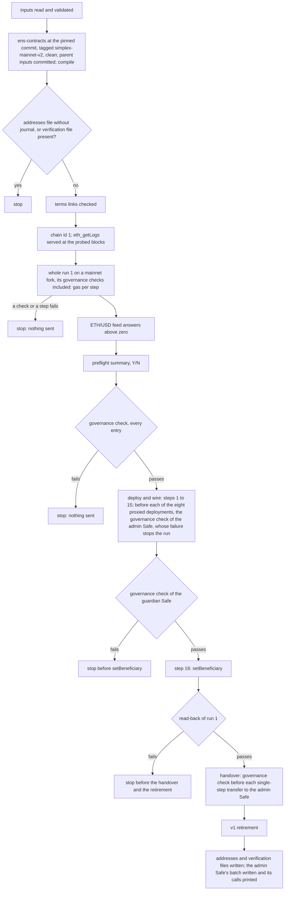
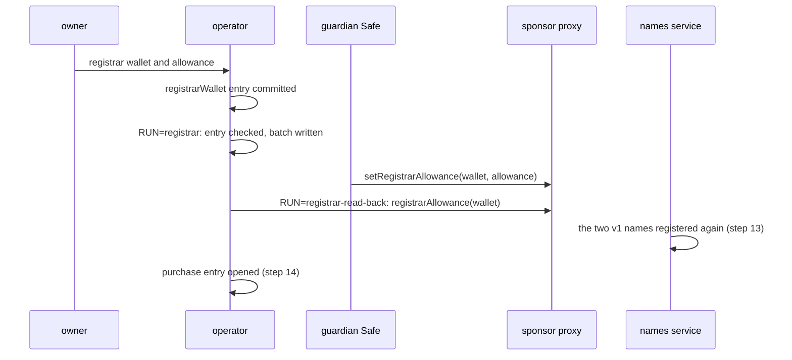
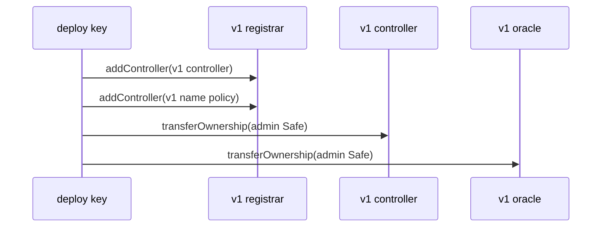
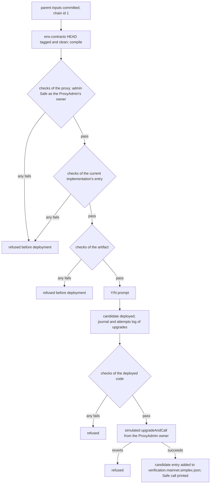
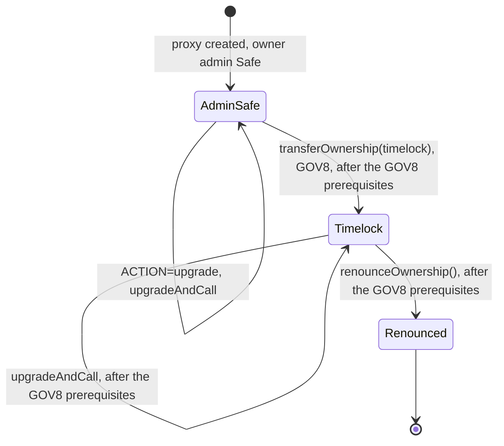

# Deployment

SNRC is **one deployment per TLD**, each an independent ENS-shaped stack without a
NameWrapper.

- `.simplex` v2: `ENSRegistry`, `BaseRegistrarImplementation`, `SimplexResolver`,
  `SubnameRegistrar`, `SimplexController`, `SimplexNamePolicy`, `SimplexSponsor` and
  `UniversalResolver` are deployed behind OpenZeppelin 5.1.0 `TransparentUpgradeableProxy`s, each
  with a `ProxyAdmin` that the admin Safe owns from its creation. `SimplexPriceOracle`,
  `MetadataRenderer`, `DummyGatewayProvider` and `Root` are immutable. The resolver's
  `nameWrapper` slot holds the `SubnameRegistrar`, so subname records are authorised
  through `SubnameRegistrar.ownerOf`. The plan is
  [`plans/upgradeable-stack.md`](./plans/upgradeable-stack.md); the governance steps are
  in [`plans/names-v2-launch-to-freeze-plan.md`](./plans/names-v2-launch-to-freeze-plan.md),
  appendix A.
- `.testing`: as deployed; of its contracts, only `SimplexController` is deployed behind a
  proxy, UUPS.

Active targets: **local Hardhat** and **Ethereum mainnet**. (Sepolia is retired —
the historical playbook lives in [`legacy/sepolia-deployment.md`](./legacy/sepolia-deployment.md).)

## Status

| TLD        | Contracts | dApp | Notes |
|------------|-----------|------|-------|
| `.testing` | **Live on mainnet** — addresses in [`deployments.mainnet.testing.json`](../deployments.mainnet.testing.json) | **Live** on GitHub Pages — [`testing-names.simplex.chat`](https://testing-names.simplex.chat) | NFT gate **disabled** (lifted on-chain 2026-07-09 via `disableNftGate`, one-way); `minCharLength = 6`; registration is **open and free** (all-zero price oracle). Controller ownership handoff to the cold owner is **still pending**. |
| `.simplex` | **v1 live on mainnet**, deployed 2–3 Nov 2026 — addresses in [`deployments.mainnet.simplex.json`](../deployments.mainnet.simplex.json) until the v2 switch. **v2**, the redeploy this document describes, is pending. | GitHub Pages — [`app.simplex.domains`](https://app.simplex.domains); the `.simplex` build is deployed once `production` is admitted by the repository's `github-pages` environment ([dApp hosting](#simplex--github-pages-appsimplexdomains)) | v1 is retired by run 1 of v2. **No** NFT gate; $50 a year. dApp: see [dApp hosting](#dapp-hosting). |

The live `.testing` controller is the proxy at
`0xeeb9b6bf5fb68fb726005f7ba549c2f4b32f2dad` (`ETHRegistrarController` in the
addresses file); its current implementation is `0x281ca41311c2aa808c917c4674639d7567b75714`.

## Contents

- [Quick reference](#quick-reference)
- [Local Hardhat](#local-hardhat)
- [Mainnet: the `.simplex` v2 redeploy](#mainnet-the-simplex-v2-redeploy)
- [Upgrades, freezes and transfers of upgrade authority](#upgrades-freezes-and-transfers-of-upgrade-authority)
- [Post-deploy operations](#post-deploy-operations)
- [dApp hosting](#dapp-hosting)
- [Frontend env vars](#frontend-env-vars)
- [Script env vars](#script-env-vars)
- [Verification](#verification)
- [Gotchas](#gotchas)

## Quick reference

| What                          | Command / Variable                                  |
|-------------------------------|------------------------------------------------------|
| Compile                       | `cd ens-contracts && npx hardhat compile`            |
| Local one-shot (`.testing`)   | `./scripts/run-local.sh`                             |
| Local one-shot (`.simplex`)   | `SIMPLEX_TLD=simplex ./scripts/run-local.sh`         |
| RPC URL, once per shell       | `read -rs MAINNET_RPC_URL`, then `export MAINNET_RPC_URL` ([Mainnet](#mainnet-the-simplex-v2-redeploy)) |
| Governance check              | `node scripts/governance-check.mjs [entry …]` |
| Rehearsal on a mainnet fork   | `node scripts/rehearse-mainnet.mjs` |
| Run 1 (deploy key)            | `RUN=1 MAX_BASE_FEE_GWEI=… node scripts/deploy-mainnet.mjs`, with `DEPLOYER_KEY` exported after `read -rs DEPLOYER_KEY` ([Run 1](#run-1)) |
| Run 2 (keyless read-back)     | `RUN=2 node scripts/deploy-mainnet.mjs` |
| Registrar step (keyless)      | `RUN=registrar node scripts/deploy-mainnet.mjs`, then `RUN=registrar-read-back` |
| Upgrade, freeze, transfer     | `ACTION=upgrade\|freeze\|transfer CONTRACT=… node scripts/prepare-upgrade.mjs` |
| Verify on Etherscan           | `ETHERSCAN_API_KEY=… NETWORK=mainnet SIMPLEX_TLD=simplex node scripts/verify-etherscan.mjs` |
| Addresses output (local)      | stdout + `deployments.local.json`                    |
| Addresses output (mainnet)    | `deployments.mainnet.simplex.json` + `.journal.jsonl` + `.attempts.log` + `verification.mainnet.simplex.json` |
| Safe batches (mainnet)        | `safe-transaction.mainnet.simplex.run-1.json`, `.registrar.json`, `.<ACTION>.<CONTRACT>.json` |
| Frontend addresses (local)    | `NEXT_PUBLIC_DEPLOYMENT_ADDRESSES` (JSON)            |
| Frontend addresses (mainnet)  | `NEXT_PUBLIC_MAINNET_DEPLOYMENT_ADDRESSES` (JSON)    |
| TLD select                    | `NEXT_PUBLIC_SIMPLEX_TLD` (`testing` or `simplex`)  |
| Chain select                  | `NEXT_PUBLIC_CHAIN_NAME` (`localhost` / `mainnet`)  |
| Static-export routing         | `NEXT_PUBLIC_IPFS=1` (GitHub Pages / IPFS build)    |

---

## Local Hardhat

A start of `./scripts/run-local.sh` is refused while port 8545, 3000 or 8097 is in use;
otherwise the script runs the following:

1. `node scripts/serve-terms.mjs` — serves `test/fixtures/terms/*.md` at
   `http://127.0.0.1:8097/`.
2. `./node_modules/.bin/hardhat --network hardhat node`, from `ens-contracts/` — starts
   Hardhat at `127.0.0.1:8545` with chainId **1337**. The `--network hardhat` flag is
   required; without it, the node defaults to chainId 31337, which the frontend's
   `localhostWithEns` chain does not recognise.
3. `node scripts/deploy-local.mjs` — deploys the stack for the TLD selected by
   `SIMPLEX_TLD` (default `testing`) from Hardhat account #0, in the v2 shape for both
   TLDs, from the compiled artifacts:
   - `ENSRegistry`, `BaseRegistrarImplementation`, `SimplexController`,
     `SubnameRegistrar`, `SimplexResolver`, `SimplexSponsor`, `SimplexNamePolicy` and
     `UniversalResolver`, each behind a `TransparentUpgradeableProxy` whose `ProxyAdmin`
     account #0 owns
   - `DummyOracle` (fixed ETH/USD = $1) + the price oracle (`SimplexPriceOracle` for
     `.simplex`, `ExponentialPremiumPriceOracle` with an all-zero curve for `.testing`)
   - `MockSMPXNFT`, with token #0 minted to the deployer (the NFT gate is on for
     `.testing`, off for `.simplex`)
   - `controller.setSponsor(sponsor proxy)`
   - `controller.setBeneficiary(account #0)` and `controller.setPublicSalesOpen(true)`,
     so one key plays both roles and the payable path works
   - `MetadataRenderer` → `baseRegistrar.setMetadataRenderer(...)`, and
     `setMaxLabelLength(63)`
   - `DummyGatewayProvider` for `UniversalResolver`, mock `Multicall3` (implements both
     `aggregate3` and `tryAggregate`)
   - `eth-usd.data.eth` resolver record → `DummyOracle` (the frontend's
     `useEthPrice` resolves this ENS name on chain)
   - Two reserved labels: `simplex`, `simplex-chat`
   - On `.simplex`, loopback links to `test/fixtures/terms/general-terms.md` and
     `community-terms.md` on port 8097, and the sample community names
     `communityname`, `communityclaim`
   - Addresses persisted to `deployments.local.json` and printed as a JSON line
     prefixed with `NEXT_PUBLIC_DEPLOYMENT_ADDRESSES=`.
4. `evm_setIntervalMining` with 5000 ms, so a commitment matures without other
   transactions.
5. `pnpm dev` in `testing-app/` or `simplex-app/`, with `NEXT_PUBLIC_DEPLOYMENT_ADDRESSES`,
   `NEXT_PUBLIC_CHAIN_NAME=localhost`, `NEXT_PUBLIC_PROVIDER` and `NEXT_PUBLIC_SIMPLEX_TLD`.

`deploy-local.mjs` reads `RPC_URL` (default `http://127.0.0.1:8545`); the local stack
omits `Root`.

### MetaMask setup

- Network: `Hardhat`, RPC `http://127.0.0.1:8545`, Chain ID `1337`
- Test account: import private key
  `0xac0974bec39a17e36ba4a6b4d238ff944bacb478cbed5efcae784d7bf4f2ff80`
  (Hardhat account #0, 10000 ETH, holds `MockSMPXNFT` #0)

---

## Mainnet: the `.simplex` v2 redeploy

`scripts/deploy-mainnet.mjs` deploys `.simplex` only: the TLD is fixed in
`scripts/stack.mjs`. One invocation is one run, selected by `RUN`.

The JSON-RPC URL may hold a personal token, so it is written on no command line: it is
read without echo and exported once per shell, and every mainnet command of this document
takes it from the environment:

```sh
read -rs MAINNET_RPC_URL
export MAINNET_RPC_URL
```

A failure of `deploy-mainnet.mjs`, `prepare-upgrade.mjs`, `governance-check.mjs`,
`build-verification.mjs` or `rehearse-mainnet.mjs` is printed as one line per error of its
chain of causes, with the error's name, code and short message, or its message where it
has none (`causes` of `scripts/stack.mjs`), in place of the whole error object. Hardhat's
own output may still name the URL: it is printed when the fork of a dry run fails to start
(`scripts/gas-tools.mjs`), and its tail when the rehearsal fails.

### Sequence

| # | Actor | Step | Tool |
|---|---|---|---|
| 1 | maintainers | ens-contracts tagged `simplex-mainnet-v2` at the commit the parent pins; the conditions version of the plan's D13 (simplex-chat/simplex-chat#8272, then #8271) replaces v1's terms before launch | git |
| 2 | operator | `terms.simplex.json` set to its links, both links checked without a key, and the file committed; v1 files renamed on the operator's checkout | git, `scripts/terms-check.mjs`, `mv` |
| 3 | operator | operator check: purchase entry closed in the webstore and the SimpleX app, no open name invoice, and no store order in the phase queued, committing, committed or registering, so that every paid order has registered on v1 (The store check) | store metrics |
| 4 | deploy key | governance check | run 1 |
| 5 | deploy key | implementations and proxies deployed and wired; governance check of the guardian Safe; beneficiary set | run 1 |
| 6 | deploy key | read-back | run 1 |
| 7 | deploy key | single-step transfers; controller and oracle proposed | run 1 |
| 8 | deploy key | v1 retirement | run 1 |
| 9 | admin Safe | `acceptOwnership()` on the controller and the oracle, one batch | Safe, the batch of run 1 |
| 10 | operator | handover read-back, without transactions | run 2 |
| 11 | operator, names service | the switch: the store service, the resolver service and the production dApp switched to v2 (The switch); the renamed v1 files, the v2 addresses file, the v2 journal, `verification.mainnet.simplex.json` and the `simplex-app` submodule pointer committed to main together (Commit the files at the switch) | ini, env, dApp pull request, git |
| 12 | operator, guardian Safe | registrar step, after step 11, once the owner provides the names service's registrar wallet: its `registrarWallet` entry committed, checked and written as the guardian Safe's batch; the guardian Safe sets the allowance; the allowance read back | git, `RUN=registrar`, Safe, `RUN=registrar-read-back` |
| 13 | names service | the two v1 names registered again for their holders, while purchase entry is still closed, by the store service in #51's form of `RegisterName` | names service |
| 14 | operator | purchase entry opened in the webstore and the SimpleX app | store |
| 15 | operator | Etherscan verification | `verify-etherscan.mjs` |
| 16 | operator | deploy key destroyed | — |

Step 3 precedes run 1: an order still in flight holds a commitment on the v1 controller
and signatures whose EIP-712 domains name the v1 sponsor and name policy, and v1 reverts
from step 8. Step 12 follows step 11, whose commit of the v2 addresses file the registrar
step reads. Run 1 deploys simplex-network/ens-contracts `ebf76989`, which holds the dispute
period of #51, so the v2 sponsor takes `RegisterName` with `disputeDays` from the first
registration; the store service is changed to sign that form before step 13 (the plan's
D21). Steps 13 and 14 follow step 12: a sponsored registration reverts
`InsufficientAllowance` while the registrar wallet's allowance is zero. Step 14 follows
step 13, so the two v1 names are registered for their holders before any buyer can order
them.

```mermaid
sequenceDiagram
  participant M as maintainers
  participant O as operator
  participant D as deploy key
  participant G as guardian Safe
  participant A as admin Safe
  participant N as names service
  M->>M: tag and mirror the conditions version
  O->>O: terms.simplex.json: links checked, committed; rename v1 files
  O->>O: check: purchase entry closed, no store order in flight
  D->>D: run 1: governance check, deploy, wire
  D->>D: run 1: guardian Safe check, beneficiary, read-back
  D->>D: run 1: transfers, proposals, v1 retirement
  A->>A: acceptOwnership x2, the batch of run 1
  O->>O: run 2: read-back
  N->>N: switch: store and resolver services, production dApp
  O->>O: commit files and the simplex-app pointer
  O->>O: registrarWallet entry committed; RUN=registrar
  G->>G: setRegistrarAllowance, the batch of the registrar step
  O->>O: RUN=registrar-read-back
  N->>N: register the two v1 names again
  O->>O: open purchase entry
  O->>O: Etherscan, destroy deploy key
```

### The store check

Step 3 is an operator check, made with the store service as it is (the owner, 20 Nov):

1. Purchase entry stays closed in the webstore and the SimpleX app.
2. The store's metrics endpoint shows, read in this order, 0 open name invoices, then 0
   orders in each of the phases queued, committing, committed and registering:

   ```sh
   curl -s http://127.0.0.1:<metrics_port>/metrics | grep -E 'simplex_store_names_(invoices_open|orders)'
   ```

   The endpoint listens on 127.0.0.1 at `listener.metrics_port` of the store's ini, an
   optional key. Where the deployed ini lacks it, it is set, and the store service is
   restarted: the ini is read only at the service's start (`Main.hs`, `Config.hs`).

   An unpaid order whose invoice is paid while open is queued in the same settlement
   (`Orders.hs`, `nameSettled`); a payment of an invoice that is no longer open is late and
   queues nothing. So `simplex_store_names_invoices_open` reaches 0 first. The `unpaid`
   count of `simplex_store_names_orders` need not be 0: an order whose invoice expired is
   closed and keeps the phase unpaid until its deletion 30 days later, and for good when a
   payment is recorded for it (`Poller.hs`, `Names/Store.hs`).

   In the gauge `simplex_store_names_orders{phase="…"}`, orders are counted by their stored
   phase. A committed order past its `revealBefore` is counted as committed until the
   store's worker saves it as failed, so the operator waits for that.

A failed paid order is closed with the store's `//close` command, with a refund recorded
for support; a failed code order's code is released after 30 days. Purchase entry opens
at step 14.

### The switch

At step 11, in one session:

| Consumer | Setting | Value |
|---|---|---|
| store service, `[chain]` of its ini, then a restart | `controller` | controller proxy |
| store service | `sponsor` | sponsor proxy |
| store service | `base_registrar` | registrar proxy |
| store service | `resolver` | resolver proxy |
| resolver service (simplex-chat/simplexmq `snrc-resolve.py`) | `SNRC_REGISTRY_SIMPLEX` | registry proxy |
| resolver service | `SNRC_REGISTRAR_SIMPLEX` | registrar proxy |
| resolver service | `SNRC_CONTROLLER_SIMPLEX` | controller proxy |

The store service reads the name policy, the registry and the subname registrar from these
contracts; it keeps the registry until it restarts, and the policy until it restarts or a
registration reverts `TermsNotAccepted`, so the restart is part of the switch.

The production dApp, app.simplex.domains, is built by `.github/workflows/deploy-pages.yml`
of simplex-chat/simplex-domains-app-v3 on each push to `production`, from that
repository's own `deployments.mainnet.simplex.json`:

1. A copy of the v2 addresses file and the storage slots of the gas estimate set to v2's
   are put in one pull request from `ab/v2-storage-slots` into `simplex`, the repository's
   default branch: `SimplexNamePolicy.acceptedTerms` at slot 2 and
   `SimplexController.commitments` at slot 160, in place of v1's 103 and 260
   (`src/hooks/gasEstimation/calculateTransactions.ts`). Without the slot change, the
   estimate of `registerName` reverts and a fixed 700,000 gas is used.
2. At step 11 it is merged, `production` is fast-forwarded to that merge commit, and the
   parent's `simplex-app` submodule pointer moves to the same commit.

The deployment from `production` of 4 Nov was refused by the repository's `github-pages`
environment, so `production` is admitted there before step 11
([dApp hosting](#simplex--github-pages-appsimplexdomains)).

The staging dApp (`scripts/cloudflare-build-simplex.sh`) reads the parent's
`deployments.mainnet.simplex.json`, so it is built against v2 from the commit of step 11.

### Inputs

Both runs read and validate the files below before any network access, and a failed
input stops the run; the tag, the committed inputs and the terms links are checked by run 1
only.

**`governance.mainnet.json`**, the only source of governance addresses. Each entry has a
`kind`; addresses must be EIP-55 checksummed. Entries:

| Entry | Kind | Fields | Presence |
|---|---|---|---|
| `adminSafe` | `Safe` | `address`, `threshold`, `owners` | required |
| `guardianSafe` | `Safe` | `address`, `threshold`, `owners` | required |
| `registrarWallet` | `EOA` | `address`, `allowance` (attoUSD, a JSON string of decimal digits; a JSON number is refused) | added for the registrar step (step 12); runs 1 and 2 parse it, stop on a malformed entry, and use it nowhere else |

A `TimelockController` entry, added at GOV8, has `address`, `codeHash`, `deployBlock`,
`minDelay`, `proposers`, `executors` and `cancellers`.

`scripts/governance-check.mjs` checks each entry against the chain:

| Kind | Check |
|---|---|
| `Safe` | runtime code hash of SafeProxy 1.5.0 |
| `Safe` | storage slot 0: the Safe 1.5.0 singleton `0xFf51A5898e281Db6DfC7855790607438dF2ca44b` |
| `Safe` | `VERSION()` is `1.5.0` |
| `Safe` | `getThreshold()` and `getOwners()` equal the entry's |
| `Safe` | `getModulesPaginated(0x1, 10)` is empty |
| `Safe` | guard slot is `0x0` |
| `Safe` | fallback handler slot: `0x3EfCBb83A4A7AfcB4F68D501E2c2203a38be77f4` |
| `Safe` | `nonce()` is at least 1, the proof that the Safe has executed a transaction |
| `EOA` | no code at the address |
| `TimelockController` | runtime code hash equals `codeHash` |
| `TimelockController` | its `RoleGranted` logs from `deployBlock` include the grant of its admin role to itself |
| `TimelockController` | `getMinDelay()` equals `minDelay` |
| `TimelockController` | each listed proposer, executor and canceller holds its role |
| `TimelockController` | among the accounts read (those of the entry, those its `RoleGranted` logs of the four roles name, the deploy key and `0x0`), the proposer, executor and canceller roles are held only by the accounts the entry lists for each, and the admin role only by the timelock itself |

Run it alone with `node scripts/governance-check.mjs`, optionally followed
by entry names (CI runs `adminSafe guardianSafe`); it requires chain id 1 and exits with 1 on
any failure. It reads the deploy key from `verification.mainnet.simplex.json` when that file
exists.

Each check validates the address and its configuration at the moment of checking. The
checks run:

- in run 1, before its first transaction, in the fork's dry run and again on mainnet: every
  entry except `registrarWallet`
- in run 1, before each of the eight upgradeable contracts is deployed with its proxy,
  whose `ProxyAdmin` the admin Safe receives: the admin Safe
- in run 1, before `setBeneficiary`: the guardian Safe
- in run 1, before each single-step transfer to the admin Safe (handover steps 1, 3, 4, 6
  and 7): the admin Safe
- in the registrar step, before its batch is written: the `registrarWallet` entry
- in CI, on each push and pull request: `adminSafe` and `guardianSafe`

**ens-contracts at the tag `simplex-mainnet-v2`** (run 1 and `build-verification.mjs`).
`HEAD` of `ens-contracts/` must be the commit the parent repository pins
(`git ls-tree HEAD ens-contracts`), the tag must point at it, and `git status --porcelain`
there must print nothing. The pin is `ebf76989ec5cab1c7dd49085b4c18faf303657d0` of
simplex-network/ens-contracts `simplex`, which holds #50 and the dispute period of #51:

```sh
git submodule update --init ens-contracts
git -C ens-contracts fetch --tags
git -C ens-contracts tag --points-at HEAD   # lists simplex-mainnet-v2
```

**Committed inputs.** In the parent repository, `git status --porcelain` must print
nothing for the paths each script reads; otherwise the script stops and prints the
changed paths:

| Script | Paths |
|---|---|
| run 1 | `scripts/`, `governance.mainnet.json`, `reserved-names.simplex.csv`, `terms.simplex.json`, `community-names.simplex.csv` |
| `RUN=registrar`, `RUN=registrar-read-back` | `scripts/`, `governance.mainnet.json`, `deployments.mainnet.simplex.json` |
| `build-verification.mjs` | `scripts/`, `governance.mainnet.json` |
| `prepare-upgrade.mjs`, every action | `scripts/`, `governance.mainnet.json`, `deployments.mainnet.simplex.json`, `verification.mainnet.simplex.json` |

Run 1, `build-verification.mjs` and `ACTION=upgrade` then run `npx hardhat compile` in
`ens-contracts/`, with `PATH` and `HOME` as its only environment variables, and stop if it
fails.

**`terms.simplex.json`**: `{ "generalTerms": link, "communityTerms": link }`, both
required. Run 1 checks each link with `scripts/terms-check.mjs` before any transaction and
stops on a failure:

- the form `https://raw.githubusercontent.com/simplex-chat/simplex-chat/<sha>/<path>.md#sha256=<hex>`
- GitHub serves the file as UTF-8 text of at most 256 KiB, whose sha256 equals the link's

The webstore accepts a link only with its `#sha256=`; the dApp accepts git.simplex.chat
links only, so its terms parser is extended to this form before its switch at step 17.

Run 1 links the files of v1, simplex-chat 72fcd358 (the owner, 20 Nov); the conditions of
the plan's D13 replace them before launch, through the admin Safe's `setGeneralTerms` and
`setCommunityTerms`:

```json
{
  "generalTerms": "https://raw.githubusercontent.com/simplex-chat/simplex-chat/72fcd35893ec8ea20531757a455699f41fbaf84e/docs/NAMES-TERMS-GENERAL.md#sha256=43d5198814c6dc846bed6e539e6f0c1df0bd3b50077a816f1e6a083d58ed6969",
  "communityTerms": "https://raw.githubusercontent.com/simplex-chat/simplex-chat/72fcd35893ec8ea20531757a455699f41fbaf84e/docs/NAMES-TERMS-COMMUNITY.md#sha256=864d07ee1cfa6a897ba8cdcccb27106c8a6da7c6f7bfc0270d8e41c0baa044c9"
}
```

With both links naming one file, a community name is registered or received under the
same acceptance as any other name until the admin sets separate community terms.

At step 2, before the file is committed, both links are checked without a key, as run 1
checks them:

```sh
node scripts/terms-check.mjs general "<generalTerms link>"
node scripts/terms-check.mjs community "<communityTerms link>"
```

Each prints `✓ <role> terms: <link>`, or `✗ <reason>` and exits with 1.

**`reserved-names.simplex.csv`**, required: a `name,reason,category` header, then one
label per row, with `category` one of `Internal`, `Trademark` or `Community` (only the
category goes on chain) and RFC 4180 quoting where a reason holds a comma. The run stops
on an empty list, a row without three fields, a dotted label, a label users cannot
register (the dApp's `ALLOWED_LABEL_REGEX`: a-z, 0-9 and hyphens), an unknown category or
a duplicate. `simplex` and `simplex-chat` are added as `Internal` when absent.

**`community-names.simplex.csv`**, optional: a `name,community` header (only the name goes
on chain) and the same label rule.

**The renamed v1 files.** Step 2 renames, on the operator's checkout:

```sh
mv deployments.mainnet.simplex.json deployments.mainnet.simplex-v1.json
mv deployments.mainnet.simplex.journal.jsonl deployments.mainnet.simplex-v1.journal.jsonl
mv verification.mainnet.simplex.json verification.mainnet.simplex-v1.json
mv deployments.mainnet.simplex.attempts.log deployments.mainnet.simplex-v1.attempts.log
```

Both runs stop while any of the first three is missing; run 1 retires v1 at the addresses
of `deployments.mainnet.simplex-v1.json`. The attempts log is renamed on the operator's
machine only. Run 1 reads `deployments.mainnet.simplex.attempts.log` to recover a step
submitted but not journalled; a v1 entry under the same step name names a different call,
and that stops the run.

**The deploy key**: the v1 deploy key `0x38D19404644fe24EE7d638229a732CbE8275E333` (the
plan's D9),
the owner of the v1 contracts that run 1 retires. The key is used by run 1 as given; with
another key, the v1 retirement reverts in the dry run on the fork, before any transaction
on mainnet. The key needs ETH for the remaining ceiling the preflight prints.

### Run 1

Run 1 is started from a checkout of the parent repository's `main`, after
brenzi/simplex-namespace-contract#20 is merged into it, so that the `parentCommit` of each
entry of `verification.mainnet.simplex.json` is a commit of `main`.

```sh
read -rs DEPLOYER_KEY
export DEPLOYER_KEY
RUN=1 \
MAX_BASE_FEE_GWEI=0.078 \
node scripts/deploy-mainnet.mjs
unset DEPLOYER_KEY
```

`read -rs` takes the key without echo, so it stays out of the terminal and the shell
history; only its variable name is written on the command line. The scripts' child processes
receive none of it; each receives only the variables `childEnv` of `scripts/stack.mjs`
names for it:

| Child process | Environment |
|---|---|
| `git rev-parse`, `git tag --points-at`, `git ls-tree` and `git status`, from the `git` helper of `scripts/stack.mjs` | `PATH`, `HOME` |
| `npx hardhat compile` | `PATH`, `HOME` |
| the fork's `npx hardhat node` | `PATH`, `HOME`, `MAINNET_RPC_URL` |

| Variable | Default | Meaning |
|---|---|---|
| `RUN` | — | `1` |
| `MAINNET_RPC_URL` | — | JSON-RPC URL, used by the fork and the real run, exported after `read -rs MAINNET_RPC_URL`; it must serve `eth_getLogs` from old blocks (below) |
| `DEPLOYER_KEY` | — | the deploy key |
| `MAX_BASE_FEE_GWEI` | — | per-gas cap; a transaction is sent only when the base fee is at most this |
| `ABSOLUTE_MAX_BASE_FEE_GWEI` | 4 × `MAX_BASE_FEE_GWEI` | ceiling at which the stall bumps stop |
| `BUMP_AFTER_HOURS` | `24` | stall time before a bump |
| `BUMP_PCT` | `20` | bump, in percent of the cap |
| `FORK_PORT` | `18545` | local port of the dry-run fork |
| `CONFIRM` | — | `yes` skips the Y/N prompt; without a TTY and without it, the run is refused |



The preflight summary shows the strategy, the current base fee, the gas of the fork's dry
run and its ceiling cost at the cap, the journal's state, and the deploy key's balance
against the ceiling of the steps not yet journalled. The fork is stopped before the
prompt.

**`MAINNET_RPC_URL` and old logs.** The run-1 read-back reads the registrar's
`ControllerAdded` logs from the block of the registrar proxy's deployment, and the
governance check of a `TimelockController` entry reads its `RoleGranted` logs from its
`deployBlock`. Before the fork, `eth_getLogs` is requested from the endpoint at each of
these blocks, and run 1 is stopped, with one line per block the endpoint refuses:

- the registrar proxy's block, from the journal; on a fresh run, the head minus 50,400
  blocks, about seven days
- the `deployBlock` of each `TimelockController` entry

An endpoint that serves logs of recent blocks only fails this probe: on 20 November 2026,
`https://ethereum-rpc.publicnode.com` answered a request 50,400 blocks back with "Archive
requests require a personal token". The fork of the dry run also reads mainnet state at
the block it starts from, for the whole dry run, as in the rehearsal (below).

**Deployment and wiring**, in this order:

1. `ENSRegistry` behind its proxy, `initialize(deploy key)`
2. `BaseRegistrarImplementation(registry, namehash("simplex"))` behind its proxy,
   `initialize(registry, namehash("simplex"), deploy key)`
3. `ens.setSubnodeOwner(0x0, labelhash("simplex"), deploy key)`
4. `SimplexPriceOracle(feed, 8, 5000, [])`
5. `SimplexController()` behind its proxy,
   `initialize(registrar, oracle, 60, 86400, registry, config, deploy key)`;
   `baseRegistrar.addController(controller)`
6. `SimplexNamePolicy(controller, registrar)` behind its proxy;
   `baseRegistrar.addController(namePolicy)`; `controller.setNamePolicy(namePolicy)`
7. `namePolicy.addReservedNames`, per category, 200 names per transaction
8. `SubnameRegistrar(registry, registrar)` and
   `SimplexResolver(registry, subnameRegistrar, controller, 0x0)`, each behind its proxy
9. `subnameRegistrar.setResolver(resolver)`; `baseRegistrar.setSubnameHook(subnameRegistrar)`;
   `controller.setDefaultResolver(resolver)`
10. `SimplexSponsor(controller)` behind its proxy; `controller.setSponsor(sponsor)`
11. `namePolicy.setGeneralTerms(link)`; `namePolicy.setCommunityTerms(link)`;
    `namePolicy.addCommunityNames`, 100 names per transaction;
    `baseRegistrar.setNamePolicy(namePolicy)`
12. `DummyGatewayProvider()`; `UniversalResolver(deploy key, registry, gateway provider)`
    behind its proxy
13. `ens.setResolver(namehash("simplex"), resolver)`;
    `ens.setSubnodeOwner(0x0, labelhash("simplex"), baseRegistrar)`
14. `eth`, `data.eth` and `eth-usd.data.eth` to the deploy key, each with the resolver;
    `resolver.setAddr(namehash("eth-usd.data.eth"), feed)`, for the frontend's `useEthPrice`
15. `MetadataRenderer(".simplex")`; `baseRegistrar.setMetadataRenderer(renderer)`;
    `baseRegistrar.setMaxLabelLength(63)`
16. `controller.setBeneficiary(guardian Safe)`, after the governance check of the guardian
    Safe passes

Each proxy is created with `initialOwner` = the admin Safe, so its `ProxyAdmin`, the
CREATE address of the proxy at nonce 1, belongs to the admin Safe from its creation; the
governance check of the admin Safe precedes each such deployment. The
proxies of the registry, the registrar and the controller are created with `initialize`
calldata, the other five with empty calldata. The feed is the Chainlink
ETH/USD aggregator `0x5f4eC3Df9cbd43714FE2740f5E3616155c5b8419`.

**Read-back of run 1.** The handover waits for every check to pass:

- the TLD node's owner, the controller and the name policy as registrar controllers,
  `maxLabelLength`, the subname hook, the metadata renderer, the default resolver, the
  beneficiary, the sponsor and its controller, both name-policy pointers, both terms links
  and their hashes, the NFT gate off, `minCharLength` 6, public sales closed, the subname
  registrar's resolver
- every reserved label (a label released by `registerReserved` counts as handed out) and
  every community name
- a non-zero two-year price for a six-character name; the controller's oracle, the
  oracle's feed and feed scale, its base price and each exception
- `eth-usd.data.eth` resolving to the feed
- for each of the eight proxies: the implementation's runtime code with its expected
  immutables (table below), `_initialized` 255 on the registry, registrar and controller
  implementations, the proxy's runtime code with its `ProxyAdmin`, the ERC-1967
  implementation and admin slots, the admin Safe as the `ProxyAdmin`'s owner, and the
  `ProxyAdmin`'s runtime code
- the runtime code of `SimplexPriceOracle`, `DummyGatewayProvider` and `MetadataRenderer`
- the registrar's `ens` and `baseNode`; the controller's `ens`, `tldNode`, `base`,
  commitment ages and `tldSuffix`; the subname registrar's `ens` and `baseRegistrar`; the
  universal resolver's registry; the registry resolver of the TLD node
- the distinct addresses of the registrar's `ControllerAdded` events: the controller and
  the name policy, and no other; an `addController` sent twice passes
- while the deploy key still owns the registrar: the deploy key as owner of the registrar,
  of the registry root, `eth`, `data.eth` and `eth-usd.data.eth`, of the controller and of
  the oracle, with no pending owner; once the admin Safe owns the registrar, the handover
  began after a passing read-back, and these checks are skipped

The code of the `ENSRegistry`, `BaseRegistrarImplementation` and `SimplexController`
implementations, of the eight `ProxyAdmin`s, and of `SimplexPriceOracle`,
`DummyGatewayProvider` and `MetadataRenderer`, must equal the artifact's deployed bytecode
as compiled. In the other
five implementations, each immutable must hold its value:

| Implementation | Immutable | Value |
|---|---|---|
| `SimplexNamePolicy` | `controller` | the controller proxy |
| `SimplexNamePolicy` | `registrar` | the registrar proxy |
| `SimplexNamePolicy` | `_ens` | the registry proxy |
| `SimplexNamePolicy` | `_tldNode` | `namehash("simplex")` |
| `SimplexNamePolicy` | `_self` | the implementation's own address |
| `SubnameRegistrar` | `ens` | the registry proxy |
| `SubnameRegistrar` | `baseRegistrar` | the registrar proxy |
| `SubnameRegistrar` | `_deployer` | the deploy key |
| `SimplexResolver` | `ens` | the registry proxy |
| `SimplexResolver` | `nameWrapper` | the subname registrar proxy |
| `SimplexResolver` | `trustedETHController` | the controller proxy |
| `SimplexResolver` | `trustedReverseRegistrar` | `0x0` |
| `SimplexSponsor` | `controller` | the controller proxy |
| `UniversalResolver` | `registry` | the registry proxy |
| `UniversalResolver` | `batchGatewayProvider` | `DummyGatewayProvider` |
| `UniversalResolver` | `unsafeCallGas` | `50000`, the `DEFAULT_UNSAFE_CALL_GAS` of `CCIPReader` |

**Handover**, after the read-back passes. Before steps 1, 3, 4, 6 and 7, the single-step
transfers to the admin Safe, the governance check of the admin Safe is repeated, and run 1
is stopped on a failure:

1. `baseRegistrar.transferOwnership(admin Safe)`
2. `ens.setOwner(namehash("eth-usd.data.eth"), 0x0)`
3. `ens.setSubnodeOwner(namehash("eth"), labelhash("data"), admin Safe)`
4. `ens.setSubnodeOwner(0x0, labelhash("eth"), admin Safe)`
5. `Root(registry)` deployed; its runtime code must equal the `Root` artifact's, or run 1
   stops before step 6, and `Root` is neither called nor given the registry root
6. `root.setController(admin Safe, true)`
7. `root.transferOwnership(admin Safe)`
8. `ens.setOwner(0x0, root)`
9. `controller.transferOwnership(admin Safe)`, a proposal
10. `oracle.transferOwnership(admin Safe)`, a proposal

**v1 retirement**, with the addresses of `deployments.mainnet.simplex-v1.json`:

1. `removeController(v1 controller)` on the v1 registrar
2. `removeController(v1 name policy)` on the v1 registrar
3. `transferOwnership(0x0)` on the v1 controller, which clears its pending owner
4. `transferOwnership(0x0)` on the v1 oracle, which clears its pending owner

From then on, registration and renewal on v1 revert.

**Outputs.** Run 1 writes `deployments.mainnet.simplex.json` (the proxies, the immutable
contracts and `Root`) and `verification.mainnet.simplex.json`, which records the deploy
key, the immutable contracts and, for each upgradeable contract, its implementation with
storage layout, immutables, functions, events and errors (each selector with its shape: a
function's inputs, state mutability and outputs; an event's inputs, their indexing and
anonymity; an error's input types), its proxy and its `ProxyAdmin`. Each entry records its constructor arguments, the `buildInfoId` of its
artifact, the `ens-contracts` commit (`ensContractsCommit`) and the parent repository's
commit (`parentCommit`). The file is written only when each implementation's code equals
its artifact outside the immutables. Run 1 then prints the admin Safe's two calls with
their calldata and writes them as a Transaction Builder batch,
`safe-transaction.mainnet.simplex.run-1.json`.

### Gas strategy at a glance

The script is built for cost, not speed: a run may take days while mainnet stays
expensive. For each transaction:

1. **Priority fee is 1 wei**, the least a Geth node accepts: Geth 1.17.10 refuses a tip of
   0 with "transaction gas price below minimum: gas tip cap 0, minimum needed 1". Each stall
   bump (6.) adds 1 wei, since Geth replaces a pending transaction only with a higher fee
   cap and a higher tip, each at least 110 % of the old one, rounded down.
2. **Cap**: `maxFeePerGas = MAX_BASE_FEE_GWEI` (e.g. `0.078`, picked from a
   base-fee distribution as a low percentile of recent blocks).
3. **Estimate**: `eth_estimateGas` plus 10 %, the transaction's gas limit; a reverting
   estimate stops the run before anything is sent.
4. **Submit policy**: poll `latest.baseFeePerGas` every ~12 s; submit only when
   `base ≤ cap`.
5. **Sign, log, broadcast**: the transaction is signed first, and its hash is computed
   from the signed bytes; a `submitted` entry with the hash, nonce, cap and bump count is
   appended to the attempts log; then the signed transaction is broadcast
   (`eth_sendRawTransaction`). A broadcast error is logged as `broadcast-error` with the
   hash, and the step waits for that hash as for any submitted transaction; a "nonce too
   low" answer is such an error, and, at the stall below, the run stops unless one of the
   step's hashes has a receipt. An "insufficient
   funds" answer stops the run at once; its hash and nonce are already logged, so a resume
   sends the step at the same nonce.
6. **Stall handling**: without a receipt within `BUMP_AFTER_HOURS` (default 24 h), the
   receipts of all the step's hashes are read: one with a receipt is journalled; when the
   key's nonce is past the step's nonce and none has a receipt, the run stops, to be
   resolved by hand; otherwise the cap is raised by `BUMP_PCT` percent (default 20) and the
   transaction is signed and sent again at the same nonce. Every bump is logged in the
   attempts log. A bump above `ABSOLUTE_MAX_BASE_FEE_GWEI` stops the run; the pending
   transaction may still be mined, and a resumed run waits for it (below).
7. **Depth**: each step waits three confirmations before the next one depends on it, and a
   receipt that a reorg removes returns the step to waiting.
8. **Upfront cost ceiling**: at startup the script spawns
   `npx hardhat node --network mainnetFork --port $FORK_PORT --hostname 127.0.0.1` in
   `ens-contracts/`, with `PATH`, `HOME` and `MAINNET_RPC_URL` as its only environment
   variables, the URL kept out of argv, and runs the whole of run 1 against the fork.
   Captured gas × cap = worst-case spend; real cost is usually lower. The dry run sends
   from the deploy key's address impersonated on the fork
   (`hardhat_impersonateAccount`), so no transaction is signed with the deploy key there.

### Resume on interruption

Re-run with the same environment. The runner reads
`deployments.mainnet.simplex.journal.jsonl` and skips every step recorded as mined.
Steps are named by operation (`deploy:ENSRegistry`, `write:addReservedNames#3`), and each
journal entry records a digest of the exact call, so a resume that would skip a different
call stops instead. A journal with positional keys (`step:NNN`) is refused.

Each submission is logged in `deployments.mainnet.simplex.attempts.log` with its hash,
nonce and fee cap before its broadcast, and a step stays bound to that nonce. Before a step
not yet journalled is sent, each transaction logged as `submitted` for it is looked up on
the node:

| Transaction | Outcome |
|---|---|
| mined; the same call from the same key | journalled after its confirmations; nothing is sent |
| another call, or another key | the run stops: the entry belongs to an earlier run |
| a lookup that fails other than with "transaction not found" | the run stops, before any send |

Then, by the latest recorded submission of the step:

| State | Outcome |
|---|---|
| the key's nonce is past the recorded nonce, and one recorded hash has a receipt | that receipt is journalled; nothing is sent |
| the key's nonce is past the recorded nonce, and no recorded hash has a receipt | the run stops, to be resolved by hand |
| pending on the node; the same call from the same key | waited for at its nonce and fee cap; nothing new is sent; the bump clock counts from its logged submission; `adopted-pending` is logged |
| unknown to the node, its nonce not used yet | the step is estimated, signed and sent again at the recorded nonce and fee cap |
| unknown to the node, logged without its nonce, as by an earlier version of the script | the run stops, to be resolved by hand |

A broadcast that fails after the node accepted the transaction, such as a timed-out call,
leaves the step waiting for the logged hash; on a later resume, that hash is looked up on
the node. A step with a logged submission is sent at no other nonce than the logged one.

A resumed run repeats the fork dry run of the whole of run 1, every governance check and
the read-back of run 1, and its preflight shows the ceiling of the steps not yet
journalled. To start over, move the journal and the attempts log aside together. Run 1
also stops:

- on an addresses file beside an empty or missing journal: it marks a completed deployment
  whose journal is gone
- once `verification.mainnet.simplex.json` exists: run 1 writes it after its last
  transaction, so run 1 is complete, and the file may record upgrade candidates since; run 1
  does not rewrite it,
  and run 2 reads the handover back

### The admin Safe's step

Run 1 prints the admin Safe's two calls with their calldata and writes them as one
Transaction Builder batch, `safe-transaction.mainnet.simplex.run-1.json`, created for the
admin Safe:

| Target | Call |
|---|---|
| controller proxy (`ETHRegistrarController`) | `acceptOwnership()` |
| `SimplexPriceOracle` | `acceptOwnership()` |

The admin Safe loads the batch into its Transaction Builder and sends both calls in one
transaction. Before signing, each signer compares the transactions that the Transaction
Builder decodes, target, function and arguments, with the calls run 1 printed. Until the
batch executes, the deploy key can still redirect the controller and the oracle, so it is
treated as hot.

### Run 2

```sh
RUN=2 node scripts/deploy-mainnet.mjs
```

Run 2 is a read-back only, without a key. It reads `deployments.mainnet.simplex.json`,
takes the deploy key from `verification.mainnet.simplex.json`, and exits with 1 on any
failed check:

| Read | Value |
|---|---|
| `owner()` of each of the eight `ProxyAdmin`s, at the admin slot of its proxy | admin Safe |
| `controller.owner()` | admin Safe |
| `controller.pendingOwner()` | `0x0` |
| `controller.beneficiary()` | guardian Safe |
| `registrar.owner()` | admin Safe |
| `oracle.owner()` | admin Safe |
| `oracle.pendingOwner()` | `0x0` |
| `ens.owner(0x0)` | `Root` |
| `ens.owner(namehash("eth"))` | admin Safe |
| `ens.owner(namehash("data.eth"))` | admin Safe |
| `ens.owner(namehash("eth-usd.data.eth"))` | `0x0` |
| `root.ens()` | the registry proxy |
| `root.owner()` | admin Safe |
| `root.controllers(admin Safe)` | `true` |
| `root.controllers(deploy key)` | `false` |
| `root.locked(labelhash("simplex"))` | `false` |
| v1 registrar `controllers(v1 controller)` | `false` |
| v1 registrar `controllers(v1 name policy)` | `false` |
| v1 controller `pendingOwner()` | `0x0` |
| v1 oracle `pendingOwner()` | `0x0` |
| each owner and pending owner above, and `ens.owner` of the root node, `eth` and `data.eth` | not the deploy key |

### Commit the files at the switch

At step 11, commit to main together:

- `deployments.mainnet.simplex-v1.json`
- `deployments.mainnet.simplex-v1.journal.jsonl`
- `verification.mainnet.simplex-v1.json`
- `deployments.mainnet.simplex.json`
- `deployments.mainnet.simplex.journal.jsonl` — one line per mined transaction (hash,
  address, gas, effective price, cost); the paper trail and the resume source
- `verification.mainnet.simplex.json`
- the `simplex-app` submodule pointer, moved to the merge commit of the dApp pull request
  ([The switch](#the-switch))

The attempts log, with each attempt and the reason of its failure, is kept on the
operator's machine. The attempts logs (`/deployments.mainnet.*.attempts.log`) and the Safe
batch files (`/safe-transaction.*.json`) are listed in `.gitignore`; a file of these names
that is already tracked stays tracked. `.testing`'s addresses file and journal, `deployments.mainnet.testing.json` and
`deployments.mainnet.testing.journal.jsonl`, are committed the same way. The committed
addresses file is read by run 2, the registrar step, the staging dApp build,
`build-verification.mjs` and `prepare-upgrade.mjs`; the committed `verification.mainnet.simplex.json`, by
`verify-etherscan.mjs` and `prepare-upgrade.mjs`.

Each on-chain deployment also **tags the git commit** it deploys (see
`CLAUDE.md` → "tracking of deployed versions"; the live `.testing` deploy is
tag `simplex-mainnet-testing-v3`). For v2 the tag `simplex-mainnet-v2` precedes run 1,
by which any commit other than the one the parent repository pins and the tag names is
refused.

### The registrar step

Runs 1 and 2 leave the registrar allowance at zero. The step follows run 2 and step 11,
without a wait for an upgrade: the sponsor of run 1 already takes #51's `RegisterName`,
with `disputeDays`, and `registerWithCredit(registration, disputeDays, nonce, deadline,
sig)`. The store service on simplex-chat `names` at 0410929 still signs `RegisterName`
without `disputeDays` and calls the four-argument `registerWithCredit`
(`Names/Registration.hs`), so its change to #51's form precedes step 13. Once the owner
provides the names service's registrar wallet and its allowance, the operator adds its
entry to `governance.mainnet.json` and commits it:

```json
"registrarWallet": { "kind": "EOA", "address": "0x…", "allowance": "<attoUSD, a decimal string>" }
```

```sh
RUN=registrar node scripts/deploy-mainnet.mjs
```

The step uses no key. It requires `scripts/`, `governance.mainnet.json` and
`deployments.mainnet.simplex.json` committed and chain id 1, and is refused for:

- a `governance.mainnet.json` without a `registrarWallet` entry
- a registrar wallet with code at its address
- a `SimplexSponsor` of the addresses file whose admin slot is not the CREATE address of
  that proxy at nonce 1, so not a v2 proxy: until step 11 the committed addresses file
  is the v1 one
- `controller.sponsor()` other than that sponsor, `sponsor.controller()` other than the
  controller, or `controller.beneficiary()` other than the guardian Safe

It prints `setRegistrarAllowance(wallet, allowance)` on the sponsor proxy with its calldata,
and writes it as a Transaction Builder batch created for the guardian Safe,
`safe-transaction.mainnet.simplex.registrar.json`. The guardian Safe executes the batch;
before signing, each signer compares the transaction that the Transaction Builder decodes
with the printed call.
Then:

```sh
RUN=registrar-read-back node scripts/deploy-mainnet.mjs
```

reads `sponsor.registrarAllowance(wallet)` and exits with 1 unless it equals the entry's
`allowance`, or when the entry is missing.



### Etherscan verification

```sh
ETHERSCAN_API_KEY=…   # v2 multi-chain key
NETWORK=mainnet SIMPLEX_TLD=simplex node scripts/verify-etherscan.mjs
```

`NETWORK` defaults to `sepolia` and `SIMPLEX_TLD` to `testing`, so `.simplex` needs both.
The entries of `verification.mainnet.simplex.json` are the eight implementations, the
eight proxies, the eight `ProxyAdmin`s, `SimplexPriceOracle`, `DummyGatewayProvider`,
`MetadataRenderer` and `Root`, and each upgrade candidate recorded later. The script reads
the standard JSON input from `ens-contracts/artifacts/build-info`. It submits an entry
only when the entry's `buildInfoId` equals that of the local artifact; any other entry is
skipped, with its `buildInfoId` and `ensContractsCommit` printed. An answer to the
submission or to the status poll that begins with "Contract source code already verified"
or "Already Verified", in any letter case, is counted as verified, so a second run passes. Run it once from a
compiled checkout of each recorded commit: the tag `simplex-mainnet-v2` for run 1, and the
`ensContractsCommit` of an upgrade candidate's entry. Its last lines:

| Last lines | Exit code |
|---|---|
| `<N> verified, <M> skipped (built from ens-contracts <commits>).` and `<F> contract(s) failed verification.` | 1 |
| `<N> verified, <M> skipped (built from ens-contracts <commits>).` and `Not all contracts verified: run this again from a compiled checkout of each commit above.` | 0 |
| `<N> verified, 0 skipped.` and `All contracts verified.` | 0 |

The parenthesis lists the commits of the skipped entries, and is absent when none is
skipped.

`scripts/build-verification.mjs` rebuilds the file when run 1 did not write it:

```sh
DEPLOYER=0x… node scripts/build-verification.mjs
```

It requires `ens-contracts/` at the pinned commit with the tag `simplex-mainnet-v2`, and
`scripts/` and `governance.mainnet.json` committed, and compiles `ens-contracts/`, as run 1
does. Without `DEPLOYER`, it takes the sender of the journal's first transaction. The
rebuild is refused:

- while `deployments.mainnet.simplex.json` is missing
- while `verification.mainnet.simplex.json` exists
- when a proxy's implementation slot holds an implementation other than the one the
  journal records for run 1; each such proxy is printed
- without a deploy key's address, from `DEPLOYER` or the journal
- when an implementation's code differs from its artifact outside the immutables

### Restore v1

Until step 11, v1 is restored with four calls from the deploy key, at the addresses of
`deployments.mainnet.simplex-v1.json`:

1. `addController(v1 controller)` on the v1 registrar
2. `addController(v1 name policy)` on the v1 registrar
3. `transferOwnership(admin Safe)` on the v1 controller
4. `transferOwnership(admin Safe)` on the v1 oracle

They are sent by hand. That they return v1 to its state before step 8, the v1 retirement,
is checked in the rehearsal.



The deploy key is destroyed at step 16, after the switch.

### Rehearsal on a mainnet fork

```sh
node scripts/rehearse-mainnet.mjs
```

For the rehearsal, the inputs of step 2 are needed, the renamed v1 files included, and
`ens-contracts/` is compiled at its current commit; its transactions are sent to the fork
only. The fork is spawned on port 18545; a fresh deploy key is generated and given the v1
roles that the v1 deploy key holds on mainnet; the Safes are impersonated, and the batches
of run 1 and of the registrar step are executed as the Safe each batch names. The
registrar step uses a registrar wallet generated for the rehearsal. Its checks, in order:

```mermaid
flowchart TD
  A[admin Safe entry with threshold 3: run 1 stops on the governance check, nothing sent] --> B
  B[a ProxyAdmin owner other than the admin Safe: run 1 stops on the read-back, before the handover and the retirement] --> C
  C[admin Safe threshold changed to 3 on chain after the wiring, then after handover step 2: run 1 stops before handover step 1, then before step 3; nothing sent after the change] --> C2
  C2[registrar ownership transferred to a third account after the wiring: run 1 stops on the read-back; nothing sent after the change] --> D
  D[run 1 stopped after each of the 10 handover steps: each step sent once] --> D2
  D2[run 1 without automining: stops at the fee ceiling with the first v1 retirement step pending] --> D3
  D3[run 1 resumed while that step is pending: it waits for it, sends it once, and ends; the journal holds the handover and the v1 retirement in their order] --> E
  E[the admin Safe executes the batch of run 1; run 2 passes without a registrar wallet] --> R
  R[the registrar step with a generated wallet: the read-back fails before the guardian Safe executes the batch, which goes to the sponsor proxy, and passes after it] --> V
  V[verification file built: its constructor arguments equal the creation inputs of the journalled deployments] --> F
  F[prepare-upgrade with a key other than run 1's: a changed trustedETHController refused unless named in INTENDED] --> G
  G[an identical rebuild of each of the eight accepted and upgraded; the SubnameRegistrar candidate holds that key as _deployer; run 2 passes again] --> G2
  G2[a controller candidate with _initialized 1 refused] --> H
  H[upgrade data: a missing function and an unguarded candidate refused] --> I
  I[the ProxyAdmin of each contract found by its name; a proxy address as CONTRACT refused; the resolver through an addresses file with swapped keys refused] --> J
  J[the restore returns v1 to its state before step 8, the v1 retirement]
```



The fork reads mainnet state at the block it started from. On a public RPC that serves only
recent state, such as CI's `https://ethereum-rpc.publicnode.com`, that block stays readable
for about 13 minutes, and the whole rehearsal must end within that window.

CI (`.github/workflows/deployment-scripts.yml`) runs on each push and pull request: the
script tests (`node --test scripts/governance-check.test.mjs scripts/prepare-upgrade.test.mjs
scripts/deploy-mainnet.test.mjs scripts/verify-etherscan.test.mjs
scripts/build-verification.test.mjs scripts/stack.test.mjs`), `scripts/journal-check.mjs`, the governance check
of `adminSafe guardianSafe`, both local deployments, the renaming of the v1 files and the
rehearsal.

---

## Upgrades, freezes and transfers of upgrade authority

`scripts/prepare-upgrade.mjs` prepares one Safe transaction for one `.simplex` contract. It
prints the call and its calldata, and writes them as a Safe Transaction Builder batch; the
`ProxyAdmin`'s owner submits them to the `ProxyAdmin`, not to the proxy.

| Variable | Actions | Meaning |
|---|---|---|
| `ACTION` | all | `upgrade`, `freeze` or `transfer` |
| `MAINNET_RPC_URL` | all | JSON-RPC URL, exported after `read -rs MAINNET_RPC_URL` ([Mainnet](#mainnet-the-simplex-v2-redeploy)); chain id 1 is required |
| `CONTRACT` | all | `ENSRegistry`, `BaseRegistrarImplementation`, `SimplexController`, `SimplexNamePolicy`, `SubnameRegistrar`, `SimplexResolver`, `SimplexSponsor` or `UniversalResolver` |
| `DEPLOYER_KEY` | `upgrade` | the key that deploys the candidate |
| `MAX_BASE_FEE_GWEI` | `upgrade` | per-gas cap of the candidate's deployment |
| `INTENDED` | `upgrade` | names of immutables whose change is intended, and signatures of functions, events and errors of the current implementation whose removal or change of shape is intended, separated by commas outside parentheses and trimmed, such as `trustedETHController,rentPrice(string,uint256)` |
| `CTOR_ARGS` | `upgrade` | JSON array of constructor arguments; default: those of run 1, with the address of `DEPLOYER_KEY` in place of the deploy key |
| `DATA` | `upgrade` | signature of the candidate's function called with the upgrade, such as `migrate(uint256)` |
| `DATA_ARGS` | `upgrade` | JSON array of that function's arguments; default `[]` |
| `CONFIRM` | `upgrade` | `yes` skips the Y/N prompt before the candidate's deployment |

Every action requires the committed inputs of its row (Inputs, "Committed inputs"), chain
id 1 and `CONTRACT`, and reads `deployments.mainnet.simplex.json` and
`verification.mainnet.simplex.json`. `ACTION=transfer` is then refused (below). An upgrade
or a freeze takes the `ProxyAdmin` from the proxy's ERC-1967 admin slot, and is refused
for:

- a `CONTRACT` outside the eight names
- an admin slot other than the CREATE address of the proxy at nonce 1
- an implementation slot holding an address that `verification.mainnet.simplex.json`
  records under another artifact than the `CONTRACT`'s, or leaves unrecorded
- a renounced `ProxyAdmin`
- a `ProxyAdmin` owned by another address than the `adminSafe` of
  `governance.mainnet.json`: a call through a timelock needs its `schedule` and `execute`
  batches, a GOV8 prerequisite that this script does not write yet (launch-to-freeze plan,
  A5)

A call is thus prepared only for the `ProxyAdmin` of a proxy whose implementation is
recorded for the named contract, while the admin Safe owns that `ProxyAdmin`:

| Owner of the `ProxyAdmin` | `upgrade` | `freeze` | `transfer` |
|---|---|---|---|
| admin Safe, before GOV8 | prepared | refused: a freeze waits for GOV8 (A7) | refused until the GOV8 prerequisites |
| timelock, from GOV8 | refused until the GOV8 prerequisites | refused until the GOV8 prerequisites | refused until the GOV8 prerequisites |
| another address | refused | refused | refused |

A freeze and a transfer are therefore prepared on no path today; only an upgrade is.

An accepted action prints the proxy's implementation slot, the call and its calldata, and
writes `safe-transaction.mainnet.simplex.<ACTION>.<CONTRACT>.json` in the repository root, a
Transaction Builder batch:

| Field | Value |
|---|---|
| `chainId` | `"1"` |
| `meta.createdFromSafeAddress` | the `ProxyAdmin`'s owner, the admin Safe |
| `meta.checksum` | the Transaction Builder's checksum of the batch |
| `transactions` | one: `to` the `ProxyAdmin`, `value` `"0"`, `data` the printed calldata |

It then prints `Wrote <path>: load it into the Transaction Builder of the Safe <owner>; its
one transaction goes to the ProxyAdmin <proxyAdmin>.` Before signing, each signer compares
the transaction that the Transaction Builder decodes, target, function and arguments, with
the printed call.

**`ACTION=upgrade`** deploys a candidate implementation from the compiled artifact and
prints `upgradeAndCall(proxy, candidate, data)`:

```sh
read -rs DEPLOYER_KEY
export DEPLOYER_KEY
ACTION=upgrade CONTRACT=SimplexController MAX_BASE_FEE_GWEI=… \
node scripts/prepare-upgrade.mjs
unset DEPLOYER_KEY
```



Before the deployment, an upgrade is refused for:

- `ens-contracts/` at a commit that no tag names, or with changes outside it
- an entry of the current implementation that records no storage layout, immutables,
  functions, events or errors
- a storage layout in which a variable of the current implementation is gone, moved, or
  changed in type, struct members or stored enum members (an appended enum member is
  accepted)
- a new variable placed inside the current layout
- a trailing `__gap` that no longer ends at the same slot
- a `fallback` or `receive` function, or the selectors `0x3659cfe6`, `0x4f1ef286` and
  `0x52d1902d`
- bytecode that contains the ERC-1967 implementation or admin slot
- an immutable of the current implementation that the candidate lacks, unless named in
  `INTENDED`
- a function or event of the current implementation whose selector the candidate lacks, or
  whose shape differs in the candidate (a function's state mutability or outputs, an
  event's indexing or anonymity), unless its signature is named in `INTENDED`
- a custom error of the current implementation whose selector the candidate lacks, unless
  its signature is named in `INTENDED`: the names service treats a `TermsNotAccepted`
  revert as a signal to read the name policy again
- a name in `INTENDED` that is neither an immutable of either implementation nor the
  signature of a function, event or error of the current implementation
- constructor arguments that do not encode, or that set the constructor input
  `proxyAdmin` to an address other than the proxy's `ProxyAdmin`; when the arguments are
  fewer than the constructor takes, the `ProxyAdmin` is inserted at the position of
  `proxyAdmin`
- a `DATA` function the candidate lacks, `DATA_ARGS` that do not encode, and any `DATA`
  for a candidate without a `_proxyAdmin` immutable
- `DATA` of `multicall(bytes[])` or `multicallWithNodeCheck(bytes32,bytes[])`: each entry of
  a multicall is executed by a `delegatecall` to the proxy itself, with the `ProxyAdmin` as
  its sender (`Multicallable.sol`), so an entry with the selector of `upgradeToAndCall` is
  executed by the proxy as an upgrade and would install another implementation

After the deployment, an upgrade is refused for:

- an immutable whose value differs from the expected one:
  - `_self` of the name policy: the candidate's own address
  - `_deployer` of the subname registrar: the deploying key
  - `_proxyAdmin`: the proxy's `ProxyAdmin`, also when named in `INTENDED`
  - any other name in `INTENDED`: any value, printed with its current and its new value
  - every other immutable: the current implementation's value
- runtime code that differs from the artifact outside its immutables
- `_initialized` other than 255 on the registry, registrar or controller
- an `upgradeAndCall` whose simulation from the `ProxyAdmin`'s owner reverts

An accepted candidate is printed with each intended change of an immutable, and each
intended removal or change of shape of a function, event or error, with its current and its
new shape. Its entry records its constructor arguments, storage layout, immutables,
functions, events and errors, `buildInfoId`, `ensContractsCommit` and `parentCommit`.
The candidate's deployment is journalled in
`deployments.mainnet.simplex.upgrades.journal.jsonl` and logged in
`deployments.mainnet.simplex.upgrades.attempts.log`, with the default bump rule. Commit the
verification file and the upgrades journal together, as the v2 journal is committed, and
verify the candidate on Etherscan before the upgrade. The attempts log is kept on the
operator's machine: `/deployments.mainnet.*.attempts.log` is listed in `.gitignore`.

**`ACTION=freeze`** is refused on every path today. While the admin Safe owns the
`ProxyAdmin`, the refusal reads that a freeze waits until GOV8 has moved it to the timelock
(launch-to-freeze plan, A7); once the timelock owns it, that the `schedule` and `execute`
batches are missing. With the GOV8 prerequisites, `renounceOwnership()` for the contract's
`ProxyAdmin` is prepared:

```sh
ACTION=freeze CONTRACT=SubnameRegistrar node scripts/prepare-upgrade.mjs
```

**`ACTION=transfer`** is refused on every path today, with the reason that a transfer of
a `ProxyAdmin` is prepared only after the GOV8 prerequisites (launch-to-freeze plan, A5):
the code of the `TimelockController` compared with the OpenZeppelin 5.1.0 artifact, and its
`schedule` and `execute` batches for the admin Safe. The `codeHash` of a
`TimelockController` entry is written by the operator in the entry itself, so the timelock
is tied to that artifact only by the comparison.

`ProxyAdmin` of each contract, per action:



### `.testing` controller (UUPS)

The `.testing` controller is upgraded by its owner with `upgradeTo(newImpl)` (or
`upgradeToAndCall`) on its proxy. A fix is built from the tag
`simplex-mainnet-testing-v3`, and its implementation is deployed by hand. **Every upgrade
must preserve storage layout** — see [`../ens-contracts/docs/upgrades.md`](../ens-contracts/docs/upgrades.md)
for the `__gap` / append-only invariants and the pre-upgrade checklist.

---

## Post-deploy operations

Owner calls go to the contract named; on `.simplex` the owner is the admin Safe after
run 1's handover and the admin Safe's acceptance.

### Changing prices

On `.simplex` this is a plain owner call. `SimplexPriceOracle.setPrices(base,
exceptions)` replaces the whole price list atomically, with no deployment and no
`setPriceOracle`. `base` is US cents per year for every length without an exception;
each exception is `(labelLength, priceCentsPerYear)` and applies to labels of exactly that
length:

| length | per year | source |
|---|---|---|
| 6+ | $50 | base price |

That is `setPrices(5000, [])`, with an empty list of exceptions, since names shorter than
six characters cannot be registered. The setter reverts for an exception length outside 1
to 64, a zero exception price and a duplicate length. A free TLD is `setPrices(0, [])`.
`setUsdOracle(feed, decimals)` moves the Chainlink feed; the scale is explicit, since the
interface has no `decimals()` to read. The premium is zero, so a lapsed name costs the
same as any other. The oracle has its
own `Ownable2Step` owner, handed over separately from the controller's.

`.testing` predates this and runs the vendored `ExponentialPremiumPriceOracle`, a
`StablePriceOracle` whose prices, feed and auction parameters are `immutable`. Changing
them there means deploying a fresh oracle pointed at the mainnet Chainlink feed
(`0x5f4eC3Df…`) with the desired `PRICES` — **six** attoUSD/sec rates for label lengths
1/2/3/4/5/6+ — and submitting `SimplexController.setPriceOracle(<new oracle>)`. A
**five**-entry array is still accepted and keeps the old behaviour, where `price5Letter`
applies to every name of five characters or more, so 5 and 6+ are priced alike; pass six
entries to split them. Deploying a `SimplexPriceOracle` as the replacement is the better
move, since every later change is then a call.

The oracle must implement `IPriceOracleUSD`, i.e. `priceUSD()` alongside
`price()`. `price()` converts to wei through the Chainlink feed for the payable
path; `priceUSD()` returns the same quote in attoUSD before conversion, and is
what the registrar allowance is denominated and deducted in. That is why the
sponsored path keeps working when the feed does not.

`setPriceOracle` survives every freeze: a defective oracle is repaired only by replacing
it, and on `.testing` a retired feed as well, since the feed is `immutable` inside that
oracle.

> ⚠ The helper `scripts/deploy-oracle.mjs` is currently **Sepolia-wired** — it
> reads `SEPOLIA_RPC_URL` and defaults to the Sepolia ETH/USD feed. Generalise it
> (RPC + `ETHUSD_FEED`) before using it for a mainnet oracle, or deploy the oracle
> contract directly.

### Other admin calls

- `disableNftGate()` — one-way (true → false); permanently removes the SMPXNFT
  registration gate. Once called, the dApp's gate UI clears automatically (it
  reads `nftGateEnabled` on-chain).
- `setMinCharLength(uint8)` — monotonic decrease only (6 → 5 → 4 → 3).
- `unregister(string label, uint256 until)` — owner **or beneficiary**, also
  after the controller's `ProxyAdmin` is renounced; only before the name's `disputeUntil` on the registrar, and
  only with `until` equal to it: read `baseRegistrar.disputeUntil(labelhash)`
  when preparing the call, so a queued or repeated call cannot end a later
  registration of the label whose dispute ends at another second. Once the
  name is unregistered, cancel any other prepared `unregister` of it: a Safe
  transaction with the same nonce, or the timelock operation. Used when a payment of
  a sponsored registration is disputed or refunded: it clears the name's
  records on the default resolver and on a past default the name points at,
  ends the registration and the `SubnameRegistrar`'s subnames, and
  makes the name available at once. Then `subnameRegistrar.purge(node,
  labelhashes)`, with the labelhashes of `getChildren(node, …)` and repeated for
  each subname with children, deletes the subnames (permissionless). The store then accepts a card
  dispute, which cannot be refunded, or refunds a payment it gives back.
  After a disputed renewal, reserve the name with `addReservedNames` instead.
- `SimplexNamePolicy.addReservedNames(string[],Reason)` — owner **or
  beneficiary**, so a name under threat can be reserved immediately rather than
  at the timelock's pace. Bulk, one reason for the batch; about 26k gas per
  name, so batch at most 200 per transaction: one may use at most 16,777,216 gas
  (EIP-7825), and the gas estimate passes that above about 210 names.
  `Reason.None` (0) is rejected — it is the value meaning *not reserved*, so
  passing it would silently unreserve. A reserved name cannot be renewed, so a
  held name reserved during a dispute expires, and after its grace period only
  `registerReserved` can assign it. Check that a label is unregistered before
  reserving it, unless the hold is deliberate: reserving a held name by mistake
  blocks its holder's renewal. Each label must follow the dApp's label rule
  (`ALLOWED_LABEL_REGEX`: lowercase a-z, 0-9 and hyphens; transliterate accents
  and drop apostrophes): the contract hashes any bytes, so `Coinbase` reserves a
  name nobody can type and leaves `coinbase` open. The admin page checks this; a
  raw call from a Safe or a block explorer does not. Send reservations
  privately, never through a public queue — see `docs/security.md`,
  "Reservations must not be public before they are mined".
  `SimplexNamePolicy.removeReservedNames(string[])` is owner-only — releasing a
  reserved name is the direction that should be visible before it lands.
- `SimplexNamePolicy.setReservationReason(string[],Reason)` — owner **or
  beneficiary**; reclassifies names that are already reserved. Use this rather
  than removing and re-adding, which would leave the name registrable for the
  gap between the two transactions. Reverts for a name that is not reserved: it
  is not a second way to reserve.
- `Reason` is an on-chain enum — `None(0)`, `Internal(1)`, `Trademark(2)`,
  `Community(3)`. The wording a
  user sees is client-side, so new phrasing needs no upgrade. The integers are
  **append-only** once names are reserved against them: reordering silently
  relabels every existing reservation and nothing on chain can detect it.
- `SimplexNamePolicy.registerReserved(string,address,uint256)` — owner-only;
  bypasses the gates and the commit/reveal. The policy is a registrar controller:
  it registers the name to itself, retires the records a former default resolver
  still holds for it, sets `defaultResolver` on the node and transfers the token,
  so a brand's name resolves immediately without the brand ever holding ETH.
  Releases the reservation, so the brand renews like any holder; if the brand
  lets it lapse, anyone can register it after its grace period unless it is
  reserved again.
- `setDefaultResolver(address)` — the resolver `registerReserved` points names at.
  Every resolver ever set as default must accept `clearRecords` from the
  controller (its `trustedETHController`): the controller clears a past default
  that a name points at, at registration and at `unregister`, so a holder could
  otherwise block both by pointing the name at it.
- `setPublicSalesOpen(bool)` — owner **or beneficiary**; gates the payable
  `register()` only. The credited path, `registerReserved` and both renew paths
  are exempt, so pausing never blocks the app-store flow or a renewal. Two-way, and
  it survives every freeze unless the controller's last upgrade adds a seal.
- `SimplexSponsor.setRegistrarAllowance(address,uint256)` — **the controller's beneficiary only**. The registrar's
  spending limit in attoUSD; a sponsored registration or renewal deducts the
  name's own list price. Replaces rather than adds, so zeroing it is a
  one-transaction kill switch for a compromised registrar.
- `setBeneficiary(address)` — owner while unset, beneficiary thereafter. Run 1 sets it
  **before** any transfer of ownership. `withdraw()` is permissionless and pays
  `beneficiary`.
- `setSponsor(address)` — owner-only; it survives every freeze unless the controller's
  last upgrade adds a seal. Sets the `SimplexSponsor`, the only caller of
  `registerSponsored` / `renewSponsored`; run 1 sets it. A sponsor is replaced in this
  order: the guardian funds the new sponsor; the names service accepts both sponsors; the
  owner calls `setSponsor`; the names service drops the old sponsor.
- `SimplexNamePolicy` reads its keys from the controller: `owner()` and
  `beneficiary()`.
  - `addCommunityNames(string[])` — owner **or beneficiary**. Skips, with
    `CommunityNameSkipped`, any name that is registered or in its grace period.
    Send it privately, like a reservation. About 28k gas per name (5.7M per
    batch of 200).
  - `removeCommunityNames(string[])`, `setGeneralTerms(string link)` and
    `setCommunityTerms(string link)` — owner-only. After a new link, an
    acceptance of that kind not yet used at registration or claim must be made
    again; existing holders are not asked to accept it. Publish a new version by
    committing the file, running `scripts/terms-check.mjs` on its link, and only
    then calling the setter through the timelock.
  - `setNamePolicy(address)` on the controller and on the registrar —
    owner-only, and they survive every freeze. Each reverts unless the address is
    a contract whose `controller()` (or `registrar()`) returns the contract
    being set; the registrar's also accepts zero, which turns the transfer check
    off, while zero is refused by the controller's, so the reserved list always applies.
    The controller's also reverts for the policy's implementation; the
    registrar's accepts it, and every holder transfer then reverts until the
    pointer is corrected.
    A new policy contract starts empty: reserve names on it before pointing the
    controller at it. It also cannot list a held name as a community name until
    the name is free again.
  - An upgrade of the policy through its `ProxyAdmin` keeps both lists, the acceptances
    and the nonces. A candidate whose `controller` or `registrar` immutable differs is
    refused by `prepare-upgrade.mjs`, unless named in `INTENDED`.

### Registering a registrar service

The allowance itself makes an address a registrar: any address with a non-zero
allowance is one, and zero means it is not. The names service's first registrar wallet is
set by the registrar step (step 12). Any other, from the guardian Safe:

```
sponsor.setRegistrarAllowance(0xREGISTRAR_HOT_WALLET, 100000000000000000000000)  // $100,000
```

The hot wallet also needs its own ETH for gas — the allowance authorises, it does
not pay. Kill switch, same Safe, no delay:
`sponsor.setRegistrarAllowance(0xREGISTRAR_HOT_WALLET, 0)`. The registrar calls
`sponsor.registerWithCredit(registration, disputeDays, nonce, deadline, sig)`,
where `disputeDays` is 120 for a card payment or an in-app purchase, 14 for BTC,
XMR and prepaid codes, and for a balance the largest days among the payments
that funded it (the controller accepts 14 to 120), and `sig` is the owner's EIP-712 `RegisterName`
signature (domain `SimplexSponsor`) over the registration, `disputeDays` and the
owner's current `sponsor.nonces(owner)`, unless the registrar registers to itself.
The registrar refuses a client's registration whose owner is the registrar's own
address: no signature is checked then, so the client would choose the name and
records the registrar holds.

---

## dApp hosting

The dApp is a static SPA (Next.js `next export`). One deployment targets one TLD
via `NEXT_PUBLIC_SIMPLEX_TLD` + `NEXT_PUBLIC_CHAIN_NAME`.

### `.testing` — GitHub Pages (canonical)

Built and deployed by `testing-app/.github/workflows/deploy-pages.yml`, which is
**self-contained in the `ens-app-v3` fork** (`deployments.mainnet.testing.json`
is checked in beside it). On every push to the fork's `simplex` branch it:

1. `pnpm install --no-frozen-lockfile --prefer-frozen-lockfile` (pnpm 10 rejects
   `--frozen-lockfile` when a patched-dependency hash drifts; resolution stays
   pinned).
2. Builds the static export with these inlined at build time:
   - `NEXT_PUBLIC_CHAIN_NAME=mainnet`, `NEXT_PUBLIC_SIMPLEX_TLD=testing`
   - `NEXT_PUBLIC_MAINNET_RPC_URL` — a dedicated Alchemy key, origin-restricted
     to `*.simplex.chat` + spend-capped (safe to ship in the bundle; a GH secret
     would not help, since `NEXT_PUBLIC_*` is inlined into the public JS anyway).
   - `NEXT_PUBLIC_MAINNET_DEPLOYMENT_ADDRESSES` — the minified
     `deployments.mainnet.testing.json`.
3. Layers GitHub-Pages-only files onto the export: `CNAME`
   (`testing-names.simplex.chat`), `.nojekyll` (keep `_next/` intact), and a
   `404.html` JS redirect that mirrors `public/_redirects` (GitHub Pages doesn't
   honour `_redirects`, so path URLs like `/foo.testing/register` are rewritten
   client-side by the 404 page).
4. Deploys via `actions/upload-pages-artifact` + `actions/deploy-pages`.

One-time setup on `simplex-network/ens-app-v3`: Settings → Pages → Source =
GitHub Actions; add the custom domain `testing-names.simplex.chat`; add a DNS
`CNAME testing-names → simplex-network.github.io`; enable "Enforce HTTPS" once
DNS resolves.

To ship a new deployment, commit the updated `deployments.mainnet.testing.json`
into the `ens-app-v3` fork and push `simplex`.

### `.simplex` — GitHub Pages, `app.simplex.domains`

Built and deployed by `.github/workflows/deploy-pages.yml` of
simplex-chat/simplex-domains-app-v3 on each push to its `production` branch, and on
`workflow_dispatch`:

1. `pnpm install --no-frozen-lockfile --prefer-frozen-lockfile`.
2. The static export, with `NEXT_PUBLIC_CHAIN_NAME=mainnet`,
   `NEXT_PUBLIC_SIMPLEX_TLD=simplex`, `NEXT_PUBLIC_MAINNET_RPC_URL` (an Alchemy key, inline)
   and `NEXT_PUBLIC_MAINNET_DEPLOYMENT_ADDRESSES`, the minified
   `deployments.mainnet.simplex.json` of that repository.
3. `CNAME` (`app.simplex.domains`), `.nojekyll` and the `404.html` redirect.
4. `actions/upload-pages-artifact` and `actions/deploy-pages`.

State on 20 Nov 2026:

| Item | State |
|---|---|
| `production` and `simplex` | both at `561a12b`, with v1's addresses in its addresses file |
| run of the workflow for `561a12b` on `production`, 4 Nov | build passed; deploy refused: `Branch "production" is not allowed to deploy to github-pages due to environment protection rules.` |
| build served at `app.simplex.domains` | `38a90e6` of 3 Nov, deployed from `simplex` by the workflow's earlier version, a `.testing` build |

Before step 11, deployments from `production` are admitted in the repository's
`github-pages` environment (Settings → Environments). At step 11 the dApp is switched as
[The switch](#the-switch) describes.

> The `.simplex` staging project on Cloudflare Pages builds `simplex-app` with the
> parent's addresses file — see [`legacy/hosting-cloudflare.md`](./legacy/hosting-cloudflare.md).

---

## Frontend env vars

| Variable                                    | Meaning                                          |
|---------------------------------------------|--------------------------------------------------|
| `NEXT_PUBLIC_DEPLOYMENT_ADDRESSES`          | JSON object of contract addresses (local)        |
| `NEXT_PUBLIC_MAINNET_DEPLOYMENT_ADDRESSES`  | JSON object of contract addresses (mainnet)      |
| `NEXT_PUBLIC_MAINNET_RPC_URL`               | Mainnet JSON-RPC URL baked into the static build |
| `NEXT_PUBLIC_PROVIDER`                      | `http://127.0.0.1:8545` (local only)             |
| `NEXT_PUBLIC_CHAIN_NAME`                    | `localhost` / `mainnet`                          |
| `NEXT_PUBLIC_SIMPLEX_TLD`                   | `testing` or `simplex`                           |
| `NEXT_PUBLIC_IPFS`                          | `1` for static-export-friendly (hash) routing    |

## Script env vars

| Variable | Read by | Meaning |
|---|---|---|
| `RUN` | `deploy-mainnet.mjs` | `1`, `2`, `registrar` or `registrar-read-back` |
| `MAINNET_RPC_URL` | `deploy-mainnet.mjs`, `governance-check.mjs`, `prepare-upgrade.mjs`, `rehearse-mainnet.mjs`, `build-verification.mjs` | JSON-RPC URL, exported after `read -rs MAINNET_RPC_URL`, never written on the command line; chain id 1 is required by each script but the rehearsal, which forks it; run 1 requires `eth_getLogs` from old blocks |
| `DEPLOYER_KEY` | `deploy-mainnet.mjs` (run 1), `prepare-upgrade.mjs` (`upgrade`) | key that signs; exported after `read -rs DEPLOYER_KEY`, never written on the command line |
| `MAX_BASE_FEE_GWEI` | `deploy-mainnet.mjs` (run 1), `prepare-upgrade.mjs` (`upgrade`) | per-gas cap |
| `ABSOLUTE_MAX_BASE_FEE_GWEI` | `deploy-mainnet.mjs` (run 1) | ceiling of the stall bumps; default 4 × cap |
| `BUMP_AFTER_HOURS` / `BUMP_PCT` | `deploy-mainnet.mjs` (run 1) | stall rule; defaults 24 and 20 |
| `FORK_PORT` | `deploy-mainnet.mjs` (run 1) | dry-run fork port; default 18545 |
| `CONFIRM` | `deploy-mainnet.mjs` (run 1), `prepare-upgrade.mjs` (`upgrade`) | `yes` skips the Y/N prompt |
| `ACTION`, `CONTRACT`, `INTENDED`, `CTOR_ARGS`, `DATA`, `DATA_ARGS` | `prepare-upgrade.mjs` | see [Upgrades, freezes and transfers](#upgrades-freezes-and-transfers-of-upgrade-authority) |
| `DEPLOYER` | `build-verification.mjs` | deploy key's address; default: the journal's first sender |
| `ETHERSCAN_API_KEY` | `verify-etherscan.mjs` | Etherscan v2 multi-chain key |
| `NETWORK` / `SIMPLEX_TLD` | `verify-etherscan.mjs` | `mainnet` / `simplex`; defaults `sepolia` / `testing` |
| `ETHERSCAN_CHAIN_ID` | `verify-etherscan.mjs` | override of the chain id derived from `NETWORK` |
| `RPC_URL` | `deploy-local.mjs` | default `http://127.0.0.1:8545` |
| `SIMPLEX_TLD` | `deploy-local.mjs`, `run-local.sh` | `testing` (default) or `simplex` |

---

## Verification

After each deployment:

1. `cd ens-contracts && npx hardhat compile` — no warnings.
2. `npx vitest run` from `ens-contracts/` — the SNRC unit and fuzz tests of
   `test/simplex/` pass alongside the upstream ENS suite.
3. Bring up the stack and run the parent-repo Playwright e2e suite:
   `./scripts/run-local.sh` then `npx playwright test --project=simplex` — every
   test passes (some conditionally skip based on live chain state).
4. Manual smoke: search a 6-char name → "Available"; register it; set
   `simplex.contact` and `simplex.channel`; visit the profile and confirm both
   records render as clickable links.
5. Admin panel `/admin`: confirm `minCharLength`, `nftGateEnabled`, and owner.

## Gotchas

The `CLAUDE.md` at the repo root lists a longer set of build-time gotchas
(Hardhat 3 chainId, `eth_createAccessList`, Multicall3 `aggregate3`, etc.). Read
it before the first deployment of a new environment.
