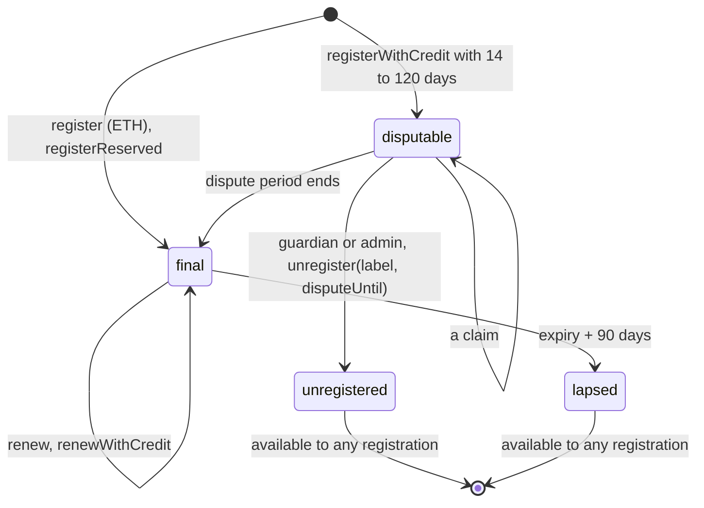
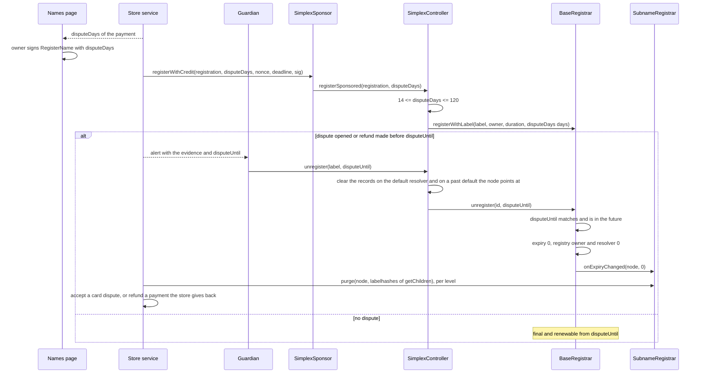
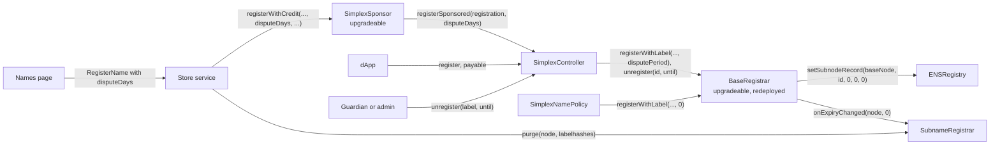

# Dispute period — contract work plan

Built on `simplex-namespace-contract` @ `c1cca32` and `ens-contracts` @ `1a11cda` (tag `simplex-mainnet-v1`, deployed), stacked on the upgradeable stack, [ens-contracts #50](https://github.com/simplex-network/ens-contracts/pull/50) (`ab/upgradeable-stack` @ `ad2a52f0`, final, eight contracts behind proxies, plan in [#20](https://github.com/brenzi/simplex-namespace-contract/pull/20)). The change is [ens-contracts #51](https://github.com/simplex-network/ens-contracts/pull/51) on `ab/dispute-period-v2`. Merge order (the owner, 20 Nov): #50, #51, then [#49](https://github.com/simplex-network/ens-contracts/pull/49), the holder-only renewal, stacked on #51. `ab/dispute-period` holds an earlier version on #49 at `7ff8c37`. Replaces the reversible-payments plan, `docs/plans/payment-reversal.md` on the branch `ab/payment-reversal`, which is kept aside.

## 1. Problem

A card payment can be disputed or refunded for about 120 days after it settles, and the money is withdrawn from the store; the buyer keeps the name for its whole paid term ([Stripe](https://docs.stripe.com/disputes/how-disputes-work)). A registration made with a compromised store key is final at once.

## 2. Decisions

| # | Decision | Applied | Status |
|---|---|---|---|
| D1 | Term | the whole paid term at registration | the owner, 19 Nov |
| D2 | Dispute period | defined by each sponsored registration; before its end the guardian or the admin unregisters the name | the owner, 19 Nov |
| D3 | Days | card 120; BTC and XMR 14; ETH in the dApp 0 | the owner, 19 Nov |
| D4 | Bounds on the sponsored path | at least 14 days, at most 120, on chain | the owner, 19 Nov |
| D5 | An unregistered name | available to anyone at once; the payment goes back: the store accepts a card dispute, or refunds; no reinstatement | the owner, 19 Nov |
| D6 | Renewals | final; after a disputed renewal the guardian reserves the name, so its next renewal is refused | the owner, 19 Nov |
| D7 | Registrar upgrades | the admin, through the registrar's own ProxyAdmin, until that ProxyAdmin's ownership is renounced; the upgradeable stack removes `controller.freeze()` | the owner, 19 Nov |
| D8 | Transfers during the dispute period | allowed; clients show the dispute end and ask the recipient's acknowledgement | the owner, 18 Nov |
| D9 | What is public | each name's `disputeUntil`, and with it the class of its payment: 0, 14 or 120 days | the owner, 19 Nov |
| D10 | Who unregisters | the guardian or the admin | the owner, 19 Nov |
| D11 | Placement | the registrar stores `disputeUntil`, written at registration and deleted at unregistration, unregisters only before it and only when the caller names it, and renews only from it; the controller's `unregister(label, until)` for the guardian and the admin | decided |
| D12 | Unregistration | the records cleared on the default resolver and on a past default the node points at; then the expiry, the registry node's owner and its resolver set to 0, and the `SubnameRegistrar`'s subnames ended; the next registration burns the token and invalidates the subnames, as for a lapsed name | decided |
| D13 | In-app payments, codes and balances | in-app 120 days; an order paid with a prepaid code 14 days, whatever paid for the code; an order paid from a balance the largest days among the payments that funded it | the owner, 20 Nov, relayed by agent-bezzera-A |
| D14 | Renewals during the dispute period | refused by the registrar until `disputeUntil` (`DisputePeriodNotOver`), on every controller's path, so a final renewal is never erased by an unregistration; the shortest term is 730 days, so a name cannot lapse meanwhile | the owner, 19 Nov |
| D15 | A registration without a dispute period | stores `disputeUntil` 0 | decided |
| D16 | Storage | `disputeUntil` follows the registrar's last state variable | decided |
| D17 | Terms | the names conditions (simplex-chat `docs/NAMES-CONDITIONS.md`, the general and the community terms on chain) state the dispute period and the end of a registration within it, only if it was made without a valid order, or a payment used for it is disputed, reversed or refunded in full | the owner, 19 Nov |
| D18 | A compromised guardian | can take a name in its dispute period | accepted by the owner, 19 Nov |
| D19 | A payment for the name disputed, reversed or refunded in full, and its registration not ended | the name stays; the guardian reserves it, as after a disputed renewal (D6), and the conditions state that further extensions can be refused | the owner, 19 Nov |
| D20 | The changed `RegisterName` and `registerWithCredit` | replaced in place, by an upgrade executed before the registrar step of the stack (#20, D21), so the first sponsored registration on v2 is signed in the new form; the store service and the webstore sign and send only the new form | the owner, 20 Nov |
| D21 | Delivery | this change merges before run 1 of the stack (#20) and is deployed by it, so D20's upgrade is not made; the conditions with the dispute period (#8271, merged after #8272) are the terms run 1 sets; #49 merges after the deployment and is its first upgrade batch | the owner, 20 Nov, relayed by agent-bezzera-B: "#50 #51 merge before deploy. #49 might be merged after deploy and run a contract update" |

## 3. States



| State | `unregister` | claim | renewal | `available` |
|---|---|---|---|---|
| disputable, before `disputeUntil` | guardian or admin | allowed; clients ask for an acknowledgement | `DisputePeriodNotOver` | false |
| final, `disputeUntil` 0 | `DisputePeriodOver` with `until` 0; `DisputeUntilMismatch` with any other | as #50 | as #50 | false |
| final, dispute period passed | `DisputePeriodOver` with `until` equal to `disputeUntil`; `DisputeUntilMismatch` with any other | as #50 | as #50 | false |
| unregistered | `DisputePeriodOver` with `until` 0; `DisputeUntilMismatch` with any other | refused by `ownerOf` | refused by the registrar's `renew` | true |

```
BaseRegistrarImplementation
  ... as #50, every state variable
  disputeUntil      mapping(uint256 => uint256)   public, written at registration, deleted at unregistration

  registerWithLabel(label, owner, duration, disputePeriod)              controller only
    ... as #50
    disputeUntil[id] = disputePeriod == 0 ? 0 : block.timestamp + disputePeriod

  renew(id, duration)                                                    controller only, live
    block.timestamp >= disputeUntil[id]                                  else DisputePeriodNotOver(id)
    ... as #50

  unregister(id, until)                                                  controller only, live
    disputeUntil[id] == until                                            else DisputeUntilMismatch(until, disputeUntil[id])
    block.timestamp < disputeUntil[id]                                   else DisputePeriodOver(id)
    delete disputeUntil[id]
    expiries[id] = 0
    ens.setSubnodeRecord(baseNode, id, 0, 0, 0)
    subnameHook.onExpiryChanged(node, 0)
    emit NameUnregistered(id)

SimplexController
  register(registration)                                                 payable
    ... as #50, disputePeriod 0
  registerSponsored(registration, disputeDays)                           sponsor only
    MIN_DISPUTE_DAYS <= disputeDays <= MAX_DISPUTE_DAYS                  else DisputeDaysOutOfRange(disputeDays)
    ... as #50, disputePeriod = disputeDays days
  unregister(label, until)                                               owner or beneficiary
    _retireStaleRecords(namehash)                                        the default or a past default the node points at
    defaultResolver != 0 => defaultResolver.clearRecords(namehash)
    base.unregister(uint256(keccak256(label)), until)

SimplexNamePolicy.registerReserved(label, owner, duration)
  ... as #50, disputePeriod 0

SimplexSponsor.registerWithCredit(registration, disputeDays, nonce, deadline, sig)
  RegisterName(string label,address owner,uint256 duration,address resolver,bytes[] data,uint256 disputeDays,uint256 nonce,uint256 deadline)
  ... as #50
  controller.registerSponsored(registration, disputeDays)
```

Example: a two-year card registration on day 0 with 120 days expires on day 730. Disputed on day 30, it is unregistered by the guardian on day 31, available to anyone at once, and the store accepts the dispute. Undisputed, it is final and renewable from day 120.



## 4. Threat model

| Who or what | Power after the change | Bound |
|---|---|---|
| a buyer who disputes a registration | gets the money back | the name is unregistered and available at once |
| a holder who disputes a renewal | keeps the renewed term | the guardian reserves the name, so it is not renewed again (D6) |
| a compromised store key | registers names to its own address, or with owners' signatures | each is unregistered by the guardian for at least 14 days (D4) |
| the guardian | unregisters any name in its dispute period, up to 120 days after its registration, and can register it to itself at once with a commitment made before; before this change it could mint only available names | one key until GOV8; a dispute period ends on its own; ETH registrations and `registerReserved` take none |
| a holder or recipient during the dispute period | renews only from `disputeUntil` (D14) | the shortest term is 730 days |
| a recipient of a claim during the dispute period | loses the name on an unregistration | clients show the dispute end and ask for an acknowledgement (D8) |
| a registrar controller added by the admin | unregisters a name in its dispute period, leaving the default resolver's records, which resolve again under the next holder who points the name at that resolver | as every controller power, behind the timelock from GOV8; a final name stays final |
| a queued or repeated `unregister` | ends no later registration of the label whose dispute ends at another second: `until` names one registration's `disputeUntil` (`DisputeUntilMismatch`) | once a name is unregistered, the guardian and the admin cancel any other prepared `unregister` of it |
| a registrar controller added by the admin, registering | any dispute period: the 14 to 120 days are bounded in `SimplexController` only, and a renewal is refused until `disputeUntil` | as every controller power, behind the timelock from GOV8 |
| an observer of the chain | learns each name's dispute end, so 0, 14 or 120 days, and with it whether its registration was paid in ETH, in crypto to the store, or by card or in-app | public by D9 |

## 5. Contract changes



`BaseRegistrarImplementation`:

- `disputeUntil`, public, after the last state variable;
- `registerWithLabel` takes `disputePeriod`;
- `renew` refuses a renewal before `disputeUntil`;
- `unregister(uint256 id, uint256 until)`, controller only;
- event `NameUnregistered(uint256 indexed id)`;
- errors `DisputePeriodOver(uint256 id)`, `DisputePeriodNotOver(uint256 id)` and `DisputeUntilMismatch(uint256 named, uint256 current)`.

`SimplexController`:

- `MIN_DISPUTE_DAYS = 14`, `MAX_DISPUTE_DAYS = 120`;
- `registerSponsored(registration, disputeDays)`;
- `_registerCore` takes the dispute period, which `register` passes as 0;
- `unregister(string label, uint256 until)`, owner or beneficiary;
- error `DisputeDaysOutOfRange(uint256)`.

`SimplexNamePolicy`: `registerReserved` registers with 0.

`SimplexSponsor`, behind its own proxy on the stack: `registerWithCredit(registration, disputeDays, nonce, deadline, sig)` and `RegisterName` with `uint256 disputeDays`; `renewWithCredit` as #50.

The registrar's, controller's, policy's and sponsor's implementations land together: `registerWithLabel`, `registerSponsored` and `registerWithCredit` change their signatures. The conditions with the dispute period (D17) are set with `setGeneralTerms` and `setCommunityTerms` in the same batch, so that every registration with a dispute period is made under them.

Run 1 of the stack deploys this change (D21); run 1 sets the terms from `terms.simplex.json`, with the links of #8271's merge commit. The rest of this section applies only if run 1 precedes the merge.

If the change lands after the stack's deployment, as an upgrade of the registrar, the controller, the policy and the sponsor through their ProxyAdmins in one batch, `scripts/prepare-upgrade.mjs` names in `INTENDED` the selectors it replaces (`docs/upgrades.md`, invariant 5): `registerWithLabel(string,address,uint256)` on the registrar, `registerSponsored` with its old argument list on the controller, and `registerWithCredit` with its old argument list on the sponsor.

- The four upgrades go in one Safe MultiSend batch: in separate transactions, every `registerWithCredit` reverts between the controller's and the sponsor's upgrade. `scripts/prepare-upgrade.mjs` simulates one `upgradeAndCall` at a time, so the whole batch is also simulated on a mainnet fork before it is signed, with a sponsored registration, a renewal and an `unregister` after it.
- Way of `docs/upgrades.md`, invariant 5: replacement, without the old form beside it (D20). The batch executes before the registrar step (#20, D21), so no `RegisterName` in the old form is signed for v2's sponsor, and sponsored registrations are interrupted for no time.
- Signers of `RegisterName` at the batch, by the code: the webstore (simplex.domains `webapp/src/flow.ts:90`); the store service verifies and sends it (simplex-chat `names` @ `0410929`, `Registration.hs:121`, `Worker.hs:311`); no SimpleX app version signs it (simplex-chat #8251, a draft, adds the types). Both ship the new form before the registrar step.

The rebase onto `ab/upgradeable-stack` @ `ad2a52f0` (done):

- the registrar's storage-layout snapshot gains `disputeUntil` at slot 22, its last variable;
- that branch removes `controller.freeze()` and `frozen`, so the test "is made without a default resolver and after the freeze" keeps only its default-resolver half, and the mutant `if (frozen) revert Frozen();` goes;
- the statements on `freeze()` in `CLAUDE.md`, `docs/security.md`, `docs/deployment.md` and the launch-to-freeze plan follow the wording of #20's documents (done at the merge of #20).

Sizes in bytes, limit 24,576:

| Contract | #50 | This change |
|---|---|---|
| BaseRegistrarImplementation | 20,166 | 21,248 |
| SimplexController | 17,841 | 18,666 |
| SimplexNamePolicy | 15,779 | 15,792 |
| SimplexSponsor | 5,779 | 5,795 |

## 6. Effects outside this repository

- simplex-chat, store service: `disputeDays` per payment by D3 and D13, in the `RegisterName` digest and calldata, with a reveal refused when signed over another value; before `disputeUntil`, the guardian's `unregister(label, disputeUntil)` and `purge` of the name's subnames, then, per trigger: on `charge.dispute.created`, the store accepts the dispute (a disputed charge cannot be refunded); for a payment the store gives back, the refund; on `charge.refunded` for a full refund made outside the service, nothing more; when a payment for the name is disputed, reversed or refunded in full and its registration is not ended, the guardian's `addReservedNames`; a renewal offered only from `disputeUntil`.
- simplex.domains: `RegisterName` with `disputeDays`; the dispute end on the order page.
- The store's registration view: a registration ended by `unregister` has the phase "ended", kept after a later registration by someone else; the web store states it on the order page, in Your names and in Edit links (the owner, 20 Nov, relayed by agent-bezzera-A).
- Client texts name the payment grounds only: "if a payment for it is disputed, reversed or refunded in full"; the ground "made without a valid order" stays in the names conditions (D17; the owner, 20 Nov, relayed by agent-bezzera-A).
- The store service and web store changes are built on simplex-chat `names` and simplex.domains `names` as they are today: #51 lands before simplex-chat #8243 and simplex.domains #19 (the owner, 20 Nov, relayed by agent-bezzera-A).
- The app's claim flow and the dApp's claim review: the dispute end before a claim, with the recipient's acknowledgement (D8). The app and the dApp offer a renewal only from `disputeUntil`.
- The names resolver reports each name's `disputeUntil`, and the SMP name response carries it to clients (D8, D9; the owner, 20 Nov, relayed by agent-bezzera-A).
- The names resolver: a name with expiry 0, and every node under it, answers as unregistered: `purge` deletes the `SubnameRegistrar`'s subnames, while subnodes the holder created directly in the registry keep their owner, resolver and records, also after the next registration, until the next holder replaces them.
- `docs/plans/names-v2-launch-to-freeze-plan.md`: `unregister` in the guardian's and the admin's powers, and its routine operation.
- Indexers: `unregister` emits `NameUnregistered(id)` and no ERC-721 `Transfer`. The subgraph (`ens-subgraph` at `a80c67b`) sets a name's expiry only from `NameRegistered` and `NameRenewed`, so it gains a `NameUnregistered` handler that sets the expiry to 0; filtering by expiry holds only with on-chain `nameExpires` until then.
- simplex-chat apps: the `RegisterName` signer planned in simplex-chat #8251 (types only now) signs `disputeDays` too.
- Client changes of the store service, simplex.domains, the dApp and the names resolver: agent-bezzera-A, each merged with its contract pull request.
- This repository: `CLAUDE.md` and `docs/security.md` state `unregister` and the narrower freeze guarantee; the deployment scripts for the redeployed registrar come with the registrar's upgradability change.
- simplex-chat `docs/NAMES-CONDITIONS.md`, linked on chain at `d94981224` (#8135): a version with the dispute period (branch `ab/names-conditions-dispute`). It follows the version for the upgradeable stack, which states upgradeability and no dispute period; the change merged second merges master. Its links go into `terms.simplex.json` and on chain as above.

## 7. Tests

`ens-contracts/test/simplex/TestDisputePeriod.test.ts`:

- a sponsored registration stores `disputeUntil` as its time plus the days; 14 and 120 days register, 13 and 121 revert `DisputeDaysOutOfRange`;
- the payable `register` and `registerReserved` store a dispute end of 0, so `unregister` reverts `DisputePeriodOver` at once;
- `RegisterName` with other `disputeDays` reverts `InvalidSignature`; the type hash is pinned;
- `unregister` by the guardian and the admin before `disputeUntil`; by the registrar key, the holder and anyone else it reverts; at `disputeUntil` it reverts `DisputePeriodOver`;
- after `unregister`: `nameExpires` 0, `available` true, `ownerOf` reverts, the registry node's owner and resolver 0, the default resolver's records empty, the subnames without owner, `expiryOf` 0 on the subname registrar, `purge` deletes the subnames, a claim, a renewal and a record write by the old holder revert, and a second `unregister` reverts;
- a registration after `unregister`, by anyone: the old token burned, the subnames of the old holder without owner, the records cleared;
- a claim during the dispute period moves the name, and an `unregister` then takes it from the recipient;
- a renewal on each path reverts `DisputePeriodNotOver` one second before `disputeUntil` and succeeds at it;
- the default resolver's records are cleared although the holder pointed the node at 0, and a past default's records although the default was rotated;
- `unregister` without a default resolver;
- a re-registration writes a new dispute end, and an `unregister` naming the earlier one reverts `DisputeUntilMismatch`;
- the registrar's `unregister` reverts for every caller but a controller;
- `test/ethregistrar/TestBaseRegistrar.test.ts` passes the new argument and runs in the fork's CI;
- each new guard, removed, fails at least one test.
