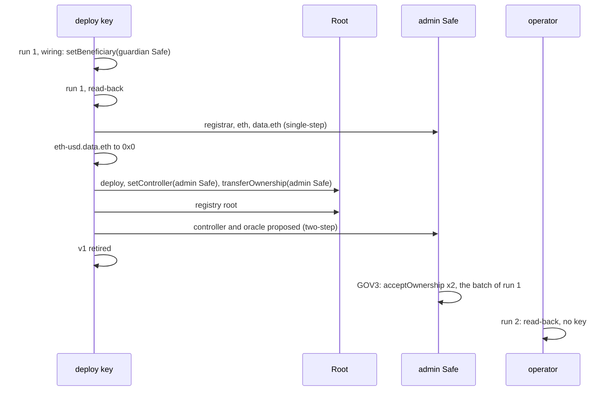
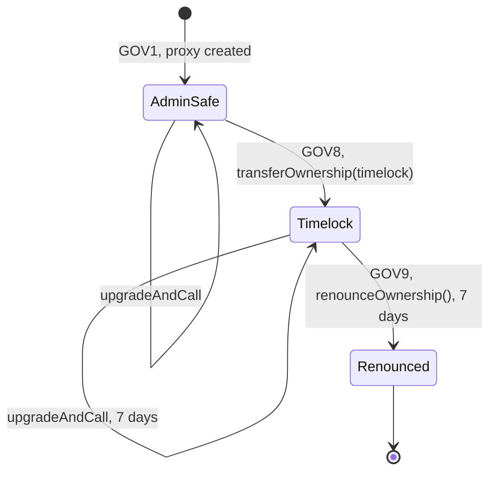
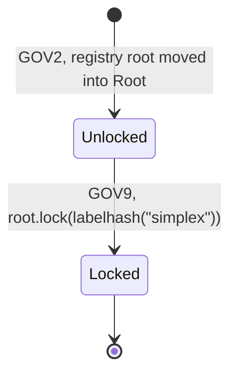

# `.simplex`: launch to freeze

Who controls the contracts, from deployment until the powers are given up.

## 1. Table of contents

1. Table of contents
2. Timeline
3. The keys
4. Powers, before and after the freeze
5. What no key can ever do
6. Why it is built this way
7. The fallback: snapshot and redeploy
8. Appendix A: transition recipes

## 2. Timeline

Four keys act in this plan: the deploy key, the admin Safe, the guardian Safe and the
registrar hot wallet.

| Milestone | Change |
|---|---|
| GOV1 | The deploy key deploys `.simplex` v2, eight contracts behind proxies whose upgrade authority is the admin Safe's from creation, and reserves 798 names: the 797 of `reserved-names.simplex.csv` and `simplex-chat`. Public sales closed. |
| GOV2 | Handover, in the same run: `setBeneficiary` first, then the single-step transfers to the admin Safe, the registry root moved into `Root`, and the two-step transfers proposed; v1 retired. The deploy key stops being used. |
| GOV3 | The admin Safe accepts the two-step transfers. Once the owner provides the registrar hot wallet, the guardian Safe gives it its spending allowance, in a step of its own (A3). |
| GOV4 | Contracts, registrar, app and codes all live. |
| GOV5 | The handover is verified and the deploy key is destroyed. |
| GOV6 | The investor window opens. Hard deadline for the handover, because names now start belonging to third parties. |
| GOV7 | The guardian Safe moves to 2 of 4, then public sales open. |
| GOV8 | Hardening: a 7-day timelock is placed in front of the admin Safe, for its own calls and for every `ProxyAdmin`. No fixed date. |
| GOV9 | The freeze, per contract: a contract's code is fixed when its `ProxyAdmin` is renounced, at a time of its own; `Root.lock` ends the ability to replace the deployment. No fixed date, never before GOV8; expected 12 to 24 months from the first registration, as the names conditions state (D13 of `docs/plans/upgradeable-stack.md`). |

GOV1 to GOV7 are dated and binding. GOV8 and GOV9 are not: both wait until the namespace is
big enough to be worth the work they cost.

`docs/plans/upgradeable-stack.md` holds the deployment of GOV1 and GOV2 in full.

## 3. The keys

**Deploy key.** A hot wallet, a plain EOA: the v1 deploy key
`0x38D19404644fe24EE7d638229a732CbE8275E333`. It deploys and wires v2, holds every owner role
except the upgrade authority until the handover, and is destroyed at GOV5.

**Admin Safe.** `0xf38920389740E46A7f4160DaF1672f3df2754Df4`, Safe 1.5.0, 2 of 4. It owns
the eight `ProxyAdmin`s from their creation, so it alone holds the upgrade authority. From GOV2
it also owns `Root`, `BaseRegistrarImplementation`, `SimplexController` and
`SimplexPriceOracle`. Its calls take effect once two owners sign. The price oracle is a
separate contract with its own owner, so it is handed over separately. It holds the price
list and the ETH/USD feed pointer; the controller holds neither.

**Guardian Safe.** `0xE6623AA6b8d335367828C2A8b06A714678d22e2c`, Safe 1.5.0, 1 of 4 until
GOV7 and 2 of 4 from GOV7, with the same four owners as the admin Safe. It is the
controller's `beneficiary`, so it receives the revenue and holds the powers that stop things
quickly. Its calls are immediate.

**Registrar hot wallet.** Owns nothing. It lives in KMS, run by the names service. It pays
gas, spends the allowance the guardian gives it, and relays users' signed requests.

The admin Safe and the guardian Safe are two authorisation tiers, ranked by how much damage a
compromise can do. The admin tier can replace the code of each upgradeable contract until its
freeze, and new code can do anything the contracts allow, so its reach has no bound. The
guardian tier is bounded in kind: halt sales, set registrar allowances, redirect revenue,
reserve names (which also stops their renewal), unregister a name in its dispute period, and
nothing else. It is not bounded in amount:
it can give itself any allowance and mint unreserved names with it, an accepted risk
(`docs/security.md`, V1). The two Safes have the same signers. Until GOV7 the tiers differ in
threshold and in the calls each may make; from GOV7 to GOV8 only in the calls; from GOV8 the
admin's calls also wait seven days. The timelock is deferred to GOV8, not abandoned.

`governance.mainnet.json` records both Safes, their owners and thresholds, and, from the
registrar step (A3), the registrar hot wallet. `scripts/governance-check.mjs` checks each
Safe against its entry before the deployment and before any single-step transfer to it,
and the registrar hot wallet before its allowance is prepared.

## 4. Powers, before and after the freeze

| Key | GOV2 until GOV9 | After GOV9 |
|---|---|---|
| Deploy key | nothing | nothing |
| Admin Safe | `ProxyAdmin.upgradeAndCall`, `ProxyAdmin.transferOwnership` and `ProxyAdmin.renounceOwnership` for each of the registry, the registrar, the resolver, the subname registrar, the controller, the name policy, the sponsor and `UniversalResolver`; `setSponsor`; `namePolicy.removeReservedNames`; `namePolicy.registerReserved`; `setMinCharLength`; `setDefaultResolver`; `setPriceOracle`; `priceOracle.setPrices`; `priceOracle.setUsdOracle`; `recoverFunds`; `addController`; `removeController`; `setMetadataRenderer`; `setMaxLabelLength`; `setSubnameHook`; `setNamePolicy` (registrar and controller); `namePolicy.removeCommunityNames`; `namePolicy.setGeneralTerms`; `namePolicy.setCommunityTerms`; `baseRegistrar.setResolver`; `Root.setResolver`; `Root.setController`; `Root.lock`; `controller.unregister` | the same list without the `ProxyAdmin` calls, and without any call that the controller's last upgrade seals (A7) |
| Guardian Safe | `namePolicy.addReservedNames`; `namePolicy.setReservationReason`; `namePolicy.addCommunityNames`; `setPublicSalesOpen`; `sponsor.setRegistrarAllowance`; `setBeneficiary`; `controller.unregister`; receives `withdraw()` | the same list, without `setPublicSalesOpen` if the controller's last upgrade seals it (A7) |
| Registrar hot wallet | `sponsor.registerWithCredit` (with the owner's `RegisterName` signature); `sponsor.renewWithCredit`; and relaying signed user requests: `approveWithSig`, `claimWithSig`, `setTextWithSig`, `clearRecordsWithSig`, `setApprovalForAllWithSig`, `createSubnameWithSig`, `deleteSubnameWithSig`, `commitUnderGeneralTermsWithSig`, `commitUnderCommunityTermsWithSig`, `acceptGeneralTermsForClaimWithSig`, `acceptCommunityTermsForClaimWithSig` | same |
| Anyone | `commit`; `commitUnderGeneralTerms`; `commitUnderCommunityTerms`; `acceptGeneralTermsForClaim`; `acceptCommunityTermsForClaim`; payable `register` and `renew`; `withdraw`; all signed-request paths; record writes on names they own; `reclaim`; subname create and delete; `purge` | same |

Until GOV8 every call in this table takes effect when the Safe's threshold signs. After GOV8
the admin's calls, the `ProxyAdmin` calls among them, wait seven days and the guardian's stay
immediate.

`disableNftGate` is the one owner function missing from the table. `.simplex` deploys with
the gate off, and the function reverts when the gate is off, so it does nothing from day one.

There is no reverse registrar and no reverse resolution: `.simplex` maps names to SimpleX
links in one direction only. A registration carrying a `reverseRecord` bit reverts with
`ReverseRecordNotSupported`. The controller's two old slots for the feature are reserved
rather than deleted, so an upgrade could bring it back without a storage migration.

There are no on-chain edit credits. Metering relayed writes is the relayer's job: it is the
only caller of those paths and the only party that can refuse before it has paid.

These powers outlive GOV9 because losing them would be worse than keeping them.
`registerReserved` and `addReservedNames` keep brand outreach open with no end date.
`addController` is the only repair path if the frozen controller has a bug.
`setMetadataRenderer` updates NFT artwork, since the renderer is immutable and is replaced
rather than edited.

A frozen contract keeps the owner calls of its own code: renouncing a `ProxyAdmin` fixes the
code, not the contract's owner.

## 5. What no key can ever do

The guarantees below hold from the freezes and the lock that each names. Until then the admin
Safe can replace the code that enforces them.

| Guarantee | Holds once these are renounced or called |
|---|---|
| no key can take, transfer or re-point a name somebody owns before it expires | registry `ProxyAdmin` |
| | registrar `ProxyAdmin` |
| | subname registrar `ProxyAdmin` |
| | `root.lock(labelhash("simplex"))` |
| no key can write records on a name it does not own | registry `ProxyAdmin` |
| | registrar `ProxyAdmin` |
| | resolver `ProxyAdmin` |
| | subname registrar `ProxyAdmin` |
| | controller `ProxyAdmin` |
| | `root.lock(labelhash("simplex"))` |

The admin Safe and the guardian Safe can still unregister a sponsored name before its
`disputeUntil`, which also clears its records on the default resolver
([`dispute-period.md`](./dispute-period.md)).

Once they hold: `_register` requires `available(id)`, false until 90 days past expiry.
`reclaim` needs the token holder. `approveWithSig` needs the owner's signature, and only the
recipient, or a controller, can complete a transfer. The controller is `trustedETHController`
on the resolver, so its freeze matters for the records: a hostile upgrade would abuse exactly
that authority.

Until the lock, the registry root's owner can assign the `simplex` node to itself, then any
name's node, and write that name's records; once the registry root is in `Root`, `Root`'s
controller, the admin Safe, can do the same. The redeploy of section 7 rests on that power.
`root.lock(labelhash("simplex"))` ends it: through `Root`, a locked label cannot be reassigned,
and the registry root cannot be moved out of `Root`.

Indirect paths stay open after every freeze and the lock:

| Path | Call | Caller |
|---|---|---|
| renewals stopped, so names lapse and become available | `baseRegistrar.removeController(controller)` | admin |
| | `baseRegistrar.setSubnameHook` to a contract that reverts | admin |
| | `controller.setNamePolicy` to a policy that reserves every name | admin |
| renewals priced out | `controller.setPriceOracle` | admin |
| | `priceOracle.setPrices` | admin |
| payable renewals priced out | `priceOracle.setUsdOracle` to a feed with a low positive answer | admin |
| renewal of one name stopped | `namePolicy.addReservedNames` | admin or guardian |
| the previous holder's subnames and records kept under a re-registered name | `baseRegistrar.setSubnameHook(0x0)` during the re-registration | admin |

Reserving a held name stops its renewal, and after its grace period `registerReserved` assigns
it, which is how disputes are settled (A6). Pricing renewals out of reach collects names as
they lapse; `setPrices` adds nothing to `setPriceOracle`, since an arbitrary oracle can already
do anything a curve change can. Before GOV8 each of these takes effect when signed. What
limits the damage is slow and public. Every name past its dispute period keeps its remaining
term plus 90 days of grace, so a name is collected months after the change, in public, and the
change can be reversed before that. After GOV8 a change is visible seven days before it takes
effect, and renewal of an unreserved name is permissionless, so anyone can renew anyone's name
at the old price in that time.

## 6. Why it is built this way

**Two keys, split by direction.** The guardian stops things: reserve a name, pause sales, cut
a registrar's allowance to zero, end a registration in its dispute period. It also funds registrars and opens sales (A3, A4), the two
permissive powers on the fast key. The admin changes things: release reserved names, hand names
to brands.

Neither Safe waits for a delay yet, so the split can look like a formality. It is not. The
revenue is paid to the beneficiary, and only the beneficiary can change that address; the
admin Safe reaches the controller's balance only by a controller upgrade, and after the
controller's freeze not at all. And it puts the emergency stops on the Safe
that is not used for routine work.

The same split decides which powers get a delay at GOV8. The guardian's stay immediate,
because the harm they answer grows with every block: a compromised registrar mints junk names
block after block, and so does an exploit in the payable path. Reserving can never be
scheduled, because a queued `addReservedNames(["nike"])` tells a squatter which name
is worth taking and how long it stays unprotected. The admin's powers answer outages rather
than losses, so they can wait. A dead price feed stops sales, but 90 days of grace means
nobody loses a name while the repair sits in the queue. Fixing that feed is now a single
`priceOracle.setUsdOracle` instead of a redeploy, which shortens the outage but does not
change which key it belongs to.

**Safes now, a timelock later.** A timelock costs coordination every week, and until the
namespace has enough names and enough turnover that cost is real while the benefit is
theoretical. The first months therefore run on the Safes without delay, with an upgrade of the
affected contract as the way out, and snapshot and redeploy behind it (section 7).

Three things are worse in the meantime:

- **No warning period.** As section 5 describes, an admin action, an upgrade among them, takes
  effect when signed, and the guardian has no scheduled transaction to cancel.
- **One signature on the guardian Safe until GOV7.** One of the four owners can halt sales,
  fund a registrar, reserve a name or redirect the revenue.
- **Rotation is one-shot.** The eight `ProxyAdmin`s, `BaseRegistrar` and `Root` use
  OpenZeppelin's single-step `Ownable`, so a transfer takes effect without the recipient
  accepting it. The zero address is rejected by OpenZeppelin's `Ownable`, an address that is valid but wrong is not;
  `scripts/governance-check.mjs` runs before each such transfer for that reason.
  `SimplexController` and `SimplexPriceOracle` are `Ownable2Step` and require acceptance.

GOV7 answers the second, GOV8 the first. The third stays, checked by the script.

**Prices stay changeable, and so does the oracle.** `SimplexPriceOracle` keeps the price list
and the feed pointer in storage rather than in `immutable`s, so the owner can change both. Chainlink has retired feeds before. On the older `StablePriceOracle` that
`.testing` runs, `usdOracle` is `immutable`, so a retired feed there means a fresh oracle and
a `setPriceOracle`. Either way, an oracle that could not be replaced and had a retired feed
would break registration and renewal permanently, with no key able to fix it. That is why
`setPriceOracle` outlives GOV9.

Bad input is also refused by the oracle. A zero or negative answer from the feed reverts with
`InvalidPriceFeed` instead of dividing by zero or wrapping the cast and quoting names at
nothing, and installing an already-dead feed is refused for the same reason.
`AggregatorInterface` has no `decimals()` to read, so `setUsdOracle` takes the replacement
feed's scale as an explicit argument; otherwise a feed on a different scale would misprice
every name by orders of magnitude and never revert. The sponsored path reads no feed at all,
because a registrar's allowance is denominated in attoUSD through `priceUSD()`, so a dead
feed closes the payable path and leaves the app-store flow running.

**The sales switch stays changeable until the controller's last upgrade.** A seal of the
switch, or of the sponsor, where wanted, is added by the controller's last upgrade before its
`ProxyAdmin` is renounced (A7). A switch sealed closed could never be reopened, so the
seal, called with that upgrade, reverts while sales are closed, as v1's `freeze()` did.

**GOV9 waits for GOV8.** A contract's freeze removes the only way to fix a bug in its code, and
`Root.lock` removes the redeploy this plan leans on. Slipping GOV9 costs nothing
operationally, since brand reservation, `registerReserved` and everything else keep working.
It does keep the upgrade power alive, and that is the one power in the system with no bound
on it.

## 7. The fallback: snapshot and redeploy

Until a contract's freeze, a defect in it is repaired by an upgrade through its `ProxyAdmin`
(A6): state and addresses stay, and users do nothing. The redeploy is the way out behind that,
for a defect in a contract already frozen or one that an upgrade cannot repair, so be precise
about what it can and cannot save.

**Why it is possible.** `Root.lock` is deliberately not called before GOV9. While the
`.simplex` label is unlocked, `Root`'s controller can point the TLD node at a freshly deployed
registrar and controller and keep the same `ENSRegistry`. Every SimpleX client reads the
contract addresses from configuration we ship, so switching them is a release, not a migration
users perform.

**What has to be carried over**, or somebody loses something: each name's owner, its
remaining expiry, its `simplex.contact` and `simplex.channel` records, and any subnames.
`registerReserved` is owner-callable forever and takes an arbitrary owner and duration, so
the new deployment re-mints the snapshot directly, with no user action and no signature.
Subnames are the exception: only a name's holder can create them, and a name the admin holds
reaches its holder only when the holder claims it, so re-creating them needs a purpose-built
migration controller or the holders' signatures. `registerReserved` writes no dispute period,
so a redeploy ends every name's dispute period; a payment disputed after it is handled by a
reservation ([`dispute-period.md`](./dispute-period.md), D19).

**The order that makes it safe.**

1. `setPublicSalesOpen(false)`, guardian Safe, immediate, and `setRegistrarAllowance(registrar, 0)`.
   The set of names stops growing.
2. Snapshot at a stated block: owner, expiry, records, subnames.
3. Deploy the new registrar, controller and name policy. `addReservedNames` for the whole
   set, then `registerReserved` each name to its snapshot owner for its remaining term,
   writing the records in the same call. `registerReserved` releases each reservation, so
   afterwards reserve again every name that was under dispute; a disputed name past its
   expiry stays reserved and is not re-minted, since `registerReserved` would give it a fresh
   term of at least two years.
4. Re-snapshot and apply the difference, because transfers do not stop when sales do.
5. Point the TLD at the new contracts, ship the client release, announce the old addresses as
   dead.

**What can still be lost.** A redeploy voids the old NFTs: they stay in wallets and stop
meaning anything. Anyone who buys a `.simplex` NFT from its holder between the snapshot
and the switch has bought a dead asset, and step 4 is the only thing that catches it. Names
held by a contract are re-minted to that contract, which
may have no idea what to do with them. Both risks grow with the number of names and the depth
of any secondary market.

**Why the fallback expires.** Step 3 costs roughly a full registration per name, so 3000
names is already several hundred million gas, and step 4's exposure grows with trading
volume. The point where redeploy stops being credible is the point where Safes and a timelock
become worth their weight. GOV8 is due when redeploy stops being believable, not on a date.
The upgrade path stays open after that, for each contract until its freeze.

## 8. Appendix A: transition recipes

Every on-chain call, in order, with who signs it.

### A1. Deployment (GOV1)

Before run 1, an operator check: purchase entry stays closed in the webstore and the SimpleX
app, and the store's metrics endpoint shows no open name invoice and no order in the phase
queued, committing, committed or registering, so that every paid order has registered on v1
before v1 is retired
(D22 of `docs/plans/upgradeable-stack.md`; `docs/deployment.md`, "The store check").

Caller: **deploy key**, alone, in run 1 of `deploy-mainnet.mjs`, deploying
simplex-network/ens-contracts `ebf76989`, tagged `simplex-mainnet-v2`, which holds the
dispute period of #51 (D9 of `docs/plans/upgradeable-stack.md`). The calls and their order
are steps 1 to 16 of `docs/deployment.md`, "Deployment and wiring";
`docs/plans/upgradeable-stack.md`, section 7, lists the constructor arguments and
initializer calls. Among them, for powers and reserved names:

- The eight proxies are created with `initialOwner` = admin Safe, so each `ProxyAdmin`
  belongs to the admin Safe from its creation.
- `namePolicy.addReservedNames([...])` is sent right after
  `controller.setNamePolicy(namePolicy)`, before the subname registrar, the resolver and
  the sponsor are deployed. 798 names are reserved, the 797 of `reserved-names.simplex.csv`
  and `simplex-chat`, per category in batches of at most 200. Measured cost is 25.8k gas
  per name: 5.2M per batch, about 21M in total, single-digit dollars at the base fee we
  expect. Run it at a low base fee; `deploy-mainnet.mjs` supports that through
  `MAX_BASE_FEE_GWEI`.
- `controller.setBeneficiary(guardianSafe)` is the last call of the wiring.
- `publicSalesOpen` stays `false`.
- The deploy key holds the registry root until the handover; `Root` comes with the
  handover (A2).

A transaction may use at most 16,777,216 gas (EIP-7825), and the gas estimate of
`addReservedNames` passes that above about 210 names, so the batches stay at 200. The name
list is final well before GOV1: the deployer commits it as `reserved-names.simplex.csv`, and
a deployment of `.simplex` without it is refused by `deploy-mainnet.mjs`.

No reverse registrar is deployed. That is possible because `PublicResolver` and
`UniversalResolver` no longer inherit `ReverseClaimer`, whose constructor called `claim` on
whatever owned `addr.reverse`. That was a hard dependency on a deployed reverse registrar,
which a subclass could not work around.

`SimplexPriceOracle` takes a **base price per year** plus a list of **exceptions**, each
`(labelLength, priceCentsPerYear)`, in US cents. An exception applies to labels of exactly
that length; every other length pays the base price. The premium is zero, so a lapsed name
costs the same as any other. The
launch list is $50 a year ($100 for the two-year minimum) with no exceptions, since names
shorter than six characters cannot be registered:

```
setPrices(5000, [])
```

The base price covers every length, so lowering `minCharLength` later never hands out free
names. `deploy-mainnet.mjs` reads the curve from `scripts/simplex-price-curve.mjs`, the one
place it is written down, and the post-deploy read-back checks it and the feed scale on chain
before the handover.

Mind the unit: these are US cents **per year**. The older oracle that `.testing` runs takes
attoUSD **per second**, so the two lists are not interchangeable, and a list in the other's
unit is rejected by neither contract.

Reserving at GOV1 rather than after the handover closes a hole. `publicSalesOpen` gates only
the payable `register`, so once the guardian funds a registrar (A3) the sponsored path can
register any label that is not reserved. The post-deploy read-back checks every reserved
label, which makes the reserved set part of the deployment's acceptance check.

Before GOV1, `scripts/governance-check.mjs` checks each Safe against `governance.mainnet.json`:
the SafeProxy 1.5.0 code and singleton, the owners, the threshold, no module and no guard,
the fallback handler, and **a nonce of at least 1**, which proves that the Safe has executed a
transaction on mainnet. The eight `ProxyAdmin`s and several handover transfers take effect with
nobody having to accept them, so an address nobody can sign for is unrecoverable.

### A2. Handover (GOV2)

Order matters. `setBeneficiary` is owner-callable only while the beneficiary is unset. After
that only the beneficiary can move it, so the guardian is chosen here or not at all:
`controller.setBeneficiary(guardianSafe)` is sent by the deploy key as the last call of the
wiring (A1), before the read-back. Steps 1 to 11 run in run 1 of `deploy-mainnet.mjs`, after
its read-back passes; steps 1 to 10 are numbered as in `docs/deployment.md`, "Handover".
The governance addresses are read from `governance.mainnet.json` only.

| # | Caller | Call |
|---|---|---|
| 1 | deploy key | `baseRegistrar.transferOwnership(adminSafe)` |
| 2 | deploy key | `ens.setOwner(namehash("eth-usd.data.eth"), 0x0)` |
| 3 | deploy key | `ens.setSubnodeOwner(namehash("eth"), labelhash("data"), adminSafe)` |
| 4 | deploy key | `ens.setSubnodeOwner(0x0, labelhash("eth"), adminSafe)` |
| 5 | deploy key | Deploy `Root(ens)`, the upstream contract |
| 6 | deploy key | `root.setController(adminSafe, true)` |
| 7 | deploy key | `root.transferOwnership(adminSafe)` |
| 8 | deploy key | `ens.setOwner(0x0, root)`; the registry root cannot be moved out of `Root` again |
| 9 | deploy key | `controller.transferOwnership(adminSafe)` |
| 10 | deploy key | `priceOracle.transferOwnership(adminSafe)` |
| 11 | deploy key | v1 retired: `removeController` of the v1 controller and the v1 name policy on the v1 registrar; `transferOwnership(0x0)` on the v1 controller and the v1 oracle |
| 12 | admin Safe | `controller.acceptOwnership()` and `priceOracle.acceptOwnership()`, one batch, required by `Ownable2Step`, from the Transaction Builder file run 1 writes; at GOV3 |



The registrar allowance is not part of the handover: runs 1 and 2 neither set nor read it,
and it is set in a step of its own (A3).

The `ProxyAdmin`s need no step: the admin Safe owns them from their creation. Steps 1 to 4
and 6 to 8 take effect immediately, nobody has to accept, and the transaction gives no sign
of whether anyone holds the key. `scripts/governance-check.mjs` passes for the admin Safe before
run 1 sends its first transaction.

Verify, in run 2 of `deploy-mainnet.mjs`: `owner()` is the admin Safe on the eight
`ProxyAdmin`s, the controller, the registrar, the price oracle and `Root`; `ens.owner(0x0)` is
`Root`, `root.controllers(adminSafe)` is true, `root.controllers(deploy key)` is false and
`root.locked(labelhash("simplex"))` is false; `beneficiary()` is the guardian Safe; `pendingOwner()` is empty on both the controller
and the price oracle; the deploy key holds none of the roles read. Run 1's read-back has
already checked the wiring, `sponsor()` among it. The oracle is the one most
easily missed, because it is not reachable from the controller. A handover that checks only
the controller looks complete while the price curve is still held by a key that is about to be
destroyed.

Until step 12 the deploy key can still redirect the controller and the oracle elsewhere, so it
is destroyed only once `setBeneficiary` and all twelve calls have landed and those checks
pass. That is GOV5.

### A3. Registrar step: the guardian's first use (GOV3)

The owner provides the registrar hot wallet after run 1; only then is its `registrarWallet`
entry added to `governance.mainnet.json`. The step follows run 2 and the switch, without a
wait for an upgrade: the sponsor of run 1 already takes #51's `RegisterName`, with
`disputeDays`, and the store service is changed to sign that form before its first
sponsored registration. After the step, the names service registers the two v1 names again while
purchase entry is still closed, and only then does purchase entry open (D14, D21 and D22
of `docs/plans/upgradeable-stack.md`).

| # | Caller | Call |
|---|---|---|
| 1 | operator | the `registrarWallet` entry, kind `EOA`, with its `address` and `N`, committed in `governance.mainnet.json` |
| 2 | operator | `RUN=registrar` of `deploy-mainnet.mjs`, without a key: the entry checked (no code at the address); the Transaction Builder file of the guardian Safe written |
| 3 | guardian Safe | `sponsor.setRegistrarAllowance(registrarHotWallet, N)`, from that file, with `N` in **attoUSD**, sized to expected sales plus headroom |
| 4 | operator | `RUN=registrar-read-back`: `sponsor.registrarAllowance(registrarHotWallet)` is `N` |
| 5 | names service | the two v1 names registered again, while purchase entry is still closed |
| 6 | operator | purchase entry opened in the webstore and the SimpleX app |

```mermaid
sequenceDiagram
  participant W as owner
  participant O as operator
  participant G as guardian Safe
  participant N as names service
  W->>O: registrar hot wallet and N
  O->>O: entry committed; RUN=registrar
  G->>G: setRegistrarAllowance(registrarHotWallet, N)
  O->>O: RUN=registrar-read-back
  N->>N: the two v1 names registered again
  O->>O: purchase entry opened
```

Not before the post-deploy read-back has reported every reserved name: a funded registrar
can register any label that is not reserved, whatever the sales switch says.

A sponsored registration or renewal deducts that name's own list price, so the allowance
bounds exposure in money rather than counting transactions. At the launch curve, $100,000
buys 1,000 two-year registrations.

There is no separate step to register a registrar: any address with a non-zero allowance is
one, and zero means it is not. The hot wallet also needs its own ETH for gas, because the
allowance authorises spending but does not pay for it. `setRegistrarAllowance` is
beneficiary-only (the controller's beneficiary) and does not depend on who owns the controller, so it works regardless of
how far the handover has got.

### A4. Open public sales (GOV7)

Caller: **guardian Safe**.

1. `guardianSafe.changeThreshold(2)`, executed by the Safe itself; `scripts/governance-check.mjs`
   then passes for the guardian Safe with threshold 2 in `governance.mainnet.json`.
2. `controller.setPublicSalesOpen(true)`.

### A5. Hardening (GOV8)

Puts a timelock in front of the admin Safe, for its own calls and for the eight `ProxyAdmin`s.

Prerequisites, before step 1:

- OpenZeppelin 5.1.0 `TimelockController` in the ens-contracts build. The timelock of step 1
  is deployed from that artifact, and `scripts/governance-check.mjs` compares its runtime
  code with the keccak256 of that artifact's `deployedBytecode`, which holds no immutables,
  in place of the `codeHash` of its entry.
- `scripts/prepare-upgrade.mjs` for a `ProxyAdmin` owned by the timelock: two admin-Safe
  batches, the timelock's `schedule` and `execute` of the call, with `hashOperation` printed
  and the call simulated from the timelock. Until then an upgrade is prepared only while
  the admin Safe owns the `ProxyAdmin`, and a freeze (A7) and a transfer of a `ProxyAdmin`
  (step 5) on no path.

| # | Caller | Call |
|---|---|---|
| 1 | none | Deploy an OpenZeppelin `TimelockController` with a 7-day delay, proposers and executors `[adminSafe]` and admin `0x0`, so its admin role is held by the timelock alone. The constructor makes the admin Safe a canceller as well. Its entry is added to `governance.mainnet.json`, and `scripts/governance-check.mjs` passes for it. |
| 2 | admin Safe | `controller.transferOwnership(timelock)`; then the admin Safe has the timelock schedule, and execute 7 days later, one batch: `controller.acceptOwnership()` and `timelock.grantRole(CANCELLER_ROLE, guardianSafe)`. The name policy follows the controller, since its owner checks read `controller.owner()`. |
| 3 | admin Safe | `root.setController(timelock, true)`, then `root.setController(adminSafe, false)`. |
| 4 | admin Safe | `baseRegistrar.transferOwnership(timelock)` and `root.transferOwnership(timelock)`. Single-step and immediate. |
| 5 | admin Safe | `ProxyAdmin.transferOwnership(timelock)` on each of the eight `ProxyAdmin`s. Single-step and immediate. |
| 6 | admin Safe | `priceOracle.transferOwnership(timelock)`, then the admin Safe has the timelock schedule and execute `priceOracle.acceptOwnership()`. |

Order matters. Step 2 comes before steps 4 and 5, because step 2 is the only one that proves
the timelock can execute, and steps 3 to 5 cannot be undone without that proof. Step 6 goes
last because it is two-step like step 2, so a wrong address there is still recoverable.

```mermaid
sequenceDiagram
  participant A as admin Safe
  participant T as timelock
  participant G as guardian Safe
  A->>A: deploy timelock; governance-check passes
  A->>T: controller.transferOwnership(timelock)
  A->>T: schedule: acceptOwnership, grantRole(CANCELLER, guardian Safe)
  T->>T: 7 days later: execute
  A->>T: Root controller: timelock in, admin Safe out
  A->>T: registrar and Root: transferOwnership (single-step)
  A->>T: eight ProxyAdmins: transferOwnership (single-step)
  A->>T: oracle.transferOwnership, then scheduled acceptOwnership
  G->>T: cancel: available from step 2 on
```

Verify: `owner()` is the timelock on the controller, the registrar, the price oracle, `Root`
and the eight `ProxyAdmin`s; `root.controllers(adminSafe)` is false; `beneficiary()` is the
guardian Safe; `hasRole(CANCELLER_ROLE, guardianSafe)` is true; a scheduled no-op executes
after 7 days, and the guardian Safe can cancel one.

A later signer rotation is a Safe transaction: `addOwnerWithThreshold`, `removeOwner` or
`swapOwner`, with `governance.mainnet.json` updated and `scripts/governance-check.mjs` run
after it.

### A6. Routine operations

Before GOV8 the admin Safe calls directly and nothing waits. After GOV8, read the form in
brackets. The guardian Safe needs one signature until GOV7 and two from GOV7.

| Action | Caller | Call |
|---|---|---|
| Upgrade one contract | admin Safe *(timelock, 7 days)* | `scripts/prepare-upgrade.mjs` deploys and checks the candidate implementation and writes the call as an admin Safe batch *(after GOV8: batches of `schedule` and `execute`, a GOV8 prerequisite, A5)*; then `upgradeAndCall(proxy, implementation, data)` on that contract's `ProxyAdmin` |
| Move one contract's upgrade authority | admin Safe *(timelock, 7 days)* | the transaction `scripts/prepare-upgrade.mjs` writes as an admin Safe batch once the GOV8 prerequisites exist (A5), and refuses before *(after GOV8: batches of `schedule` and `execute`)*: `transferOwnership(next)` on that contract's `ProxyAdmin`, after `scripts/governance-check.mjs` passes for `next` |
| Reserve a brand name under threat | guardian Safe | `namePolicy.addReservedNames([name], reason)`, sent privately (see below) |
| Give a brand its name | admin Safe *(timelock, 7 days)* | `namePolicy.registerReserved(label, brandAddr, duration)`; releases the reservation, so the brand renews like any holder |
| List community names | guardian Safe | `namePolicy.addCommunityNames([names])`, sent privately; names that are registered or in grace are skipped (`CommunityNameSkipped`) |
| Publish new general terms or community terms | admin Safe *(timelock, 7 days)* | Commit the file to `simplex-chat/simplex-chat`, tag it `general-terms-vN` or `community-terms-vN`, wait until git.simplex.chat mirrors it, run `scripts/terms-check.mjs` on the link, then `namePolicy.setGeneralTerms(link)` or `namePolicy.setCommunityTerms(link)`. An acceptance of that kind not yet used at registration or claim must then be made again; existing holders are not asked to accept. |
| Hold a disputed name | guardian Safe | `namePolicy.addReservedNames([name], reason)`, sent privately (see below): the name can no longer be renewed. Settle with `removeReservedNames([name])` (admin, executed before the grace period ends; the holder keeps it) or, once the grace period has ended, `registerReserved` to whoever the ruling names |
| End a registration whose payment is disputed, reversed or refunded in full, or which was made without a valid order | guardian Safe | before its `disputeUntil`: `controller.unregister(label, baseRegistrar.disputeUntil(labelhash))`, then `subnameRegistrar.purge(node, labelhashes)` with the labelhashes of `getChildren(node, …)`, repeated for each subname with children; the store accepts a card dispute or refunds a payment it gives back; cancel any other prepared `unregister` of the name (`docs/deployment.md`) |
| Keep a lapsing brand name protected | guardian Safe | for a name handed out by `registerReserved` and not renewed: `namePolicy.addReservedNames([name], reason)` before its grace period ends, sent privately |
| Refill a registrar's allowance | guardian Safe | `sponsor.setRegistrarAllowance(registrar, N)`, in attoUSD; replaces the old value rather than adding to it |
| Cut off a compromised registrar | guardian Safe | `sponsor.setRegistrarAllowance(registrar, 0)` |
| Pause payable sales | guardian Safe | `controller.setPublicSalesOpen(false)` |
| Change prices | admin Safe *(timelock, 7 days)* | `priceOracle.setPrices(baseCentsPerYear, exceptions)`; replaces the base and every exception together; a length outside 1 to 64, a zero exception price and a duplicate length are rejected |
| Replace a retired ETH/USD feed | admin Safe *(timelock, 7 days)* | `priceOracle.setUsdOracle(feed, decimals)`; the scale is explicit, since the interface has no `decimals()` to read |
| Replace the price oracle wholesale | admin Safe *(timelock, 7 days)* | `controller.setPriceOracle(newOracle)`; the escape hatch if the oracle itself is defective |
| Replace the sponsor by `setSponsor` instead of an upgrade, for instance after its freeze | guardian Safe, then admin Safe *(timelock, 7 days)* | the guardian funds the new sponsor; the names service accepts both sponsors; `controller.setSponsor(newSponsor)`; the names service drops the old sponsor |
| Update NFT artwork | admin Safe *(timelock, 7 days)* | `baseRegistrar.setMetadataRenderer(newRenderer)` |
| Cancel a scheduled admin action | *(guardian Safe)* | `timelock.cancel(id)`; exists only after GOV8 |

Every label passed to `addReservedNames` or `registerReserved` must follow the dApp's label rule (`ALLOWED_LABEL_REGEX`: lowercase a-z, 0-9 and hyphens; transliterate accents and drop apostrophes). The contract hashes whatever bytes it is given, so `Coinbase` or `nestlé` reserves a name nobody can type and leaves `coinbase` and `nestle` open. The admin page enforces the rule; raw calls from a Safe, a timelock or a block explorer do not, so check each label against it first. `reason` is `Internal` (1), `Trademark` (2) or `Community` (3).

A reservation must not sit in public before it is mined: a squatter who sees it can still register the name first. Collect the guardian Safe's signatures off the Safe Transaction Service and let the last signer execute through private orderflow (Flashbots Protect or MEV Blocker). Failing that, first `setPublicSalesOpen(false)` and `setRegistrarAllowance(registrar, 0)`, then reserve, then restore both. See `docs/security.md`, "Reservations must not be public before they are mined".

### A7. The freeze (GOV9)

The freeze is staged: each of the eight upgradeable contracts is frozen on its own, at a time of
its own, and `Root.lock` is a step of its own. The guarantees of section 5 hold once the
freezes and the lock that each names have landed.

Owner of each `ProxyAdmin`, per contract:



`.simplex` label in `Root`:



Conditions for each step, all of which must hold before it is scheduled:

- GOV8 is complete. Freezing before then would make the code permanent and the weakest
  custody permanent with it.
- No open bug or unexplained behaviour against that contract's implementation.
- The full sponsored journey has run in production since GOV7 with no defect in that contract
  that needed an upgrade to fix.
- For `Root.lock`: no redeploy is under consideration, since the lock ends that option.

If any of them fails, wait. The expected period of GOV9 (section 2) is the plan, not a deadline.

**The controller's last upgrade, where wanted.** Seals of the sponsor and of the sales switch
are added by an upgrade before the controller's freeze (D7 of `docs/plans/upgradeable-stack.md`).
The seal of the switch reverts while sales are closed, so a pause answering an incident between
the scheduling and the execution makes the queued seal revert, and it is queued again, instead
of sealing the payable path shut forever.

**Freezing one contract.** Caller: **admin Safe**, through the timelock.

1. Read the proxy's ERC-1967 implementation slot and confirm that it holds the audited
   implementation of that contract.
2. Schedule the freeze of that contract from the admin Safe batch of `schedule` that
   `scripts/prepare-upgrade.mjs` writes once the GOV8 prerequisites exist (A5):
   `renounceOwnership()` on its `ProxyAdmin`, the target read from the proxy's ERC-1967
   admin slot. The registrar and the controller have a `renounceOwnership()` of their own, with
   the same selector, so their owner is removed by a transaction sent to the proxy by mistake.
3. Seven days later, read the implementation slot again, then execute, from the admin Safe
   batch of `execute`.

**Locking `.simplex`.** Caller: **admin Safe**, through the timelock. Schedule
`root.lock(labelhash("simplex"))`; execute it seven days later.

Verify, for each frozen contract: its `ProxyAdmin`'s `owner()` is `address(0)`; a simulated
`upgradeAndCall` reverts; the owner calls of that contract, where it has any, still succeed
from the timelock. For the lock: `root.locked(labelhash("simplex")) == true`.

Then confirm live: a sponsored registration, a relayed record edit, a signed offer and claim,
`registerReserved`, and `withdraw()` paying the guardian Safe.
