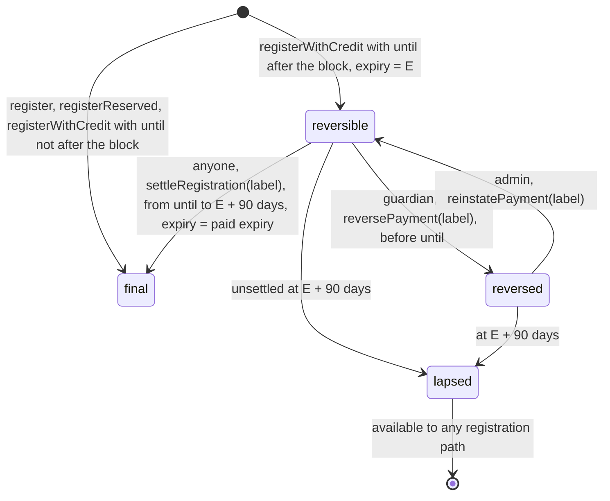
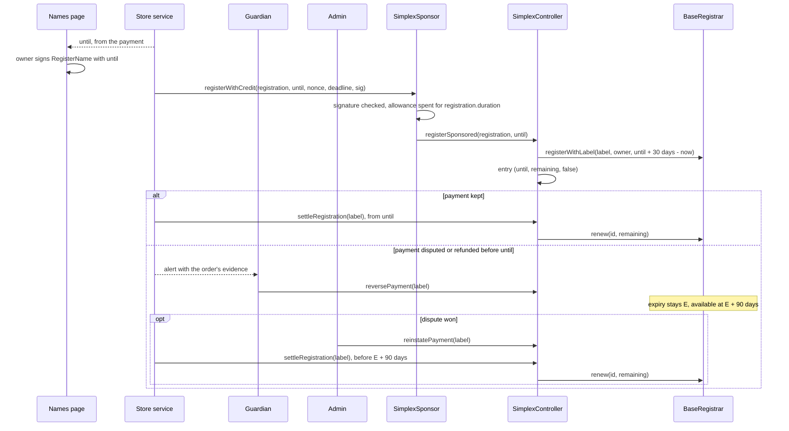
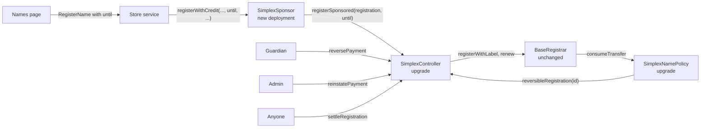

# Reversible payments — contract work plan

Built on `simplex-namespace-contract` @ `c1cca32` and `ens-contracts` @ `1a11cda` (tag `simplex-mainnet-v1`, deployed), stacked on [ens-contracts #49](https://github.com/simplex-network/ens-contracts/pull/49) (`ab/holder-renewal-terms` @ `7ff8c37`) and its deployment, [#18](https://github.com/brenzi/simplex-namespace-contract/pull/18).

## 1. Contents

1. Contents
2. Problem
3. Decisions
4. Registration states
5. Threat model
6. Contract changes
7. Deployment
8. Requirements for the store service
9. Effects outside this repository
10. Tests

## 2. Problem

The store service registers a name with `SimplexSponsor.registerWithCredit` once its payment settles. A card payment can still be disputed or refunded afterwards, usually within 120 days of the payment and longer on some card networks; the price and a dispute fee are withdrawn from the store's balance when a dispute opens ([Stripe](https://docs.stripe.com/disputes/how-disputes-work)).

A registration keeps its whole paid term after its payment is reversed:

- a term is set once, by `registerWithLabel`, and is only extended by `renew` ([`BaseRegistrarImplementation.sol:171`](https://github.com/simplex-network/ens-contracts/blob/1a11cda4be59ae46a13e194d78ffdaac1ca3b0c8/contracts/ethregistrar/BaseRegistrarImplementation.sol#L171), [`:213`](https://github.com/simplex-network/ens-contracts/blob/1a11cda4be59ae46a13e194d78ffdaac1ca3b0c8/contracts/ethregistrar/BaseRegistrarImplementation.sol#L213));
- a held name becomes available 90 days after its expiry ([`:51`](https://github.com/simplex-network/ens-contracts/blob/1a11cda4be59ae46a13e194d78ffdaac1ca3b0c8/contracts/ethregistrar/BaseRegistrarImplementation.sol#L51), [`:134-137`](https://github.com/simplex-network/ens-contracts/blob/1a11cda4be59ae46a13e194d78ffdaac1ca3b0c8/contracts/ethregistrar/BaseRegistrarImplementation.sol#L134-L137));
- a held name moves only to an address its holder approved ([`:72-80`](https://github.com/simplex-network/ens-contracts/blob/1a11cda4be59ae46a13e194d78ffdaac1ca3b0c8/contracts/ethregistrar/BaseRegistrarImplementation.sol#L72-L80), [`:273-281`](https://github.com/simplex-network/ens-contracts/blob/1a11cda4be59ae46a13e194d78ffdaac1ca3b0c8/contracts/ethregistrar/BaseRegistrarImplementation.sol#L273-L281));
- the registrar is immutable.

Example: a two-year registration paid by card is disputed 30 days later. The price and the dispute fee are withdrawn at once, and the holder keeps the name for two years and 90 days.

## 3. Decisions

| # | Decision | Applied |
|---|---|---|
| D0 | Consent to the deadline | the buyer signs `reversibleUntil` in `RegisterName`; pending the owner's answer |
| D1 | Transfers before the deadline | allowed; a claim of a registration whose payment is reversed is refused; pending the owner's answer |
| D2 | Cancellation | the first term ends 30 days after the deadline; the rest of the paid term is added at settlement |
| D3 | Who reverses and who reinstates | the guardian (`beneficiary`) reverses, before the deadline; the admin (`owner`) reinstates |
| D4 | The deadline's form and bound | a timestamp, at most 180 days after the registration; a deadline already passed registers the whole term |
| D5 | Settlement window | `SETTLEMENT_WINDOW`, 30 days between the deadline and the first term's end |
| D6 | Records of a reversed registration | kept on chain; withheld by the names resolver |
| D7 | Renewal of an unsettled registration | refused on both paths until settlement |
| D8 | Settlement of a reserved name | allowed: renewals are stopped by a reservation, and the paid term is kept |
| D9 | Placement | in `SimplexController`, 179 bytes under the size limit |

## 4. Registration states

`until` is the signed deadline; `E = until + SETTLEMENT_WINDOW` is the first term's end.



One entry per reversible registration is stored in the controller:

```
ReversibleRegistration      one slot, keyed by token id, internal
  until       uint64        the signed deadline
  remaining   uint64        the paid term minus the first term
  reversed    bool          set by the guardian, cleared by the admin
```

An entry is in effect while `until != 0` and `base.nameExpires(id) == until + SETTLEMENT_WINDOW`. The expiry is changed by settlement, by every later registration, and by a renewal from another registrar controller that the admin adds, so a stale entry is ignored.

| State | renewal, both paths | claim | `settleRegistration` | `reversePayment` | `reinstatePayment` |
|---|---|---|---|---|---|
| reversible, before `until` | `PaymentReversible` | allowed | `ReversiblePeriodNotEnded` | guardian | `PaymentNotReversed` |
| reversible, `until` to `E` | `PaymentReversible` | allowed | anyone | `ReversiblePeriodEnded` | `PaymentNotReversed` |
| reversible, `E` to `E` + 90 days | `PaymentReversible` | refused by `ownerOf` | anyone | `ReversiblePeriodEnded` | `PaymentNotReversed` |
| reversed, before `E` | `PaymentReversible` | `PaymentReversed` | `PaymentReversed` | `PaymentReversed` | admin |
| reversed, `E` to `E` + 90 days | `PaymentReversible` | refused by `ownerOf` | `PaymentReversed` | `PaymentReversed` | admin |
| final | as #49 | as #49 | `NotReversible` | `NotReversible` | `NotReversible` |

```
registerSponsored(registration, until)              sponsor only
  until <= block.timestamp + MAX_REVERSIBLE_PERIOD  else ReversibleUntilTooLate(until)
  reversible = until > block.timestamp
  term = reversible ? until + SETTLEMENT_WINDOW - block.timestamp : registration.duration
  _registerCore(registration, labelhash, (0, 0), term)
  if reversible:
    _reversibles[id] = (until, registration.duration - term, false)
    emit NamePaymentReversible(label, labelhash, until, block.timestamp + registration.duration)

settleRegistration(label)                           anyone
  entry in effect                                   else NotReversible(label)
  !reversed                                         else PaymentReversed(label)
  block.timestamp >= until                          else ReversiblePeriodNotEnded(label)
  remaining = entry.remaining
  delete _reversibles[id]
  expires = base.renew(id, remaining)               reverts after E + 90 days
  emit NameRegistrationSettled(labelhash, expires)

reversePayment(label)                               beneficiary only
  entry in effect                                   else NotReversible(label)
  !reversed                                         else PaymentReversed(label)
  block.timestamp < until                           else ReversiblePeriodEnded(label)
  reversed = true
  emit NamePaymentReversed(labelhash)

reinstatePayment(label)                             owner only
  entry in effect                                   else NotReversible(label)
  reversed                                          else PaymentNotReversed(label)
  reversed = false
  emit NamePaymentReinstated(labelhash)

reversibleRegistration(id) view                     (until, paid expiry, reversed) of an entry in effect, else zeros

_renewCore(label, ...)                              both renewal paths
  no entry in effect                                else PaymentReversible(label)
  ... as #49

SimplexNamePolicy.consumeTransfer(tokenId, from, to, offer, label)
  !controller.reversibleRegistration(tokenId).reversed       else PaymentReversed(label)
  ... as #49
```

Example after the change: a two-year registration with the deadline on day 180 expires on day 210 until it is settled, and settlement from day 180 extends it to day 730. Disputed on day 30 and reversed, it stays with its holder without renewal or onward claim, and without records from the names resolver, until day 210; it is available on day 300.



## 5. Threat model

| Who | Power after the change | Bound |
|---|---|---|
| a buyer who disputes, or a card thief | holds the name until `E` | no renewal; after the reversal, no claim, no records from the names resolver; available at `E` + 90 days; other on-chain readers show its records until then |
| a third party who claims before the reversal | loses the name at `E` | the deadline is listed before a claim (D1) |
| the guardian | reverses any unsettled reversible registration before its deadline | one hardware wallet until GOV8; kept after `freeze()`; reinstating stays with the admin |
| the admin | reinstates; adds a registrar controller, whose renewal ends an entry | as every admin power, behind the timelock from GOV8 |
| the registrar key | registers with a deadline only when the buyer signed it (D0) | a registration to its own address is unsigned, as today |
| the store service | settles each reversible registration | unsettled for 120 days after `until`, an honest buyer's name lapses; settlement is open to anyone |
| a dispute after the deadline | borne by the store | 180 days from the payment covers Stripe's usual 120 days |

## 6. Contract changes



- **`SimplexSponsor`**, a new deployment: `registerWithCredit(registration, reversibleUntil, nonce, deadline, sig)`; the type becomes `RegisterName(string label,address owner,uint256 duration,address resolver,bytes[] data,uint256 reversibleUntil,uint256 nonce,uint256 deadline)`; the deadline is passed to `registerSponsored`. The allowance spent is the price of `registration.duration`, as now.
- **`SimplexController`**, upgraded in place:
  - `MAX_REVERSIBLE_PERIOD = 180 days`, `SETTLEMENT_WINDOW = 30 days`, `ReversibleRegistration`, and `mapping(uint256 => ReversibleRegistration) internal _reversibles` declared before `__gap`, which shrinks from 43 to 42;
  - `registerSponsored(registration, reversibleUntil)`; `_registerCore` takes the first term, which `register` passes as `registration.duration`;
  - `settleRegistration(string)`, `reversePayment(string)`, `reinstatePayment(string)`, `reversibleRegistration(uint256)`;
  - the entry check in `_renewCore`;
  - events `NamePaymentReversible(string label, bytes32 indexed labelhash, uint256 until, uint256 paidExpires)`, `NamePaymentReversed(bytes32 indexed labelhash)`, `NamePaymentReinstated(bytes32 indexed labelhash)`, `NameRegistrationSettled(bytes32 indexed labelhash, uint256 expires)`;
  - errors `ReversibleUntilTooLate(uint256)`, `NotReversible(string)`, `ReversiblePeriodNotEnded(string)`, `ReversiblePeriodEnded(string)`, `PaymentReversed(string)`, `PaymentNotReversed(string)`, `PaymentReversible(string)`.
- **`SimplexNamePolicy`**, upgraded in place: the check in `consumeTransfer`, and the error `PaymentReversed(string)`. Its storage is unchanged.
- `BaseRegistrarImplementation`, `ENSRegistry`, `SimplexResolver` and `SubnameRegistrar` are unchanged.
- Sizes of a prototype on #49, by solc 0.8.26, optimizer runs 1,000,000, EVM `paris`, against the limit of 24,576 bytes: the controller 24,397 (#49: 21,889), the policy 22,962 (22,652), the sponsor 5,856 (5,840). If a later controller change exceeds the limit, the entries and their four functions are moved into a contract of their own.
- `ens-contracts/docs/upgrades.md`: the new slot and `__gap` 42.

## 7. Deployment

By the recipe of [#18](https://github.com/brenzi/simplex-namespace-contract/pull/18), before the store accepts its first card order for a name (`[names] codes_only = off`):

| # | Caller | Call |
|---|---|---|
| 1 | any funded key | deploy the `SimplexNamePolicy` and `SimplexController` implementations and `SimplexSponsor(controllerProxy)`; verify the three on Etherscan |
| 2 | controller owner | `controller.upgradeToAndCall(controllerImpl, setSponsor(newSponsor))`, one transaction, as the one-argument `registerSponsored` is called by the old sponsor |
| 3 | controller owner | `namePolicy.upgradeTo(policyImpl)` |
| 4 | guardian key | `newSponsor.setRegistrarAllowance(registrar, N)` |
| 5 | controller owner | `namePolicy.setGeneralTerms(link)` and `namePolicy.setCommunityTerms(link)`, when the terms text states the condition; acceptances of the old links are made again |
| 6 | operators | the store service and the names page, with the new sponsor address and `RegisterName` type |

Run together with #18, steps 2 and 3 are swapped, because the #49 controller calls `consumeRenewal` on the policy: holder transfers revert between the two transactions, as `reversibleRegistration` is called on the controller by the new policy.

The upgrade is rehearsed by the script on a fork of mainnet first: the settings read back unchanged, then a sponsored registration with a deadline, a refused renewal, a reversal with a refused claim, a reinstatement and a settlement. Verified on mainnet: `controller.sponsor()` is the new sponsor, whose `controller()` is the proxy; `MAX_REVERSIBLE_PERIOD()` is 15,552,000 and `SETTLEMENT_WINDOW()` 2,592,000.

Rollback: the store service declares no deadline; the policy is rolled back to the #49 implementation; the controller is rolled back once every entry is settled or lapsed.

## 8. Requirements for the store service

- Supply each sponsored registration's deadline for the owner's signature: a card payment, its time plus 180 days; crypto and prepaid codes, 0; a balance, the deadline of the money it holds; an in-app payment, when added for names, the end of its store's refund window.
- Send `settleRegistration(label)` for each reversible registration from `until`, and alert the operators when one is unsettled 7 days after `until`.
- Show the paid expiry and the date the registration becomes final.
- Read Stripe's `charge.dispute.created`, `charge.dispute.funds_reinstated`, `charge.dispute.closed`, `charge.refunded` and `radar.early_fraud_warning.created` for registered orders, and alert the operators with the order's payment, signed order and registration transaction; the guardian reverses, the admin reinstates.
- Relay no record edit, offer or claim of a registration whose payment is reversed, and show it as reversed in search.

## 9. Effects outside this repository

- simplex-chat, branch `names`: the store service's `RegisterName` digest and calldata ([`Names/Registration.hs:119-141`](https://github.com/simplex-chat/simplex-chat/blob/0410929c9d1659312fa41ee69127796454379eef/apps/simplex-store-service/src/StoreService/Names/Registration.hs#L119-L141)), its Stripe events ([`Providers/Stripe.hs:104`](https://github.com/simplex-chat/simplex-chat/blob/0410929c9d1659312fa41ee69127796454379eef/apps/simplex-store-service/src/StoreService/Providers/Stripe.hs#L104)), a settlement lane, and `docs/protocol/names-overview.md`, whose non-custodial property ([`:189`](https://github.com/simplex-chat/simplex-chat/blob/0410929c9d1659312fa41ee69127796454379eef/docs/protocol/names-overview.md#L189)) is amended by the deadline.
- simplex-chat app: the import of an owner code is an offer and a claim ([plan, §3](https://github.com/simplex-chat/simplex-chat/blob/0410929c9d1659312fa41ee69127796454379eef/plans/2026-10-12-names-sponsored-registration.md#L44)); before a claim, the app lists the deadline of an unsettled registration.
- simplex.domains: `RegisterName` with `reversibleUntil` ([`crypto/registration.ts:61`](https://github.com/simplex-chat/simplex.domains/blob/c33ba147c58702d54c99cf27415502f50727daee/webapp/src/crypto/registration.ts#L61)), shown to the buyer before signing; "Registered until" with the paid expiry and the final date ([`views/order.ts:1270-1272`](https://github.com/simplex-chat/simplex.domains/blob/c33ba147c58702d54c99cf27415502f50727daee/webapp/src/views/order.ts#L1270-L1272)); the terms text.
- simplexmq resolver: the paid expiry and the deadline of an unsettled registration; a reversed registration and its subnames answered without records, in `registration()` and `resolve()` ([`snrc-resolve.py:1180-1260`](https://github.com/simplex-chat/simplexmq/blob/9c4a814fdab9f7350b5f259bb5afe5145b5bd383/scripts/resolver/service/snrc-resolve.py#L1180-L1260)).
- simplex-domains-app-v3: Extend of an unsettled registration reverts `PaymentReversible`; the claim review lists the deadline.
- This repository: `docs/plans/names-v2-launch-to-freeze-plan.md` §4 and §5, `docs/security.md` (new privileged surface; the invariant reads "before its registration expires, `until` + 30 days for an unsettled reversible registration"), `CLAUDE.md` (admin capabilities), and the deployment script of #18.

## 10. Tests

`ens-contracts/test/simplex/TestReversiblePayment.test.ts`:

- a sponsored registration with a deadline expires 30 days after it, on the bare and the resolver path, and emits `NamePaymentReversible` with the paid expiry; with a deadline not after the block it expires at the paid term's end; a deadline more than 180 days ahead reverts; the allowance spent is the paid term's price;
- `RegisterName` with another `reversibleUntil` reverts `InvalidSignature`; the type hash is pinned;
- `settleRegistration` reverts before `until`, extends the expiry to the paid term's end from `until` to `E` + 90 days, reverts after, reverts a second time, and settles a reserved name;
- renewal on both paths reverts `PaymentReversible` before settlement and works after it;
- `reversePayment` refuses a claim and settlement, and the name lapses at `E` and is available 90 days later; it reverts for the admin, the registrar, the holder and anyone else, from `until`, and for a final registration;
- `reinstatePayment` lets settlement extend the term; it reverts for the guardian and anyone but the admin;
- an offer and a claim before the reversal succeed, also between `until` and `E`, and the guardian's reversal then applies to the new holder; subnames keep their owner between `until` and `E`;
- a community name with a deadline;
- a re-registration of a lapsed name, through `registerWithCredit` and through `registerReserved`, and a renewal by an added registrar controller, leave the stale entry without effect;
- the upgrade order: transfers and renewals across each step, and the rollback of the policy;
- `TestControllerStorageLayout`: the new slot right after `namePolicy` and `__gap` 42;
- an upgrade of a proxy populated by the #49 implementation keeps every value;
- each new guard, removed, fails at least one test.
