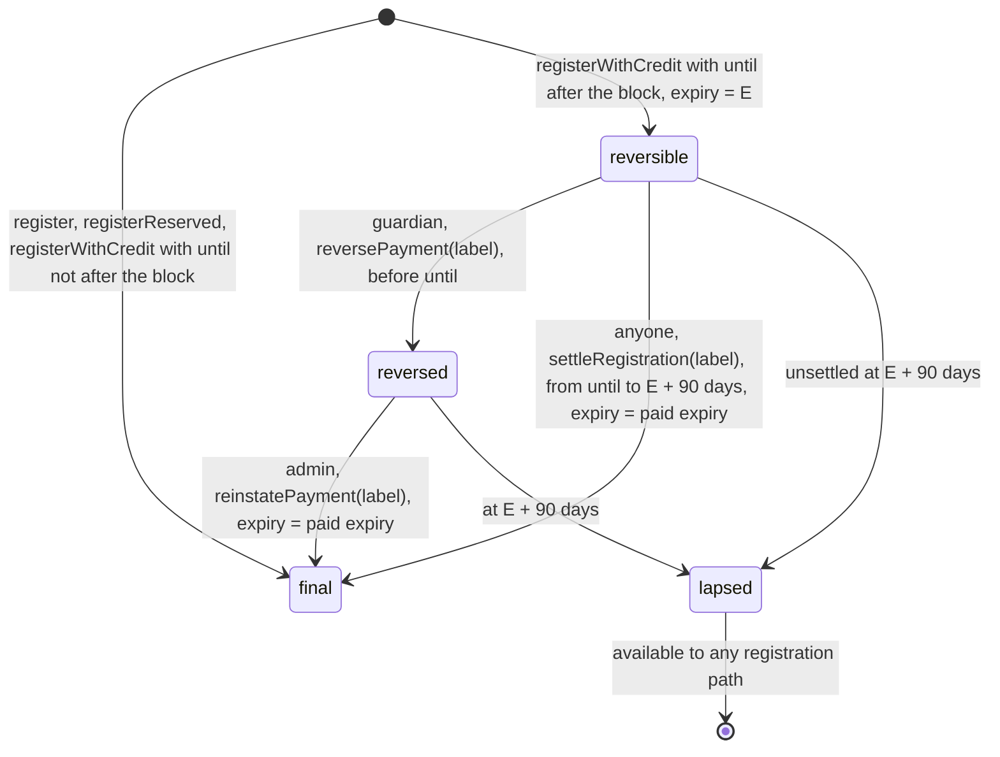
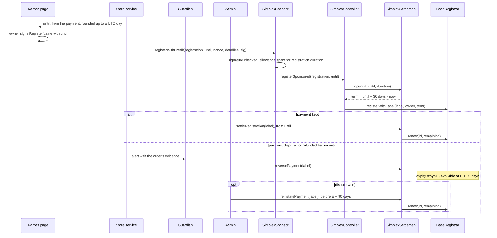
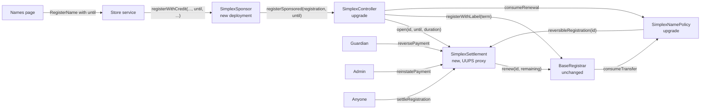
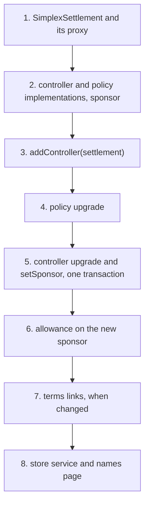

# Reversible payments — contract work plan

Built on `simplex-namespace-contract` @ `c1cca32` and `ens-contracts` @ `1a11cda` (tag `simplex-mainnet-v1`, deployed), stacked on [ens-contracts #49](https://github.com/simplex-network/ens-contracts/pull/49) (`ab/holder-renewal-terms` @ `7ff8c37`) and its deployment, [#18](https://github.com/brenzi/simplex-namespace-contract/pull/18).

## 1. Contents

1. Contents
2. Problem
3. Decisions
4. Registration states
5. Threat model
6. Contract changes
7. Deployment
8. Requirements for the store service
9. Effects outside this repository
10. Tests

## 2. Problem

The store service registers a name with `SimplexSponsor.registerWithCredit` once its payment settles. A card payment can still be disputed or refunded afterwards, usually within 120 days of the payment and longer on some card networks; the price and a dispute fee are withdrawn from the store's balance when a dispute opens ([Stripe](https://docs.stripe.com/disputes/how-disputes-work)).

A registration keeps its whole paid term after its payment is reversed:

- a term is set once, by `registerWithLabel`, and is only extended by `renew` ([`BaseRegistrarImplementation.sol:171`](https://github.com/simplex-network/ens-contracts/blob/1a11cda4be59ae46a13e194d78ffdaac1ca3b0c8/contracts/ethregistrar/BaseRegistrarImplementation.sol#L171), [`:213`](https://github.com/simplex-network/ens-contracts/blob/1a11cda4be59ae46a13e194d78ffdaac1ca3b0c8/contracts/ethregistrar/BaseRegistrarImplementation.sol#L213));
- a held name becomes available 90 days after its expiry ([`:51`](https://github.com/simplex-network/ens-contracts/blob/1a11cda4be59ae46a13e194d78ffdaac1ca3b0c8/contracts/ethregistrar/BaseRegistrarImplementation.sol#L51), [`:134-137`](https://github.com/simplex-network/ens-contracts/blob/1a11cda4be59ae46a13e194d78ffdaac1ca3b0c8/contracts/ethregistrar/BaseRegistrarImplementation.sol#L134-L137));
- a held name moves only to an address its holder approved ([`:72-80`](https://github.com/simplex-network/ens-contracts/blob/1a11cda4be59ae46a13e194d78ffdaac1ca3b0c8/contracts/ethregistrar/BaseRegistrarImplementation.sol#L72-L80), [`:273-281`](https://github.com/simplex-network/ens-contracts/blob/1a11cda4be59ae46a13e194d78ffdaac1ca3b0c8/contracts/ethregistrar/BaseRegistrarImplementation.sol#L273-L281));
- the registrar is immutable.

Example: a two-year registration paid by card is disputed 30 days later. The price and the dispute fee are withdrawn at once, and the holder keeps the name for two years and 90 days.

## 3. Decisions

| # | Decision | Applied | Status |
|---|---|---|---|
| D0 | Consent to the deadline | the buyer signs `reversibleUntil` in `RegisterName` | pending the owner |
| D1 | Transfers before the deadline | allowed; a claim of a reversed registration is refused; a claim of an unsettled one needs the recipient's acknowledgement in the app and the dApp | the owner, 18 Nov |
| D2 | Cancellation | the first term ends 30 days after the deadline; the rest of the paid term is added at settlement; the paid expiry is shown to people | the owner, 18 Nov |
| D3 | What is public on chain | the deadline of a card payment and each reversal; the store rounds the deadline up to a whole UTC day | pending the owner |
| D4 | Records of a reversed registration | kept on chain; withheld by the names resolver | pending the owner |
| D5 | Who reverses and who reinstates | the guardian (`beneficiary`) reverses, before the deadline; the admin (`owner`) reinstates, which settles at once | decided |
| D6 | The deadline's form and bound | a signed timestamp rather than the number of days, as it follows the payment's time; at most 180 days after the registration; a deadline already passed registers the whole term | decided |
| D7 | Settlement window | 30 days between the deadline and the first term's end, stored in each entry | decided |
| D8 | Renewal of an unsettled registration | refused on both paths until settlement | decided |
| D9 | Settlement of a reserved name | allowed: renewals are stopped by a reservation, and the paid term is kept | decided |
| D10 | Placement | a new contract, `SimplexSettlement`, behind a UUPS proxy, a registrar controller | decided |
| D11 | Who settles | anyone: the store service, a script in this repository, and the dApp's Settle action | decided |

## 4. Registration states

`until` is the signed deadline; `E`, stored in the entry, is the first term's end, `until + 30 days`.



One entry per reversible registration is stored in `SimplexSettlement`:

```
Entry                       one slot, keyed by token id
  until        uint64       the signed deadline
  firstExpiry  uint64       E, the first term's end
  remaining    uint64       the paid term minus the first term
  reversed     bool         set by the guardian
```

An entry is in effect while `until != 0` and `registrar.nameExpires(id) == firstExpiry`. The expiry is changed by settlement, by reinstatement, by every later registration, and by a renewal from another registrar controller that the admin adds, so a stale entry is ignored.

| State | renewal, both paths | claim | `settleRegistration` | `reversePayment` | `reinstatePayment` |
|---|---|---|---|---|---|
| reversible, before `until` | `RegistrationNotSettled` | with the recipient's acknowledgement | `ReversiblePeriodNotEnded` | guardian | `PaymentNotReversed` |
| reversible, `until` to `E` | `RegistrationNotSettled` | with the recipient's acknowledgement | anyone | `ReversiblePeriodEnded` | `PaymentNotReversed` |
| reversible, `E` to `E` + 90 days | `RegistrationNotSettled` | refused by `ownerOf` | anyone | `ReversiblePeriodEnded` | `PaymentNotReversed` |
| reversed, before `E` | `RegistrationNotSettled` | `PaymentReversed` | `PaymentReversed` | `PaymentReversed` | admin |
| reversed, `E` to `E` + 90 days | `RegistrationNotSettled` | refused by `ownerOf` | `PaymentReversed` | `PaymentReversed` | admin |
| final | as #49 | as #49 | `NotReversible` | `NotReversible` | `NotReversible` |

```
SimplexController.registerSponsored(registration, until)       sponsor only
  ... as #49
  term = settlement.open(id, until, registration.duration)
  _registerCore(registration, labelhash, (0, 0), term)

SimplexSettlement.open(id, until, duration)                    controller only
  until <= block.timestamp: return duration
  until <= block.timestamp + MAX_REVERSIBLE_PERIOD             else ReversibleUntilTooLate(until)
  term = until + SETTLEMENT_WINDOW - block.timestamp
  entries[id] = (until, block.timestamp + term, duration - term, false)
  emit NamePaymentReversible(labelhash, until, block.timestamp + duration)
  return term

settleRegistration(label)                                      anyone
  entry in effect                                              else NotReversible(label)
  !reversed                                                    else PaymentReversed(label)
  block.timestamp >= until                                     else ReversiblePeriodNotEnded(label)
  _settle(id, remaining)

reversePayment(label)                                          controller.beneficiary() only
  entry in effect                                              else NotReversible(label)
  !reversed                                                    else PaymentReversed(label)
  block.timestamp < until                                      else ReversiblePeriodEnded(label)
  reversed = true
  emit NamePaymentReversed(labelhash)

reinstatePayment(label)                                        controller.owner() only
  entry in effect                                              else NotReversible(label)
  reversed                                                     else PaymentNotReversed(label)
  _settle(id, remaining)

_settle(id, remaining)
  delete entries[id]
  emit NameRegistrationSettled(labelhash, registrar.renew(id, remaining))      reverts after E + 90 days

reversibleRegistration(id) view
  entry in effect: (until, firstExpiry + remaining, reversed)
  else: (0, 0, false)

SimplexNamePolicy.consumeRenewal(label, labelhash, duration, holder)
  settlement.reversibleRegistration(id).until == 0             else RegistrationNotSettled(label)
  ... as #49

SimplexNamePolicy.consumeTransfer(tokenId, from, to, offer, label)
  !settlement.reversibleRegistration(tokenId).reversed         else PaymentReversed(label)
  ... as #49
```

Example after the change: a two-year registration with the deadline on day 180 expires on day 210 until it is settled, and is extended to day 730 by settlement from day 180. Disputed on day 30 and reversed, it stays with its holder until day 210, without renewal, onward claim or records from the names resolver; it is available on day 300.



## 5. Threat model

| Who | Power after the change | Bound |
|---|---|---|
| a buyer who disputes, or a card thief | holds the name until `E` | no renewal; after the reversal, no claim and no records from the names resolver; available at `E` + 90 days; other on-chain readers show its records until then |
| a third party who claims before the reversal | loses the name at `E` | the recipient acknowledges the deadline before a claim (D1) |
| the guardian | reverses any unsettled reversible registration before its deadline | one hardware wallet until GOV8, and the admin's key while it is the guardian too; kept after `freeze()`; a reinstatement settles the registration, so it cannot be reversed again |
| the admin | reinstates; upgrades `SimplexSettlement` until `freeze()`; adds a registrar controller, whose renewal ends an entry | as every admin power, behind the timelock from GOV8 |
| `SimplexSettlement` | a registrar controller: registers and renews in its code's bounds | the same trust as the name policy, which is a registrar controller behind a UUPS proxy too |
| the registrar key | registers with a deadline only when the buyer signed it (D0) | a registration to its own address is unsigned, as today |
| the store service | settles each reversible registration | unsettled for 120 days after `until`, an honest buyer's name lapses; settlement is open to anyone (D11) |
| an observer of the chain | learns which names were paid by card, the day of each payment, and each reversal (D3) | crypto and code orders carry no deadline |
| a dispute opened shortly before the deadline | the reversal is mined before `until`, else the loss is the store's | the store alerts at once; a dispute won after `E` + 90 days is settled by the admin with `addReservedNames` and `registerReserved` |
| a dispute after the deadline | borne by the store | a deadline 180 days after the payment exceeds Stripe's usual 120 days, also from `term_start` (2027-01-01) for payments made from 18 Nov 2026 |

## 6. Contract changes



- **`SimplexSettlement`**, new, behind an ERC-1967 proxy:
  - immutables `controller` and `registrar`; constants `MAX_REVERSIBLE_PERIOD = 180 days` and `SETTLEMENT_WINDOW = 30 days`;
  - storage `mapping(uint256 => Entry) private _entries`, then `uint256[49] __gap`;
  - functions `open`, `settleRegistration(string)`, `reversePayment(string)`, `reinstatePayment(string)`, `reversibleRegistration(uint256)`;
  - `_authorizeUpgrade`: the controller's owner, refused once the controller is frozen, and for an implementation built for another controller or registrar, as in the name policy;
  - events:
    - `NamePaymentReversible(bytes32 indexed labelhash, uint256 until, uint256 paidExpires)`;
    - `NamePaymentReversed(bytes32 indexed labelhash)`;
    - `NameRegistrationSettled(bytes32 indexed labelhash, uint256 expires)`;
  - errors:
    - `ReversibleUntilTooLate(uint256)`;
    - `NotReversible(string)`;
    - `ReversiblePeriodNotEnded(string)`;
    - `ReversiblePeriodEnded(string)`;
    - `PaymentReversed(string)`;
    - `PaymentNotReversed(string)`.
- **`SimplexController`**, upgraded in place:
  - the implementation's immutable `settlement`, set in its constructor; storage unchanged;
  - `registerSponsored(registration, reversibleUntil)`;
  - `_registerCore` takes the first term, which `register` passes as `registration.duration`.
- **`SimplexNamePolicy`**, upgraded in place:
  - the implementation's immutable `settlement`; storage unchanged;
  - the checks in `consumeRenewal` and `consumeTransfer`;
  - errors `PaymentReversed(string)` and `RegistrationNotSettled(string)`.
- **`SimplexSponsor`**, a new deployment:
  - `registerWithCredit(registration, reversibleUntil, nonce, deadline, sig)`;
  - the type `RegisterName(string label,address owner,uint256 duration,address resolver,bytes[] data,uint256 reversibleUntil,uint256 nonce,uint256 deadline)`;
  - the deadline passed to `registerSponsored`; the allowance spent for `registration.duration`, as now.
- `BaseRegistrarImplementation`, `ENSRegistry`, `SimplexResolver` and `SubnameRegistrar` are unchanged.
- `ens-contracts/docs/upgrades.md`: `SimplexSettlement`'s layout; the invariant `MAX_REVERSIBLE_PERIOD + SETTLEMENT_WINDOW < MIN_REGISTRATION`.

Sizes of a prototype on #49, by solc 0.8.26, optimizer runs 1,000,000, EVM `paris`, against the limit of 24,576 bytes:

| Contract | #49 | Prototype | Headroom |
|---|---|---|---|
| `SimplexController` | 21,889 | 22,222 | 2,354 |
| `SimplexNamePolicy` | 22,652 | 23,269 | 1,307 |
| `SimplexSponsor` | 5,840 | 5,856 | 18,720 |
| `SimplexSettlement` | — | 8,105 | 16,471 |

## 7. Deployment

By the recipe of [#18](https://github.com/brenzi/simplex-namespace-contract/pull/18), before the store accepts its first card order for a name (`[names] codes_only = off`):

| # | Caller | Call |
|---|---|---|
| 1 | any funded key | deploy `SimplexSettlement(controllerProxy, registrar)` and its proxy |
| 2 | any funded key | deploy the `SimplexController` and `SimplexNamePolicy` implementations with the settlement proxy, and `SimplexSponsor(controllerProxy)`; verify the five on Etherscan |
| 3 | registrar owner | `registrar.addController(settlementProxy)` |
| 4 | controller owner | `namePolicy.upgradeTo(policyImpl)` |
| 5 | controller owner | `controller.upgradeToAndCall(controllerImpl, setSponsor(newSponsor))`, one transaction, as the one-argument `registerSponsored` is called by the old sponsor |
| 6 | guardian key | `newSponsor.setRegistrarAllowance(registrar, N)` |
| 7 | controller owner | `namePolicy.setGeneralTerms(link)` and `namePolicy.setCommunityTerms(link)`, when the terms text states the condition; acceptances of the old links are made again |
| 8 | operators | the store service and the names page, with the new sponsor address and `RegisterName` type |



The order holds with #18 in the same run or before it: the #49 controller calls `consumeRenewal` on the policy, and the new policy and controller call only `SimplexSettlement`, so neither upgrade depends on the other.

The upgrade is rehearsed by the script on a fork of mainnet first: the settings read back unchanged, then a sponsored registration with a deadline, a refused renewal, a reversal with a refused claim, a reinstatement and a settlement. Verified on mainnet:

- `controller.sponsor()` is the new sponsor, whose `controller()` is the proxy;
- `controller.settlement()` and `namePolicy.settlement()` are the settlement proxy;
- `registrar.controllers(settlementProxy)` is true;
- `MAX_REVERSIBLE_PERIOD()` is 15,552,000 and `SETTLEMENT_WINDOW()` 2,592,000.

Rollback:

1. the store service supplies no deadline;
2. the policy is upgraded back to the #49 implementation;
3. a sponsor of the #49 interface is deployed, and the controller is rolled back by `upgradeToAndCall(#49 implementation, setSponsor(that sponsor))`;
4. `SimplexSettlement` stays a registrar controller until every entry is settled or lapsed, at most 300 days after the last reversible registration; renewals and claims are unchecked meanwhile.

The snapshot-and-redeploy fallback of the launch-to-freeze plan, §7: a reversed name is reserved and not re-minted, as a disputed name past its expiry; an unsettled name is re-minted for its paid term.

## 8. Requirements for the store service

- Supply each sponsored registration's deadline for the owner's signature, rounded up to a whole UTC day:
  - a card payment: its time plus 180 days;
  - an in-app payment, when added for names: its time plus 180 days;
  - a balance: the deadline of the money it holds;
  - crypto and prepaid codes: 0.
- Send `settleRegistration(label)` for each reversible registration from `until`, and alert the operators when one is unsettled 7 days after `until`.
- Show the paid expiry and the date the registration becomes final, in place of the expiry on chain.
- Read Stripe's `charge.dispute.created`, `charge.dispute.funds_reinstated`, `charge.dispute.closed`, `charge.refunded` and `radar.early_fraud_warning.created` for registered orders; alert the operators at once with the order's payment, signed order and registration transaction, marked urgent within 14 days of `until`; the guardian reverses, the admin reinstates.
- Relay no record edit, offer or claim of a reversed registration, and show it as reversed in search.

## 9. Effects outside this repository

- simplex-chat, branch `names`:
  - the store service's `RegisterName` digest and calldata ([`Names/Registration.hs:119-141`](https://github.com/simplex-chat/simplex-chat/blob/0410929c9d1659312fa41ee69127796454379eef/apps/simplex-store-service/src/StoreService/Names/Registration.hs#L119-L141));
  - its Stripe events ([`Providers/Stripe.hs:104`](https://github.com/simplex-chat/simplex-chat/blob/0410929c9d1659312fa41ee69127796454379eef/apps/simplex-store-service/src/StoreService/Providers/Stripe.hs#L104));
  - a settlement lane;
  - `docs/protocol/names-overview.md`: the non-custodial objective ([`:189`](https://github.com/simplex-chat/simplex-chat/blob/0410929c9d1659312fa41ee69127796454379eef/docs/protocol/names-overview.md#L189)) gains the deadline, and, with D4, the objective against infrastructure censorship ([`:190`](https://github.com/simplex-chat/simplex-chat/blob/0410929c9d1659312fa41ee69127796454379eef/docs/protocol/names-overview.md#L190)) gains the withheld records.
- simplex-chat app: the import of an owner code is an offer and a claim ([plan, §3](https://github.com/simplex-chat/simplex-chat/blob/0410929c9d1659312fa41ee69127796454379eef/plans/2026-10-12-names-sponsored-registration.md#L44)); before a claim of an unsettled registration, the recipient acknowledges its deadline.
- simplex.domains:
  - `RegisterName` with `reversibleUntil` ([`crypto/registration.ts:61`](https://github.com/simplex-chat/simplex.domains/blob/c33ba147c58702d54c99cf27415502f50727daee/webapp/src/crypto/registration.ts#L61)), shown to the buyer before signing;
  - "Registered until" with the paid expiry and the final date ([`views/order.ts:1270-1272`](https://github.com/simplex-chat/simplex.domains/blob/c33ba147c58702d54c99cf27415502f50727daee/webapp/src/views/order.ts#L1270-L1272));
  - the terms text.
- simplexmq:
  - the resolver answers the paid expiry and the deadline of an unsettled registration, and, with D4, a reversed registration and its subnames without records, in `registration()` and `resolve()` ([`snrc-resolve.py:1180-1260`](https://github.com/simplex-chat/simplexmq/blob/9c4a814fdab9f7350b5f259bb5afe5145b5bd383/scripts/resolver/service/snrc-resolve.py#L1180-L1260));
  - the SMP protocol's `NameRegistration` gains those fields under a new protocol version.
- simplex-domains-app-v3:
  - the paid expiry and the final date;
  - a Settle action;
  - Extend of an unsettled registration reverts `RegistrationNotSettled`;
  - the claim review lists the deadline and asks for an acknowledgement.
- This repository:
  - `scripts/settle-due.mjs`: settles every due entry from the `NamePaymentReversible` events, with any funded key;
  - `docs/plans/names-v2-launch-to-freeze-plan.md` §4, §5 and §7;
  - `docs/security.md`: the new privileged surface, and the invariant "before its registration expires, `E` for an unsettled reversible registration";
  - `CLAUDE.md`: admin capabilities;
  - the deployment script of #18.

## 10. Tests

`ens-contracts/test/simplex/TestReversiblePayment.test.ts`:

- registration:
  - a deadline expires the name 30 days after it, on the bare and the resolver path, and emits `NamePaymentReversible` with the paid expiry;
  - a deadline not after the block registers the whole term;
  - a deadline more than 180 days ahead reverts;
  - the allowance spent is the paid term's price;
  - `RegisterName` with another `reversibleUntil` reverts `InvalidSignature`; the type hash is pinned;
  - a community name with a deadline.
- settlement:
  - reverts before `until`, and is allowed at `block.timestamp == until`;
  - extends the expiry to the paid term's end from `until` to `E` + 90 days, and reverts after;
  - reverts a second time;
  - settles a reserved name;
  - during the grace period, restores the subnames' owner.
- renewal on both paths reverts `RegistrationNotSettled` before settlement and works after it.
- reversal:
  - refuses a claim and settlement; the name lapses at `E` and is available 90 days later;
  - reverts at `block.timestamp == until`, for the admin, the registrar, the holder, anyone else, and for a final registration.
- reinstatement:
  - extends the term at once and ends the entry, so a second reversal reverts `NotReversible`;
  - reverts for the guardian and anyone but the admin.
- transfers:
  - `transferFrom`, both `safeTransferFrom` overloads and `claimWithSig` revert `PaymentReversed` after a reversal;
  - `approve` and `approveWithSig` still work;
  - an offer and a claim before the reversal succeed, also between `until` and `E`, and the reversal then applies to the new holder;
  - subnames keep their owner between `until` and `E`.
- stale entries: a re-registration of a lapsed name, through `registerWithCredit` and through `registerReserved`, and a renewal by an added registrar controller, leave the entry without effect.
- upgrades:
  - `SimplexSettlement`: only the controller's owner, never once frozen, never to an implementation for another controller or registrar; an upgrade keeps the entries;
  - the deployment order and the rollback, with transfers and renewals across each step;
  - an upgrade of proxies populated by the #49 implementations keeps every value;
  - the invariant `MAX_REVERSIBLE_PERIOD + SETTLEMENT_WINDOW < MIN_REGISTRATION`.
- each new guard, removed, fails at least one test.
