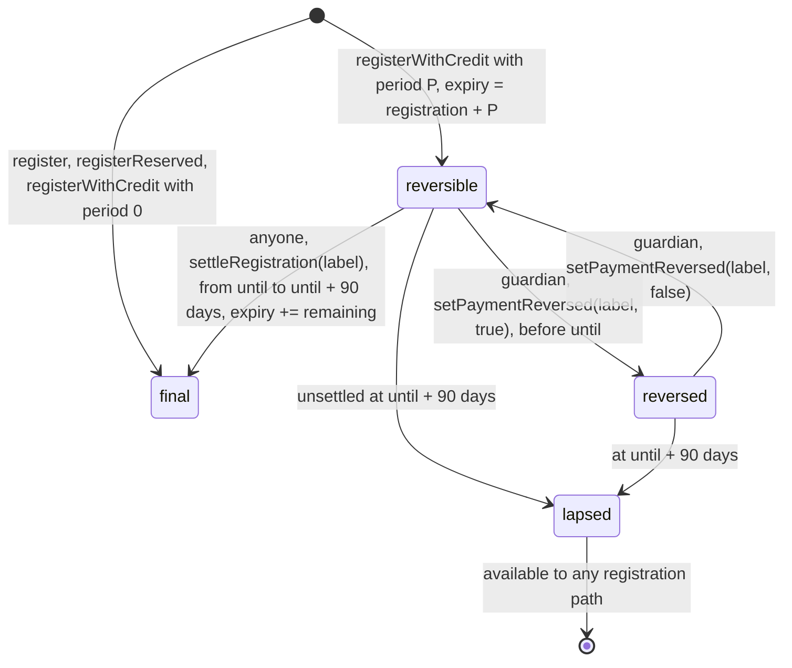
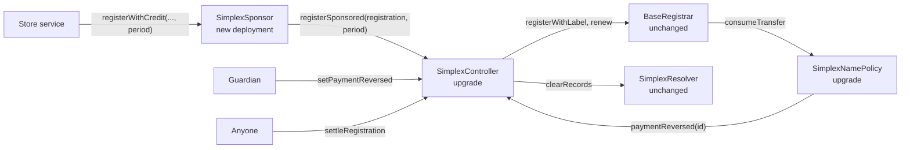

# Reversible payments — contract work plan

Built on `simplex-namespace-contract` @ `c1cca32` and `ens-contracts` @ `1a11cda` (tag `simplex-mainnet-v1`, deployed), stacked on [ens-contracts #49](https://github.com/simplex-network/ens-contracts/pull/49) (`ab/holder-renewal-terms` @ `7ff8c37`) and its deployment, [#18](https://github.com/brenzi/simplex-namespace-contract/pull/18).

## 1. Contents

1. Contents
2. Problem
3. Decisions
4. Registration states
5. Contract changes
6. Deployment
7. Requirements handed to the store service
8. Effects outside this repository
9. Tests

## 2. Problem

The store service registers a name with `SimplexSponsor.registerWithCredit` once its payment settles. A card payment can still be disputed or refunded afterwards, usually within 120 days of the payment and longer on some card networks; the price and a dispute fee are withdrawn from the store's balance when a dispute opens ([Stripe](https://docs.stripe.com/disputes/how-disputes-work)).

A registration keeps its whole paid term after its payment is reversed:

- the term is set once, by `registerWithLabel`, and `renew` only adds to it ([`BaseRegistrarImplementation.sol:171`](https://github.com/simplex-network/ens-contracts/blob/1a11cda4be59ae46a13e194d78ffdaac1ca3b0c8/contracts/ethregistrar/BaseRegistrarImplementation.sol#L171), [`:213`](https://github.com/simplex-network/ens-contracts/blob/1a11cda4be59ae46a13e194d78ffdaac1ca3b0c8/contracts/ethregistrar/BaseRegistrarImplementation.sol#L213));
- a held name becomes available 90 days after its expiry ([`:51`](https://github.com/simplex-network/ens-contracts/blob/1a11cda4be59ae46a13e194d78ffdaac1ca3b0c8/contracts/ethregistrar/BaseRegistrarImplementation.sol#L51), [`:134-137`](https://github.com/simplex-network/ens-contracts/blob/1a11cda4be59ae46a13e194d78ffdaac1ca3b0c8/contracts/ethregistrar/BaseRegistrarImplementation.sol#L134-L137));
- a held name moves only to an address its holder approved ([`:72-80`](https://github.com/simplex-network/ens-contracts/blob/1a11cda4be59ae46a13e194d78ffdaac1ca3b0c8/contracts/ethregistrar/BaseRegistrarImplementation.sol#L72-L80), [`:273-281`](https://github.com/simplex-network/ens-contracts/blob/1a11cda4be59ae46a13e194d78ffdaac1ca3b0c8/contracts/ethregistrar/BaseRegistrarImplementation.sol#L273-L281));
- the registrar is immutable.

Example: a two-year registration paid by card is disputed 30 days later. The price and the dispute fee are withdrawn at once, and the holder keeps the name for two years and 90 days.

## 3. Decisions

| # | Decision | Applied |
|---|---|---|
| D1 | Transfers during the reversible period | allowed; a claim of a registration whose payment is reversed is refused. Pending the user's answer. |
| D2 | Cancellation | the first term of a reversible registration is its reversible period; the rest of the paid term is added at settlement |
| D3 | Who marks a payment reversed | the guardian, the controller's `beneficiary` |
| D4 | The period's unit and bound | seconds, as every duration in these contracts; at most `MAX_REVERSIBLE_PERIOD`, 180 days |
| D5 | Who declares the period | the registrar, in `registerWithCredit`; the general terms state the condition, and `RegisterName` is unchanged |
| D6 | A reinstated payment | the guardian clears the mark, and settlement proceeds |
| D7 | Records of a reversed registration | cleared on the default resolver when the payment is marked reversed |

## 4. Registration states



One entry per reversible registration is stored in the controller:

```
ReversibleRegistration      one slot, keyed by token id
  until       uint64        the first term's end
  remaining   uint64        the paid term minus the period
  reversed    bool          set by the guardian
```

An entry is live while `base.nameExpires(id) == until`. The expiry is changed by settlement and by every later registration, through any path, so a stale entry is ignored.

| State | renewal, both paths | claim | `settleRegistration` | `setPaymentReversed(true)` | `setPaymentReversed(false)` |
|---|---|---|---|---|---|
| reversible, before `until` | `PaymentReversible` | allowed | `ReversiblePeriodNotEnded` | guardian | `PaymentNotReversed` |
| reversible, `until` to `until` + 90 days | `PaymentReversible` | refused by `ownerOf` | anyone | `ReversiblePeriodEnded` | `PaymentNotReversed` |
| reversed, before `until` | `PaymentReversible` | `PaymentReversed` | `PaymentReversed` | `PaymentReversed` | guardian |
| reversed, `until` to `until` + 90 days | `PaymentReversible` | refused by `ownerOf` | `PaymentReversed` | `PaymentReversed` | guardian |
| final | as #49 | as #49 | `NotReversible` | `NotReversible` | `NotReversible` |

```
registerSponsored(registration, period)             sponsor only
  period <= MAX_REVERSIBLE_PERIOD                   else ReversiblePeriodTooLong(period)
  term = period == 0 ? registration.duration : period
  expires = _registerCore(registration, labelhash, (0, 0), term)
  if period > 0:
    reversibleRegistrations[id] = (expires, registration.duration - period, false)
    emit NamePaymentReversible(label, labelhash, expires, expires + registration.duration - period)

settleRegistration(label)                           anyone
  r = live entry of label                           else NotReversible(label)
  !r.reversed                                       else PaymentReversed(label)
  block.timestamp >= r.until                        else ReversiblePeriodNotEnded(label)
  delete reversibleRegistrations[id]
  expires = base.renew(id, r.remaining)             reverts after until + 90 days
  emit NameRegistrationSettled(labelhash, expires)

setPaymentReversed(label, reversed)                 beneficiary only
  r = live entry of label                           else NotReversible(label)
  reversed:
    !r.reversed                                     else PaymentReversed(label)
    block.timestamp < r.until                       else ReversiblePeriodEnded(label)
    _retireStaleRecords(namehash)
  !reversed:
    r.reversed                                      else PaymentNotReversed(label)
  r.reversed = reversed
  emit NamePaymentReversed(labelhash, reversed)

_renewCore(label, ...)                              both renewal paths
  no live entry of label                            else PaymentReversible(label)
  ... as #49

paymentReversed(id) view                            read by the name policy
  live entry of id and its reversed

SimplexNamePolicy.consumeTransfer(tokenId, from, to, offer, label)
  !controller.paymentReversed(tokenId)              else PaymentReversed(label)
  ... as #49
```

```mermaid
sequenceDiagram
  participant S as Store service
  participant G as Guardian
  participant Sp as SimplexSponsor
  participant C as SimplexController
  participant R as BaseRegistrar
  participant Rs as Default resolver
  S->>Sp: registerWithCredit(registration, nonce, deadline, sig, period)
  Sp->>Sp: allowance spent for registration.duration
  Sp->>C: registerSponsored(registration, period)
  C->>R: registerWithLabel(label, owner, period)
  C->>C: entry (until, remaining, false)
  alt payment kept
    S->>C: settleRegistration(label), after until
    C->>R: renew(id, remaining)
  else payment disputed or refunded before until
    S-->>G: alert with the order's evidence
    G->>C: setPaymentReversed(label, true)
    C->>Rs: clearRecords(namehash)
    Note over R: expiry stays until; available at until + 90 days
    opt dispute won
      G->>C: setPaymentReversed(label, false)
      S->>C: settleRegistration(label), from until to until + 90 days
      C->>R: renew(id, remaining)
    end
  end
```

## 5. Contract changes



- **`SimplexSponsor`**, a new deployment: `registerWithCredit(registration, nonce, deadline, sig, reversiblePeriod)` passes the period to `registerSponsored`. The allowance spent is the price of `registration.duration`, as now.
- **`SimplexController`**, upgraded in place:
  - `MAX_REVERSIBLE_PERIOD = 180 days`, `ReversibleRegistration`, and `mapping(uint256 => ReversibleRegistration) public reversibleRegistrations` declared before `__gap`, which shrinks from 43 to 42;
  - `registerSponsored(registration, reversiblePeriod)`; `_registerCore` takes the first term, which `register` passes as `registration.duration`;
  - `settleRegistration(string)`, `setPaymentReversed(string, bool)`, `paymentReversed(uint256)`;
  - the live-entry check in `_renewCore`;
  - events `NamePaymentReversible(string label, bytes32 indexed labelhash, uint256 until, uint256 expires)`, `NamePaymentReversed(bytes32 indexed labelhash, bool reversed)`, `NameRegistrationSettled(bytes32 indexed labelhash, uint256 expires)`;
  - errors `ReversiblePeriodTooLong(uint256)`, `NotReversible(string)`, `ReversiblePeriodNotEnded(string)`, `ReversiblePeriodEnded(string)`, `PaymentReversed(string)`, `PaymentNotReversed(string)`, `PaymentReversible(string)`.
- **`SimplexNamePolicy`**, upgraded in place: the `paymentReversed` check in `consumeTransfer`, and the error `PaymentReversed(string)`. Its storage is unchanged.
- `BaseRegistrarImplementation`, `ENSRegistry`, `SimplexResolver` and `SubnameRegistrar` are unchanged.
- Sizes are measured against the limit of 24,576 bytes; at #49 the controller is 21,889 bytes, the policy 22,652 and the sponsor 5,840.
- `ens-contracts/docs/upgrades.md`: the new slot and `__gap` 42.

## 6. Deployment

By the recipe of [#18](https://github.com/brenzi/simplex-namespace-contract/pull/18), in the same run when both changes are merged before it, else in a second run, before public sales open (GOV7):

| # | Caller | Call |
|---|---|---|
| 1 | any funded key | deploy the `SimplexNamePolicy` and `SimplexController` implementations and `SimplexSponsor(controllerProxy)`; verify the three on Etherscan |
| 2 | controller owner | `namePolicy.upgradeTo(policyImpl)`; holder transfers revert until step 3 lands, as the new policy reads `paymentReversed` from the controller |
| 3 | controller owner | `controller.upgradeToAndCall(controllerImpl, setSponsor(newSponsor))`, one transaction, as the old sponsor calls the one-argument `registerSponsored` |
| 4 | guardian key | `newSponsor.setRegistrarAllowance(registrar, N)` |
| 5 | operators | the store service release with the new sponsor address and the five-argument `registerWithCredit` |

The script rehearses on a fork of mainnet first: the settings read back unchanged, then a sponsored registration with a period, a refused renewal, a reversal with its cleared records and refused claim, a cleared mark and a settlement. Verify on mainnet: `controller.sponsor()` is the new sponsor, whose `controller()` is the proxy, and `MAX_REVERSIBLE_PERIOD()` is 15,552,000.

A rollback to an implementation without `settleRegistration` waits until every reversible registration is settled or lapsed.

## 7. Requirements handed to the store service

- Declare each sponsored registration's period from its payment: a card payment's period ends 180 days after the payment; crypto and prepaid codes declare 0; a balance declares the period of the money it holds; an in-app payment, when added for names, declares its store's refund window.
- Send `settleRegistration(label)` for each reversible registration after `until` and before `until + 90 days`, and alert the operators when one is unsettled 7 days after `until`.
- Show the paid expiry, `until + remaining`, and the date the registration becomes final.
- Read Stripe's `charge.dispute.created`, `charge.dispute.funds_reinstated`, `charge.dispute.closed`, `charge.refunded` and `radar.early_fraud_warning.created` for registered orders, and alert the operators with the order's payment, signed order and registration transaction; the guardian marks the payment reversed, or clears the mark.
- Relay no record edit, offer or claim of a registration whose payment is marked reversed.

## 8. Effects outside this repository

- simplex-chat, branch `names`: the store service's calldata ([`Names/Registration.hs:119-121`](https://github.com/simplex-chat/simplex-chat/blob/0410929c9d1659312fa41ee69127796454379eef/apps/simplex-store-service/src/StoreService/Names/Registration.hs#L119-L121)), its Stripe events ([`Providers/Stripe.hs:104`](https://github.com/simplex-chat/simplex-chat/blob/0410929c9d1659312fa41ee69127796454379eef/apps/simplex-store-service/src/StoreService/Providers/Stripe.hs#L104)), a settlement lane, and `docs/protocol/names-overview.md`, whose non-custodial property ([`:189`](https://github.com/simplex-chat/simplex-chat/blob/0410929c9d1659312fa41ee69127796454379eef/docs/protocol/names-overview.md#L189)) is amended by the reversible period.
- simplex-chat app: the import of an owner code is an offer and a claim ([plan, §3](https://github.com/simplex-chat/simplex-chat/blob/0410929c9d1659312fa41ee69127796454379eef/plans/2026-10-12-names-sponsored-registration.md#L44)); before the claim, the app shows the period of an unsettled registration.
- simplex.domains: the paid expiry and the final date; the general terms text states the condition.
- simplexmq resolver: a registration whose payment is marked reversed is answered without its records ([`snrc-resolve.py:1180-1204`](https://github.com/simplex-chat/simplexmq/blob/9c4a814fdab9f7350b5f259bb5afe5145b5bd383/scripts/resolver/service/snrc-resolve.py#L1180-L1204)).
- simplex-domains-app-v3: the claim review lists the period of an unsettled registration.
- This repository: `docs/plans/names-v2-launch-to-freeze-plan.md` §4 and §5, `docs/security.md` (new privileged surface; the invariant now reads "before its registration expires, `until` for an unsettled reversible registration"), `CLAUDE.md` (admin capabilities), and the deployment script of #18.

## 9. Tests

`ens-contracts/test/simplex/TestReversiblePayment.test.ts`:

- a sponsored registration with a period expires at the period's end and emits `NamePaymentReversible` with the paid expiry; with period 0 it expires at the paid term's end; a period above 180 days reverts; the allowance spent is the paid term's price;
- `settleRegistration` reverts before `until`, extends the expiry to the paid term's end from `until` and within grace, reverts past grace, and reverts a second time;
- renewal on both paths reverts `PaymentReversible` before settlement and works after it;
- `setPaymentReversed(true)` clears the records on the default resolver, refuses a claim and settlement, and lets the name lapse at `until` and become available 90 days later; it reverts for the owner, the registrar, the holder and anyone else, after `until`, and for a final registration;
- `setPaymentReversed(false)` lets settlement extend the term;
- an offer and a claim during the period succeed, and the guardian's mark then applies to the new holder;
- a re-registration of a lapsed name, through `registerWithCredit` and through `registerReserved`, leaves the stale entry without effect;
- `TestControllerStorageLayout`: the new slot right after `namePolicy` and `__gap` 42;
- an upgrade of a proxy populated by the #49 implementation keeps every value;
- each new guard, removed, fails at least one test.
