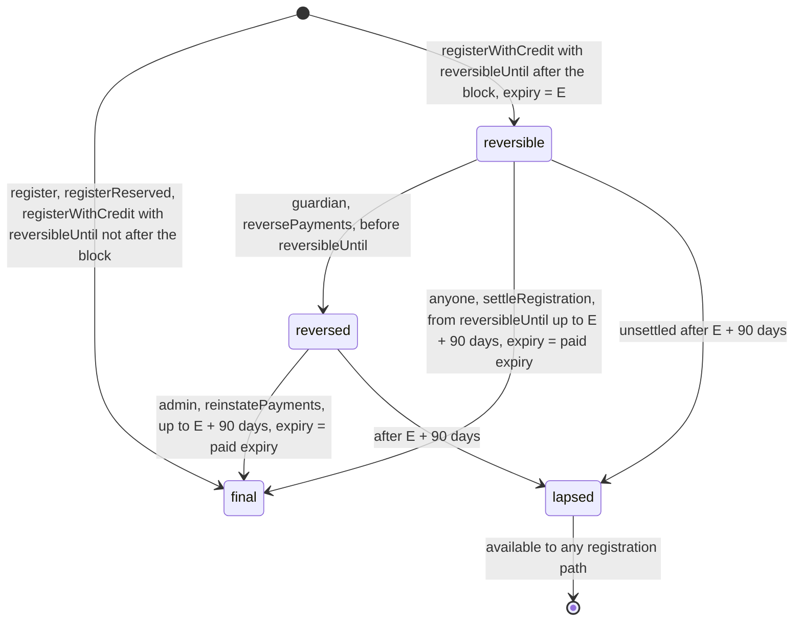
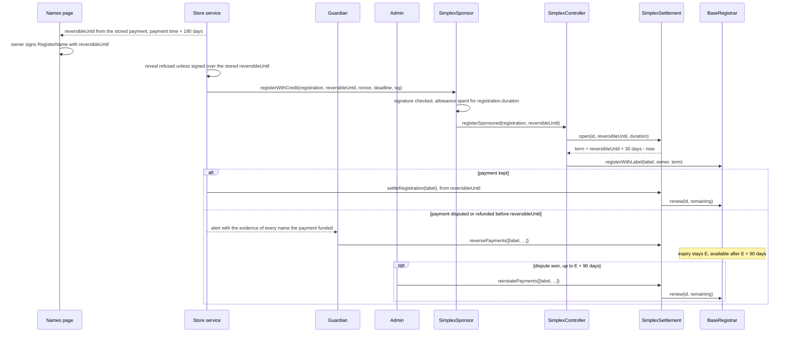
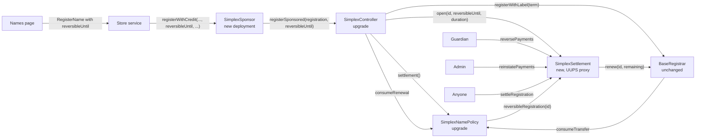
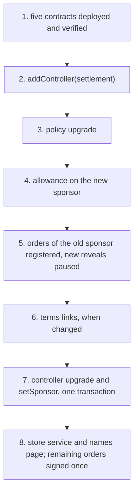
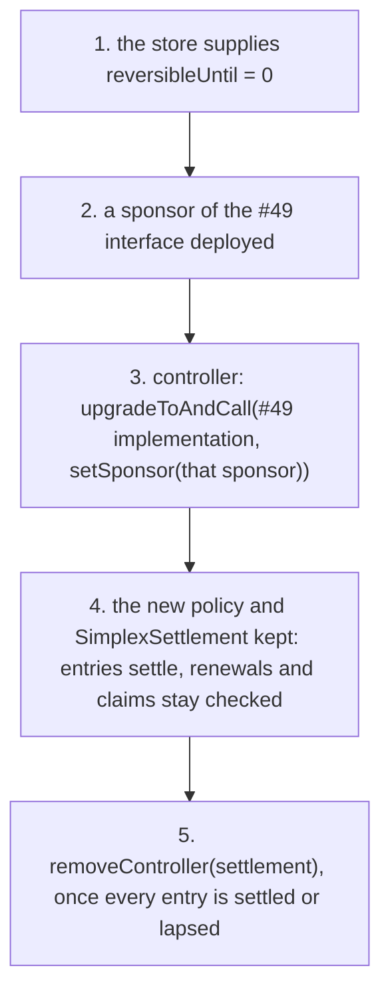
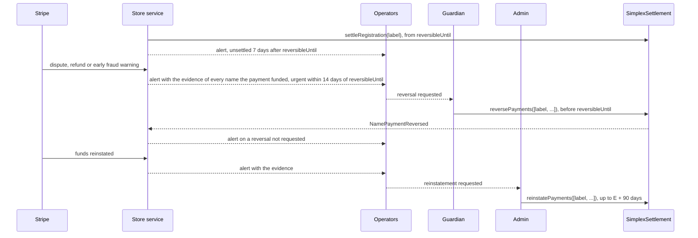

# Reversible payments — contract work plan

Built on `simplex-namespace-contract` @ `c1cca32` and `ens-contracts` @ `1a11cda` (tag `simplex-mainnet-v1`, deployed), stacked on [ens-contracts #49](https://github.com/simplex-network/ens-contracts/pull/49) (`ab/holder-renewal-terms` @ `7ff8c37`) and its deployment, [#18](https://github.com/brenzi/simplex-namespace-contract/pull/18).

## 1. Contents

1. Contents
2. Problem
3. Decisions
4. Registration states
5. Threat model and risks
6. Contract changes
7. Deployment and rollback
8. Requirements for the store service
9. Effects outside this repository
10. Tests

## 2. Problem

The store service registers a name with `SimplexSponsor.registerWithCredit` once its payment settles. A card payment can still be disputed or refunded afterwards, usually within 120 days of the payment and longer on some card networks; the price and a dispute fee are withdrawn from the store's balance when a dispute opens ([Stripe](https://docs.stripe.com/disputes/how-disputes-work)).

A registration keeps its whole paid term after its payment is reversed:

- a term is set once, by `registerWithLabel`, and is only extended by `renew` ([`BaseRegistrarImplementation.sol:171`](https://github.com/simplex-network/ens-contracts/blob/1a11cda4be59ae46a13e194d78ffdaac1ca3b0c8/contracts/ethregistrar/BaseRegistrarImplementation.sol#L171), [`:213`](https://github.com/simplex-network/ens-contracts/blob/1a11cda4be59ae46a13e194d78ffdaac1ca3b0c8/contracts/ethregistrar/BaseRegistrarImplementation.sol#L213));
- a held name becomes available 90 days after its expiry ([`:51`](https://github.com/simplex-network/ens-contracts/blob/1a11cda4be59ae46a13e194d78ffdaac1ca3b0c8/contracts/ethregistrar/BaseRegistrarImplementation.sol#L51), [`:134-137`](https://github.com/simplex-network/ens-contracts/blob/1a11cda4be59ae46a13e194d78ffdaac1ca3b0c8/contracts/ethregistrar/BaseRegistrarImplementation.sol#L134-L137));
- a held name is moved only to an address its holder approved ([`:72-80`](https://github.com/simplex-network/ens-contracts/blob/1a11cda4be59ae46a13e194d78ffdaac1ca3b0c8/contracts/ethregistrar/BaseRegistrarImplementation.sol#L72-L80), [`:273-281`](https://github.com/simplex-network/ens-contracts/blob/1a11cda4be59ae46a13e194d78ffdaac1ca3b0c8/contracts/ethregistrar/BaseRegistrarImplementation.sol#L273-L281));
- the registrar is immutable.

Example: a two-year registration paid by card is disputed 30 days later. The price and the dispute fee are withdrawn at once, and the holder keeps the name for two years and 90 days.

## 3. Decisions

`reversibleUntil` is the reversal deadline of a registration's payment; `E` is the end of its first term.

| # | Decision | Applied | Status |
|---|---|---|---|
| D0 | Consent to the reversal deadline | the buyer signs `reversibleUntil` in `RegisterName` | pending the owner |
| D1 | Transfers before the reversal deadline | allowed; a claim of a reversed registration is refused; before `reversibleUntil`, every claim of an unsettled registration, the import of an owner code included, lists the reversal deadline and `E` and needs the recipient's acknowledgement | the owner, 18 Nov |
| D2 | Cancellation | the first term ends 30 days after the reversal deadline; the rest of the paid term is added at settlement; people see the paid expiry | the owner, 18 Nov |
| D3 | What is public on chain | the reversal deadline of each card payment, to the second, and each reversal | pending the owner |
| D4 | Records of a reversed registration | kept on chain; withheld by the names resolver | pending the owner |
| D5 | Renewals paid by card | not sold: the store renews for crypto, prepaid codes, or a balance past its reversal deadline | pending the owner |
| D6 | Who reverses and who reinstates | the guardian (`beneficiary`) reverses, before the reversal deadline; the admin (`owner`) reinstates, which settles at once | decided |
| D7 | Form and bound of the reversal deadline | a signed timestamp, at most 180 days after the registration; one already passed registers the whole term | decided |
| D8 | Settlement window | 30 days between the reversal deadline and `E`; `E` stored in each entry | decided |
| D9 | Renewal of an unsettled registration | refused on both paths until settlement | decided |
| D10 | Settlement of a reserved name | allowed, to the paid term | decided |
| D11 | Placement | a new contract, `SimplexSettlement`, behind a UUPS proxy, a registrar controller; its address held once, by the name policy | decided |
| D12 | Who settles | anyone: the store service, a script in this repository, and the dApp's Settle action | decided |

## 4. Registration states



One entry per reversible registration is stored in `SimplexSettlement`:

```
Entry                          one slot, keyed by token id
  reversibleUntil  uint64      the reversal deadline
  firstExpiry      uint64      E, the end of the first term
  remaining        uint64      the paid term minus the first term
  reversed         bool        set by the guardian
```

An entry is in effect while all three hold:

- `reversibleUntil != 0`;
- `block.timestamp <= firstExpiry + 90 days`, the registrar's grace period, inclusive as in `available` ([`:136`](https://github.com/simplex-network/ens-contracts/blob/1a11cda4be59ae46a13e194d78ffdaac1ca3b0c8/contracts/ethregistrar/BaseRegistrarImplementation.sol#L136));
- `registrar.nameExpires(id) == firstExpiry`.

The expiry is changed by settlement, by reinstatement, by every later registration, and by a renewal from another registrar controller that the admin adds; a stale entry is ignored.

| State | renewal, both paths | claim | `settleRegistration` | `reversePayments` | `reinstatePayments` |
|---|---|---|---|---|---|
| reversible, before `reversibleUntil` | `RegistrationNotSettled` | with the recipient's acknowledgement | `ReversiblePeriodNotEnded` | guardian | `PaymentNotReversed` |
| reversible, `reversibleUntil` to `E` | `RegistrationNotSettled` | allowed; the app and the dApp settle first | anyone | `ReversiblePeriodEnded` | `PaymentNotReversed` |
| reversible, after `E`, up to `E` + 90 days | `RegistrationNotSettled` | refused by `ownerOf` | anyone | `ReversiblePeriodEnded` | `PaymentNotReversed` |
| reversed, up to `E` | `RegistrationNotSettled` | `PaymentReversed` | `PaymentReversed` | `PaymentReversed` | admin |
| reversed, after `E`, up to `E` + 90 days | `RegistrationNotSettled` | refused by `ownerOf` | `PaymentReversed` | `PaymentReversed` | admin |
| lapsed, after `E` + 90 days | as #49 for a new registration | — | `NotReversible` | `NotReversible` | `NotReversible` |
| final | as #49 | as #49 | `NotReversible` | `NotReversible` | `NotReversible` |

```
SimplexController.registerSponsored(registration, reversibleUntil)      sponsor only
  ... as #49
  term = registration.duration
  reversibleUntil > block.timestamp:
    term = namePolicy.settlement().open(id, reversibleUntil, registration.duration)
  _registerCore(registration, labelhash, (0, 0), term)

SimplexSettlement.open(id, reversibleUntil, duration)                   controller only, proxy only
  reversibleUntil <= block.timestamp + MAX_REVERSIBLE_PERIOD            else ReversibleUntilTooLate(reversibleUntil)
  term = reversibleUntil + SETTLEMENT_WINDOW - block.timestamp
  duration > term                                                       else DurationTooShort(duration)
  entries[id] = (reversibleUntil, block.timestamp + term, duration - term, false)
  emit NamePaymentReversible(labelhash, reversibleUntil, block.timestamp + duration)
  return term

settleRegistration(label)                                               anyone
  entry in effect                                                       else NotReversible(label)
  !reversed                                                             else PaymentReversed(label)
  block.timestamp >= reversibleUntil                                    else ReversiblePeriodNotEnded(label)
  _settle(id, remaining)

reversePayments(labels)                                                 controller.beneficiary() only
  for each label:
    entry in effect                                                     else NotReversible(label)
    !reversed                                                           else PaymentReversed(label)
    block.timestamp < reversibleUntil                                   else ReversiblePeriodEnded(label)
    reversed = true
    emit NamePaymentReversed(labelhash)

reinstatePayments(labels)                                               controller.owner() only
  for each label:
    entry in effect                                                     else NotReversible(label)
    reversed                                                            else PaymentNotReversed(label)
    _settle(id, remaining)

_settle(id, remaining)
  delete entries[id]
  emit NameRegistrationSettled(labelhash, registrar.renew(id, remaining))

reversibleRegistration(id) view                                         proxy only
  entry in effect: (reversibleUntil, firstExpiry + remaining, reversed)
  else: (0, 0, false)

SimplexNamePolicy.consumeRenewal(label, labelhash, duration, holder)
  settlement.reversibleRegistration(id).reversibleUntil == 0            else RegistrationNotSettled(label)
  ... as #49

SimplexNamePolicy.consumeTransfer(tokenId, from, to, offer, label)
  !settlement.reversibleRegistration(tokenId).reversed                  else PaymentReversed(label)
  ... as #49
```

Example after the change: a two-year registration with its reversal deadline on day 180 expires on day 210 until it is settled, and is extended to day 730 by settlement from day 180. Disputed on day 30 and reversed, it stays with its holder until day 210, without renewal, onward claim or records from the names resolver; it is available after day 300.



## 5. Threat model and risks

| Who or what | Power after the change | Bound |
|---|---|---|
| a buyer who disputes, or a card thief | holds the name until `E` | renewal refused; after the reversal, claims refused and records withheld by the names resolver; available after `E` + 90 days; other on-chain readers show its records until then |
| a card thief's modified names page | signs `RegisterName` with `reversibleUntil = 0` | the store refuses a reveal signed over another value than its stored one |
| a third party who claims before the reversal | loses the name at `E` | the recipient acknowledges the reversal deadline before the claim (D1) |
| the guardian | reverses any unsettled reversible registration before its reversal deadline | one hardware wallet until GOV8; kept after `freeze()`; a reinstatement settles the registration, which then cannot be reversed; while the guardian and the admin are one key, the split separates nothing; the store alerts on a reversal the operators did not request |
| the admin | reinstates; upgrades `SimplexSettlement` until `freeze()`; adds a registrar controller, whose renewal ends an entry; removes `SimplexSettlement` as a registrar controller, also after `freeze()`, after which every unsettled registration lapses after `E` + 90 days | as every admin power, behind the timelock from GOV8; a reinstatement lands up to `E` + 90 days, after the 7-day delay |
| `SimplexSettlement` | a registrar controller: registers and renews in its code's bounds | the same trust as the name policy, which is a registrar controller behind a UUPS proxy too |
| a fault in `SimplexSettlement.reversibleRegistration` | all holder transfers and renewals of all names revert, as the name policy calls it on both | repaired by an upgrade until `freeze()`; after it, only by a new name policy, which starts without the reserved and community lists |
| the registrar key | registers with a reversal deadline only when the buyer signed it (D0) | a registration to its own address is unsigned, as today |
| the store service | settles each reversible registration | unsettled after `E` + 90 days, an honest buyer's name lapses; anyone can settle (D12) |
| an observer of the chain | learns which names were paid by card, the time of each payment, and each reversal (D3) | crypto and code orders are registered without a reversal deadline |
| a dispute still open at `E` + 90 days | the name becomes available | the guardian reserves it privately before `E` + 90 days; on a won dispute the admin assigns it with `registerReserved`, for at least 730 days, or the store refunds |
| a payment withdrawn again after a reinstatement | the registration stays final | the store's loss |
| a reversal after the reversal deadline | outside the contracts | the store's loss; the deadline, 180 days after the payment, exceeds Stripe's usual 120 days, also from `term_start` (2027-01-01) for payments made from 2 Nov 2026 |
| the snapshot-and-redeploy fallback | re-mints an unsettled name as final | the store's reversal window for it ends |

## 6. Contract changes



`SimplexSettlement`, new, behind `SimplexSettlementProxy`, an ERC-1967 proxy as `SimplexNamePolicyProxy`:

- immutables:
  - `controller`;
  - `registrar`.
- constants:
  - `MAX_REVERSIBLE_PERIOD = 180 days`;
  - `SETTLEMENT_WINDOW = 30 days`;
  - the registrar's grace period, 90 days.
- storage:
  - `mapping(uint256 => Entry) private _entries`;
  - `uint256[49] __gap`.
- functions:
  - `open(uint256, uint256, uint256)`;
  - `settleRegistration(string)`;
  - `reversePayments(string[])`;
  - `reinstatePayments(string[])`;
  - `reversibleRegistration(uint256)`.
- `open` and `reversibleRegistration` revert `NotProxy` on the implementation, as the name policy's functions do.
- `_authorizeUpgrade`: the controller's owner; refused once the controller is frozen, and for an implementation built for another controller or registrar.
- events:
  - `NamePaymentReversible(bytes32 indexed labelhash, uint256 reversibleUntil, uint256 paidExpires)`;
  - `NamePaymentReversed(bytes32 indexed labelhash)`;
  - `NameRegistrationSettled(bytes32 indexed labelhash, uint256 expires)`.
- errors:
  - `ReversibleUntilTooLate(uint256)`;
  - `DurationTooShort(uint256)`;
  - `NotReversible(string)`;
  - `ReversiblePeriodNotEnded(string)`;
  - `ReversiblePeriodEnded(string)`;
  - `PaymentReversed(string)`;
  - `PaymentNotReversed(string)`.

`SimplexNamePolicy`, upgraded in place, storage unchanged:

- the implementation's immutable `settlement`;
- `_authorizeUpgrade` also refuses an implementation built for another `settlement`;
- the checks in `consumeRenewal` and `consumeTransfer`;
- errors:
  - `PaymentReversed(string)`;
  - `RegistrationNotSettled(string)`.

`INamePolicy`:

- `settlement()`;
- `ISettlement`, with `open` and `reversibleRegistration`.

`SimplexController`, upgraded in place, storage unchanged:

- `registerSponsored(registration, reversibleUntil)`;
- `_registerCore` takes the first term, which `register` passes as `registration.duration`.

`SimplexSponsor`, a new deployment:

- `registerWithCredit(registration, reversibleUntil, nonce, deadline, sig)`;
- the type `RegisterName(string label,address owner,uint256 duration,address resolver,bytes[] data,uint256 reversibleUntil,uint256 nonce,uint256 deadline)`;
- `reversibleUntil` passed to `registerSponsored`;
- the allowance spent for `registration.duration`, as now.

`BaseRegistrarImplementation`, `ENSRegistry`, `SimplexResolver` and `SubnameRegistrar` are unchanged.

`ens-contracts/docs/upgrades.md`:

- `SimplexSettlement`'s layout;
- the invariant `MAX_REVERSIBLE_PERIOD + SETTLEMENT_WINDOW < MIN_REGISTRATION`.

Sizes of a prototype on #49, by solc 0.8.26, optimizer runs 1,000,000, EVM `paris`, against the limit of 24,576 bytes:

| Contract | #49 | Prototype | Headroom |
|---|---|---|---|
| `SimplexController` | 21,889 | 22,297 | 2,279 |
| `SimplexNamePolicy` | 22,652 | 23,466 | 1,110 |
| `SimplexSponsor` | 5,840 | 5,856 | 18,720 |
| `SimplexSettlement` | — | 8,837 | 15,739 |

## 7. Deployment and rollback

By the recipe of [#18](https://github.com/brenzi/simplex-namespace-contract/pull/18), in one run with it when both are merged before it, and before the store accepts its first card order for a name (`[names] codes_only = off`):

| # | Caller | Call |
|---|---|---|
| 1 | any funded key | deploy `SimplexSettlement(controllerProxy, registrar)`, `SimplexSettlementProxy`, the `SimplexController` implementation, the `SimplexNamePolicy` implementation with the settlement proxy, and `SimplexSponsor(controllerProxy)`; verify the five on Etherscan |
| 2 | registrar owner | `registrar.addController(settlementProxy)` |
| 3 | controller owner | `namePolicy.upgradeTo(policyImpl)` |
| 4 | guardian key | `newSponsor.setRegistrarAllowance(registrar, N)` |
| 5 | operators | the store service registers every order already signed for the old sponsor, and takes no new reveal |
| 6 | controller owner | `namePolicy.setGeneralTerms(link)` and `namePolicy.setCommunityTerms(link)`, when the terms text states the condition |
| 7 | controller owner | `controller.upgradeToAndCall(controllerImpl, setSponsor(newSponsor))`, in one transaction: the new controller reverts every call of the old sponsor |
| 8 | operators | the store service and the names page, with the new sponsor address and `RegisterName` type; the remaining orders are signed once |



The order holds with #18 in the same run or before it. The #49 controller calls `consumeRenewal` on the policy; `SimplexSettlement` is the new policy's one new callee; the new controller calls the policy's `settlement()`.

The upgrade is rehearsed by the script on a fork of mainnet first: the settings read back unchanged, then a sponsored registration with a reversal deadline, a refused renewal, a reversal with a refused claim, a reinstatement and a settlement. Verified on mainnet:

- `controller.sponsor()` is the new sponsor, whose `controller()` is the proxy;
- `namePolicy.settlement()` is the settlement proxy, whose `controller()` is the controller proxy;
- `registrar.controllers(settlementProxy)` is true;
- `MAX_REVERSIBLE_PERIOD()` is 15,552,000 and `SETTLEMENT_WINDOW()` 2,592,000.

Rollback, while entries exist:



With every entry settled or lapsed, `reversibleRegistration` answers zeros, and the new policy behaves as the #49 policy.

The snapshot-and-redeploy fallback of the launch-to-freeze plan, §7: a reversed name is reserved and not re-minted, as a disputed name past its expiry; an unsettled name is re-minted for its paid term.

## 8. Requirements for the store service



- Store each payment's `reversibleUntil` with it, exact to the second:
  - a card payment: its time plus 180 days;
  - an in-app payment, when added for names: its time plus 180 days;
  - a balance: the `reversibleUntil` of the money it holds;
  - an order paid from a balance and a card together: the later of the two;
  - crypto and prepaid codes: 0.
- Build the `RegisterName` digest and the calldata from the stored `reversibleUntil`, and refuse a reveal signed over any other value.
- Show at checkout that a card payment is final 180 days after it, and on the order page the exact date.
- Show the paid expiry and the date the registration becomes final, in place of the expiry on chain.
- Sell renewals for crypto, prepaid codes, or a balance past its `reversibleUntil` (D5); refuse a renewal of a registration before its `reversibleUntil`, and settle it before a renewal after.
- Send `settleRegistration(label)` for each reversible registration from `reversibleUntil`, and alert the operators when one is unsettled 7 days after it.
- Read Stripe's `charge.dispute.created`, `charge.dispute.funds_reinstated`, `charge.dispute.closed`, `charge.refunded` and `radar.early_fraud_warning.created`; alert the operators with the evidence of every name the payment funded, directly or through balances.
- Alert the operators on a `NamePaymentReversed` they did not request.
- Alert the operators 14 days before `E` + 90 days of a reversed registration whose dispute is still open, for the guardian's reservation.
- Relay no record edit, offer or claim of a reversed registration, and show it as reversed in search.
- Classify `ReversibleUntilTooLate` and `DurationTooShort` as code errors.

## 9. Effects outside this repository

- simplex-chat, branch `names`:
  - the store service's `RegisterName` digest and calldata ([`Names/Registration.hs:119-141`](https://github.com/simplex-chat/simplex-chat/blob/0410929c9d1659312fa41ee69127796454379eef/apps/simplex-store-service/src/StoreService/Names/Registration.hs#L119-L141));
  - its reveal check, which takes the duration from the stored order ([`Names/Reveal.hs:109`](https://github.com/simplex-chat/simplex-chat/blob/0410929c9d1659312fa41ee69127796454379eef/apps/simplex-store-service/src/StoreService/Names/Reveal.hs#L109)) and takes `reversibleUntil` the same way;
  - its Stripe events ([`Providers/Stripe.hs:104`](https://github.com/simplex-chat/simplex-chat/blob/0410929c9d1659312fa41ee69127796454379eef/apps/simplex-store-service/src/StoreService/Providers/Stripe.hs#L104));
  - a settlement task;
  - a test in which the page signs `reversibleUntil = 0` for a card order;
  - `docs/protocol/names-overview.md`: the non-custodial objective ([`:189`](https://github.com/simplex-chat/simplex-chat/blob/0410929c9d1659312fa41ee69127796454379eef/docs/protocol/names-overview.md#L189)) is amended by the reversal deadline, and, with D4, the objective against infrastructure censorship ([`:190`](https://github.com/simplex-chat/simplex-chat/blob/0410929c9d1659312fa41ee69127796454379eef/docs/protocol/names-overview.md#L190)) by the withheld records.
- simplex-chat app:
  - the import of an owner code is an offer and a claim ([plan, §3](https://github.com/simplex-chat/simplex-chat/blob/0410929c9d1659312fa41ee69127796454379eef/plans/2026-10-12-names-sponsored-registration.md#L44));
  - before `reversibleUntil`, a claim of an unsettled registration lists the reversal deadline and `E` and needs the recipient's acknowledgement; after it, the app settles before the claim.
- simplex.domains:
  - `RegisterName` with `reversibleUntil` ([`crypto/registration.ts:61`](https://github.com/simplex-chat/simplex.domains/blob/c33ba147c58702d54c99cf27415502f50727daee/webapp/src/crypto/registration.ts#L61));
  - checkout: a card payment is final 180 days after it; the order page: the exact date;
  - "Registered until" with the paid expiry and the final date ([`views/order.ts:1270-1272`](https://github.com/simplex-chat/simplex.domains/blob/c33ba147c58702d54c99cf27415502f50727daee/webapp/src/views/order.ts#L1270-L1272));
  - the terms text.
- simplexmq:
  - the resolver answers the paid expiry and the reversal deadline of an unsettled registration ([`snrc-resolve.py:1180-1260`](https://github.com/simplex-chat/simplexmq/blob/9c4a814fdab9f7350b5f259bb5afe5145b5bd383/scripts/resolver/service/snrc-resolve.py#L1180-L1260));
  - with D4, a reversed registration and its subnames are answered without records, in `registration()` and `resolve()`;
  - the SMP protocol's `NameRegistration` gains those fields under a new protocol version.
- simplex-domains-app-v3:
  - the paid expiry and the final date;
  - a Settle action;
  - Extend of an unsettled registration reverts `RegistrationNotSettled`;
  - before `reversibleUntil`, the claim review lists the reversal deadline and asks for an acknowledgement; after it, Settle before the claim.
- This repository:
  - `scripts/settle-due.mjs`: settles every due entry from the `NamePaymentReversible` events, with any funded key;
  - `docs/plans/names-v2-launch-to-freeze-plan.md` §4, §5 and §7;
  - `docs/security.md`: the new privileged surface, the risks of §5, and the invariant "before its registration expires, `E` for an unsettled reversible registration, while `SimplexSettlement` is a registrar controller";
  - `CLAUDE.md`: admin capabilities;
  - the deployment script of #18.

## 10. Tests

`ens-contracts/test/simplex/TestReversiblePayment.test.ts`:

- registration:
  - a reversal deadline expires the name 30 days after it, on the bare and the resolver path, and emits `NamePaymentReversible` with the paid expiry;
  - a reversal deadline not after the block registers the whole term, and `open` is not called;
  - `reversibleUntil == block.timestamp + MAX_REVERSIBLE_PERIOD` registers; one second later reverts `ReversibleUntilTooLate`;
  - the store's formula, payment time plus 180 days, with the registration minutes and a day after the payment;
  - a duration not above the first term reverts `DurationTooShort`;
  - the allowance spent is the paid term's price;
  - `RegisterName` with another `reversibleUntil` reverts `InvalidSignature`; the type hash is pinned;
  - a community name with a reversal deadline.
- settlement:
  - reverts before `reversibleUntil`, and is allowed at `block.timestamp == reversibleUntil`;
  - extends the expiry to the paid term's end from `reversibleUntil` to `E` + 90 days inclusive;
  - reverts `NotReversible` one second after `E` + 90 days, and a second time;
  - settles a reserved name;
  - during the grace period, restores the subnames' owner.
- renewal on both paths reverts `RegistrationNotSettled` before settlement and works after it.
- reversal:
  - refuses a claim and settlement; the name lapses at `E` and is available one second after `E` + 90 days;
  - reverts at `block.timestamp == reversibleUntil`;
  - reverts for the admin, the registrar, the holder and anyone else;
  - reverts for a final registration;
  - reverses several names in one call, and reverts the call for one name out of effect.
- reinstatement:
  - extends the term at once and ends the entry, so a second reversal reverts `NotReversible`;
  - is allowed at `E` + 90 days and reverts one second later;
  - reverts for the guardian and anyone but the admin.
- transfers:
  - `transferFrom`, both `safeTransferFrom` overloads and `claimWithSig` revert `PaymentReversed` after a reversal;
  - `approve` and `approveWithSig` still work;
  - an offer and a claim before the reversal succeed, and the reversal then applies to the new holder;
  - a claim between `reversibleUntil` and `E` succeeds, and a reversal then reverts `ReversiblePeriodEnded`;
  - subnames keep their owner between `reversibleUntil` and `E`.
- stale and lapsed entries:
  - a re-registration of a lapsed name, through `registerWithCredit` and through `registerReserved`, leaves the entry without effect;
  - so does a renewal by an added registrar controller;
  - `reversibleRegistration` answers the entry at `E` + 90 days and zeros one second later.
- upgrades:
  - `SimplexSettlement` is upgraded only by the controller's owner, and refuses an upgrade once the controller is frozen or to an implementation for another controller or registrar; an upgrade keeps the entries;
  - the implementation's `open` and `reversibleRegistration` revert `NotProxy`;
  - the name policy refuses an implementation built for another `settlement`;
  - the deployment order and the rollback, with transfers and renewals across each step;
  - an upgrade of proxies populated by the #49 implementations keeps every value;
  - the invariant `MAX_REVERSIBLE_PERIOD + SETTLEMENT_WINDOW < MIN_REGISTRATION`.
- each new guard, removed, fails at least one test.
