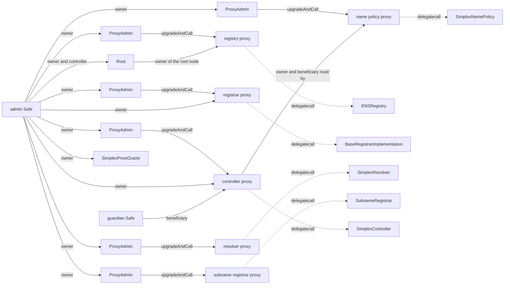
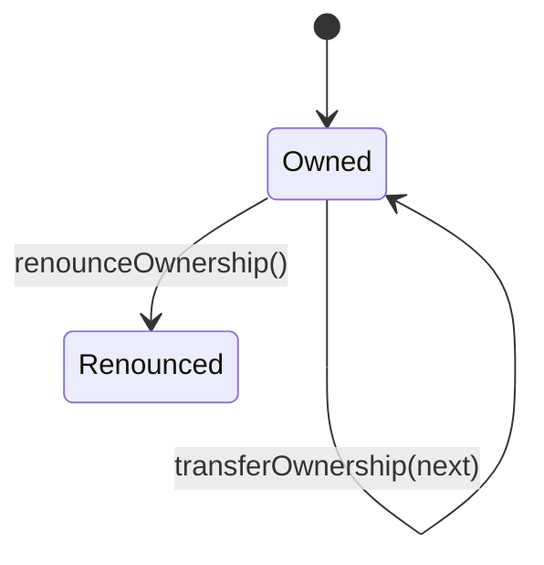
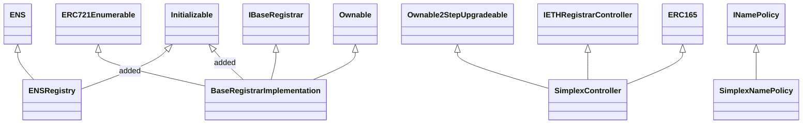
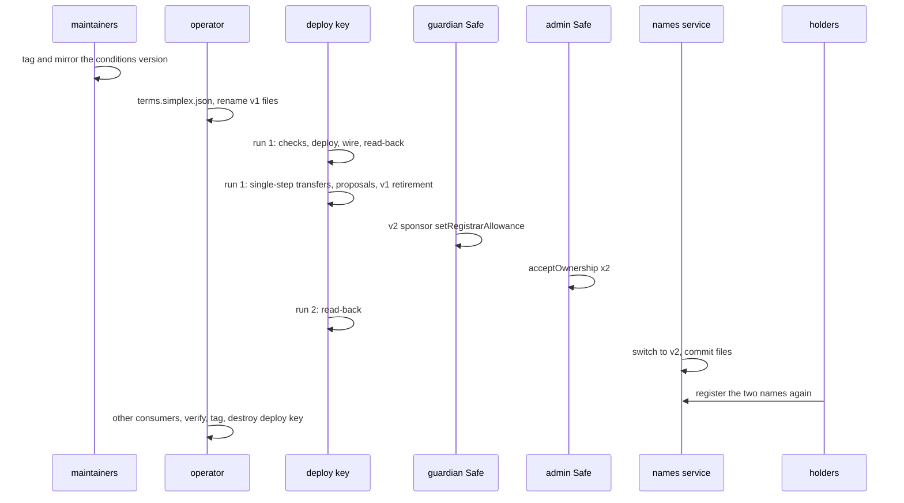
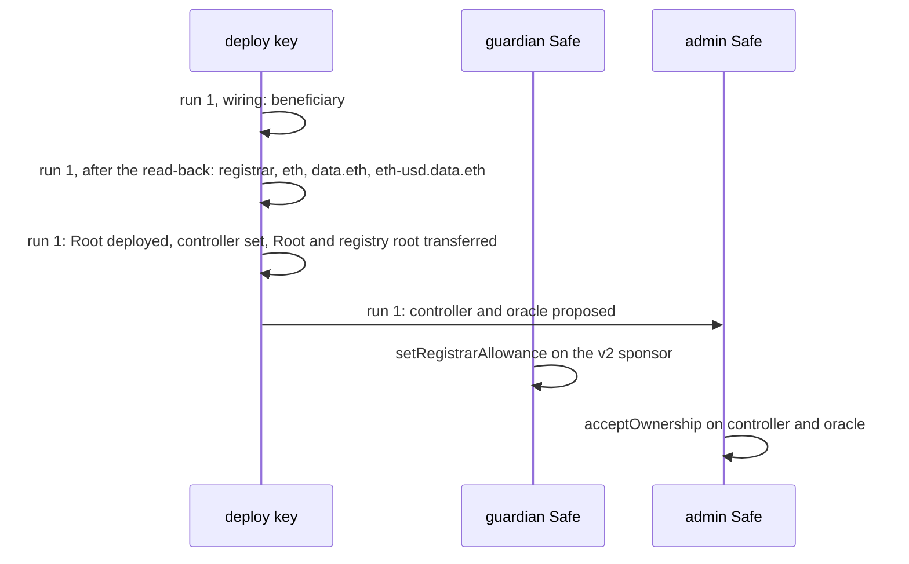

# `.simplex` v2: upgradeable contracts, each frozen on its own

## 1. Contents

1. Contents
2. Decisions
3. Contracts
4. Upgrade authority, ownership, freeze and guarantees
5. Contract changes
6. Migration sequence
7. Deployment
8. Handover
9. Switch and retirement of v1
10. Tests
11. Scripts and documentation
12. Why transparent proxies in place of UUPS

## 2. Decisions

- D1. Scope: `.simplex` is redeployed as v2. `.testing` remains as deployed, on its current controller implementation; its UUPS proxy refuses the v2 controller source, which has no `proxiableUUID` and a different storage layout.
- D2. Behind an OpenZeppelin 5.1.0 `TransparentUpgradeableProxy`, one `ProxyAdmin` per proxy:
  - `ENSRegistry`
  - `BaseRegistrarImplementation`
  - `SimplexResolver`
  - `SubnameRegistrar`
  - `SimplexController`
  - `SimplexNamePolicy`
- D3. The UUPS upgrade code is removed from `SimplexController` and `SimplexNamePolicy`.
- D4. Immutable, deployed fresh with unchanged code:
  - `SimplexSponsor`
  - `UniversalResolver`
  - `SimplexPriceOracle`
  - `MetadataRenderer`
  - `DummyGatewayProvider`
  - `Root`
- D5. Upgrade authority of each proxy: the owner of its `ProxyAdmin`. Each proxy is created with `initialOwner` = admin Safe `0xf38920389740E46A7f4160DaF1672f3df2754Df4`.
- D6. A contract is frozen when its `ProxyAdmin` is renounced: `renounceOwnership()`, per contract, at any time and in any order.
- D7. `controller.freeze()` and its `frozen` flag are removed. A seal of the sponsor or of the public sales switch, where wanted, is added by the controller's last upgrade before its `ProxyAdmin` is renounced.
- D8. Constructors of `ENSRegistry` and `BaseRegistrarImplementation`: unchanged, plus `_disableInitializers()`. A proxy is initialized by `initialize`.
- D9. Deploy key of v2: the v1 deploy key `0x38D19404644fe24EE7d638229a732CbE8275E333`.
- D10. Governance addresses and the names service's registrar wallet are committed in `governance.mainnet.json`, the only source of these addresses for `deploy-mainnet.mjs`. `scripts/governance-check.mjs` checks each governance address against its entry (section 7) before the first transaction of each run, and before any later single-step transfer to it.
- D11. The Safes as deployed: admin Safe 2 of 4, guardian Safe `0xE6623AA6b8d335367828C2A8b06A714678d22e2c` 1 of 4, the same four owners. The guardian Safe moves to 2 of 4 before public sales open (GOV7). The six `ProxyAdmin`s stay with the admin Safe, without delay, past GOV7; the 7-day timelock of GOV8 follows GOV7, at a date not set.
- D12. v2 state comes from the committed files, as in the v1 run:
  - `reserved-names.simplex.csv`, unchanged: `evgeny`, `brenzi` and `evgenypoberezkin` are left unreserved
  - `community-names.simplex.csv`
  - `terms.simplex.json`, with the links of the conditions version of D13
- D13. The registry paragraph of simplex-chat `docs/NAMES-CONDITIONS.md` (line 7) reads: "**Registry**. The .simplex names registry is a set of contracts on the Ethereum blockchain. The contracts may be updated during a stabilization period, expected to last 12 to 24 months from the first registration, after which each of them is made immutable." This version is tagged `general-terms-vN` and `community-terms-vN` before run 1. Run 1 refuses `TERMS_UNCHECKED`.
- D14. The two names registered on v1 are registered again on v2 by their holders through the names service, as the first check of the v2 line.
- D15. `.simplex` stays unlocked at deployment. `root.lock(labelhash("simplex"))` is a step of the launch-to-freeze plan, which keeps its freeze naming for the end state.
- D16. Single-step transfers, by the deploy key in run 1:
  - in the wiring: beneficiary, guardian Safe
  - after the read-back:
    - registrar: admin Safe
    - `eth` and `data.eth`: admin Safe
    - `eth-usd.data.eth`: owner zero
    - `Root`: owner and controller admin Safe
    - registry root: `Root`
- D17. Two-step transfers, proposed at the end of run 1 and accepted by the admin Safe in one batch before the switch:
  - `SimplexController`
  - `SimplexPriceOracle`
- D18. v1 retirement, by the deploy key, at the end of run 1, with the v1 addresses of `deployments.mainnet.simplex-v1.json`:
  - `removeController(v1 controller)` on the v1 registrar
  - `removeController(v1 name policy)` on the v1 registrar
  - `transferOwnership(0x0)` on the v1 controller, which clears its pending owner
  - `transferOwnership(0x0)` on the v1 oracle, which clears its pending owner
- D19. simplex-network/ens-contracts#49 lands after v2, as upgrades of the v2 controller and name policy and a new sponsor set by `setSponsor`. Its storage-slot statements are recomputed for the layout without UUPS. brenzi/simplex-namespace-contract#18 is rewritten for v2.
- D20. A sponsor is replaced in this order: the guardian funds the new sponsor; the names service accepts both sponsors; the owner calls `setSponsor`; the names service drops the old sponsor.

## 3. Contracts

Runtime bytes; the limit is 24,576 (EIP-170). Compiled with solc 0.8.26, optimizer 1,000,000 runs, `evmVersion` paris, metadata `ipfs`. The v1 column equals the runtime size of each v1 instance on mainnet.

| Contract | v1 | v2 |
|---|---:|---:|
| `ENSRegistry` | 5,809 | 6,370 |
| `BaseRegistrarImplementation` | 19,556 | 20,166 |
| `SimplexResolver` | 18,964 | 18,964 |
| `SubnameRegistrar` | 9,651 | 9,651 |
| `SimplexController` | 21,619 | 17,841 |
| `SimplexNamePolicy` | 20,210 | 15,779 |
| `SimplexSponsor` | 5,779 | 5,779 |
| `SimplexPriceOracle` | 5,667 | 5,667 |
| `MetadataRenderer` | 8,986 | 8,986 |
| `UniversalResolver` | 19,035 | 19,035 |
| `DummyGatewayProvider` | 400 | 400 |
| `TransparentUpgradeableProxy` | – | 1,581 |
| `ProxyAdmin` | – | 1,415 |

`TransparentUpgradeableProxy` initcode, including its `ProxyAdmin`: 4,474 bytes.



## 4. Upgrade authority, ownership, freeze and guarantees

| Action | Call | Caller |
|---|---|---|
| upgrade | `ProxyAdmin.upgradeAndCall(proxy, implementation, data)` | `ProxyAdmin` owner |
| freeze | `ProxyAdmin.renounceOwnership()` | `ProxyAdmin` owner |
| move upgrade authority | `ProxyAdmin.transferOwnership(next)` | `ProxyAdmin` owner, after `scripts/governance-check.mjs` passes for `next` |

`ProxyAdmin`, per proxy:

| State | `owner()` | `upgradeAndCall` |
|---|---|---|
| Owned | an address | accepted from that address |
| Renounced | `0x0` | reverts |

```
upgradeAndCall(proxy, implementation, data):
  require msg.sender == owner
  proxy.upgradeToAndCall(implementation, data)

renounceOwnership():
  require msg.sender == owner
  owner = 0x0
```



Owner of each contract's own calls, apart from its upgrade authority:

| Contract | Owner | Transfer |
|---|---|---|
| registrar | admin Safe | `Ownable`, single-step |
| controller | admin Safe | `Ownable2Step`, two-step |
| name policy | `controller.owner()` and `controller.beneficiary()` (`SimplexNamePolicy.sol:115-126`) | with the controller's |
| oracle | admin Safe | `Ownable2Step`, two-step |
| `Root` | admin Safe | `Ownable`, single-step |
| resolver | – | – |
| subname registrar | – | – |
| sponsor | – | – |

Until a `ProxyAdmin` is renounced, its owner can replace the code behind its proxy. Once it is renounced, the functions that the other contracts call on that proxy are fixed. Each guarantee holds from the last of its conditions:

| Guarantee | Condition |
|---|---|
| a held name cannot be taken, transferred or re-pointed before it expires | registry `ProxyAdmin` renounced |
| | registrar `ProxyAdmin` renounced |
| | subname registrar `ProxyAdmin` renounced |
| a name's records are written only by its holder | registry `ProxyAdmin` renounced |
| | registrar `ProxyAdmin` renounced |
| | resolver `ProxyAdmin` renounced |
| | subname registrar `ProxyAdmin` renounced |
| | controller `ProxyAdmin` renounced |

`root.lock(labelhash("simplex"))` is a further condition of both guarantees, scheduled by the launch-to-freeze plan (D15).

Calls that remain after every freeze:

| Contract | Call | Caller |
|---|---|---|
| controller | `setSponsor` | owner |
| controller | `setPublicSalesOpen` | owner or beneficiary |
| controller | `setNamePolicy` | owner |
| controller | `setPriceOracle` | owner |
| controller | `setMinCharLength` | owner |
| controller | `setDefaultResolver` | owner |
| controller | `recoverFunds` | owner |
| controller | `setBeneficiary` | beneficiary |
| controller | `transferOwnership`, `renounceOwnership` | owner |
| registrar | `addController` | owner |
| registrar | `removeController` | owner |
| registrar | `setNamePolicy` | owner |
| registrar | `setSubnameHook` | owner |
| registrar | `setMaxLabelLength` | owner |
| registrar | `setMetadataRenderer` | owner |
| registrar | `setResolver` | owner |
| registrar | `transferOwnership`, `renounceOwnership` | owner |
| oracle | `setPrices` | owner |
| oracle | `setUsdOracle` | owner |
| oracle | `transferOwnership`, `renounceOwnership` | owner |
| sponsor | `setRegistrarAllowance` | controller's beneficiary |
| name policy | the owner and beneficiary calls of launch-to-freeze plan section 4 | controller's owner or beneficiary |
| `Root` | `setSubnodeOwner` for unlocked labels, `simplex` until its lock | controller of `Root` |
| `Root` | `setResolver` | owner |
| `Root` | `setController` | owner |
| `Root` | `lock` | owner |
| `Root` | `transferOwnership` | owner |

## 5. Contract changes

simplex-network/ens-contracts, branch `ab/upgradeable-stack` from `simplex` at `1a11cda`.



`UUPSUpgradeable` leaves the inheritance lists of `SimplexController` and `SimplexNamePolicy`.

`contracts/registry/ENSRegistry.sol`:

```solidity
import {Initializable} from "@openzeppelin/contracts-upgradeable/proxy/utils/Initializable.sol";

contract ENSRegistry is ENS, Initializable {
    constructor() public {
        records[0x0].owner = msg.sender;
        _disableInitializers();
    }

    function initialize(address rootOwner) external initializer {
        records[0x0].owner = rootOwner;
    }
}
```

`contracts/ethregistrar/BaseRegistrarImplementation.sol`:

```solidity
import {Initializable} from "@openzeppelin/contracts-upgradeable/proxy/utils/Initializable.sol";

contract BaseRegistrarImplementation is
    ERC721Enumerable,
    IBaseRegistrar,
    Ownable,
    Initializable
{
    constructor(
        ENS _ens,
        bytes32 _baseNode
    ) ERC721("SimpleX Names", "SIMPLEX") {
        ens = _ens;
        baseNode = _baseNode;
        _disableInitializers();
    }

    function initialize(
        ENS _ens,
        bytes32 _baseNode,
        address initialOwner
    ) external initializer {
        ens = _ens;
        baseNode = _baseNode;
        _transferOwnership(initialOwner);
    }

    function name() public pure override returns (string memory) {
        return "SimpleX Names";
    }

    function symbol() public pure override returns (string memory) {
        return "SIMPLEX";
    }
}
```

`contracts/simplex/SimplexController.sol`, removed:

- the import of `UUPSUpgradeable`
- `UUPSUpgradeable` from the inheritance list
- `__UUPSUpgradeable_init()` in `initialize`
- `_authorizeUpgrade`
- `freeze()` with its NatSpec
- `bool public frozen`
- the `frozen` check in `setSponsor`
- the `frozen` check in `setPublicSalesOpen`
- error `Frozen`
- error `AlreadyFrozen`
- event `ContractFrozen`

Comments of `SimplexController` restated:

- lines 36, 57 and 62: a proxy in place of UUPS
- line 263, `setSponsor`: the mention of `freeze`
- line 280, `setNamePolicy`: the mention of `freeze`
- line 290, `setPublicSalesOpen`: the mention of `freeze`
- line 338, `setPriceOracle`: the mention of `freeze`
- line 685: the slot packing without `frozen`

`contracts/simplex/SimplexNamePolicy.sol`, removed:

- the import of `UUPSUpgradeable`
- `UUPSUpgradeable` from the inheritance list
- `_authorizeUpgrade`
- error `Frozen`
- error `ImplementationMismatch`

`contracts/simplex/SimplexSponsor.sol`: the comment at lines 13-15 without "until `freeze`".

`hardhat.config.ts`, `npmFilesToBuild`, for the proxy and `ProxyAdmin` artifacts:

- `@openzeppelin/contracts-v5/proxy/transparent/TransparentUpgradeableProxy.sol`
- `@openzeppelin/contracts-v5/proxy/transparent/ProxyAdmin.sol`

Unchanged:

- `SimplexResolver`
- `SubnameRegistrar`
- `SimplexControllerProxy` and `SimplexNamePolicyProxy`, deployed by tests and read by `scripts/build-verification.mjs` for v1

## 6. Migration sequence

| # | Actor | Step |
|---|---|---|
| 1 | maintainers | the conditions version of D13 merged, tagged and mirrored to git.simplex.chat |
| 2 | operator | `terms.simplex.json` set to its links and committed to the task branch; v1 files renamed on the operator's checkout (section 9) |
| 3 | deploy key, run 1 | governance checks (section 7) |
| 4 | deploy key, run 1 | implementations and proxies deployed and wired; beneficiary set |
| 5 | deploy key, run 1 | read-back |
| 6 | deploy key, run 1 | single-step transfers (D16); controller and oracle proposed (D17) |
| 7 | deploy key, run 1 | v1 retirement (D18) |
| 8 | guardian Safe | registrar allowance on the v2 sponsor |
| 9 | admin Safe | `acceptOwnership()` on the controller and the oracle, one batch |
| 10 | deploy key, run 2 | handover read-back |
| 11 | names service | switched to v2; the renamed v1 files and the v2 addresses file committed to main together |
| 12 | holders, names service | the two v1 names registered again (D14) |
| 13 | operator | other consumers switched, Etherscan verification, tag |
| 14 | operator | deploy key destroyed |



Each run of `deploy-mainnet.mjs` is one invocation with a `RUN` of 1 or 2. Its inputs are the committed files of D10, D12 and D13, and, on the operator's checkout, `deployments.mainnet.simplex-v1.json`, the journal and the attempts log. A resumed run re-sends no journalled step and evaluates only its own read-back.

v1 registers nothing between steps 7 and 11 either: its public sales are closed and its sponsor holds no allowance.

Until step 11, v1 is restored by the deploy key: `addController` for the v1 controller and the v1 name policy on the v1 registrar, and `transferOwnership(admin Safe)` on the v1 controller and the v1 oracle.

## 7. Deployment

`governance.mainnet.json` entries and the checks of `scripts/governance-check.mjs`:

| Kind | Read | Value |
|---|---|---|
| Safe | `getCode` | the SafeProxy 1.5.0 code |
| Safe | storage slot 0 | Safe 1.5.0 singleton `0xff51a5898e281db6dfc7855790607438df2ca44b` |
| Safe | `VERSION()` | `1.5.0` |
| Safe | `getThreshold()` | the entry's threshold |
| Safe | `getOwners()` | the entry's owners |
| Safe | `getModulesPaginated(0x1, 10)` | empty |
| Safe | guard slot | `0x0` |
| Safe | fallback handler slot | Safe 1.5.0 compatibility fallback handler `0x3efcbb83a4a7afcb4f68d501e2c2203a38be77f4` |
| Safe | `nonce()` | at least 1 |
| TimelockController | `getCode` | the entry's code hash |
| TimelockController | `getMinDelay()` | the entry's delay |
| TimelockController | `hasRole` of the proposer, executor and canceller roles | the entry's Safes |
| TimelockController | `hasRole` of its admin role | `false` for every account of the entry and for the deploy key |

The registrar wallet's entry holds its address and its allowance N, in attoUSD; `scripts/governance-check.mjs` checks that its `getCode` is empty.

Run 1, deploy key. Each proxy is a `TransparentUpgradeableProxy` with `initialOwner` = admin Safe. The address of a proxy's `ProxyAdmin` is the CREATE address of the proxy at nonce 1.

| # | Implementation or contract, constructor arguments | Proxy data |
|---|---|---|
| 1 | `ENSRegistry()` | `initialize(deploy key)` |
| 2 | `BaseRegistrarImplementation(registry proxy, namehash("simplex"))` | `initialize(registry proxy, namehash("simplex"), deploy key)` |
| 3 | `SimplexPriceOracle(feed, decimals, base, rungs)`, as `deploy-mainnet.mjs:317-318` | – |
| 4 | `SimplexController()` | `initialize(registrar proxy, oracle, 60, 86400, registry proxy, config, deploy key)` |
| 5 | `SimplexNamePolicy(controller proxy, registrar proxy)` | empty |
| 6 | `SubnameRegistrar(registry proxy, registrar proxy)` | empty |
| 7 | `SimplexResolver(registry proxy, subname registrar proxy, controller proxy, 0x0)` | empty |
| 8 | `SimplexSponsor(controller proxy)` | – |
| 9 | `DummyGatewayProvider()` | – |
| 10 | `UniversalResolver(deploy key, registry proxy, gateway provider)` | – |
| 11 | `MetadataRenderer(".simplex")` | – |

Wiring: the calls of the v1 run, `deploy-mainnet.mjs:304-441`, against the v2 addresses, including `controller.setBeneficiary(guardian Safe)`.

The read-back of run 1 checks, before section 8:

- the checks of the v1 run at `deploy-mainnet.mjs:537-570` and `573-660`, against the v2 addresses
- the runtime code of each of the six implementations: the compiled artifact, with the expected immutables placed at its `immutableReferences`
- `_initialized` of the registry, registrar and controller implementations: 255
- the ERC-1967 implementation slot of each of the six proxies: its implementation
- the ERC-1967 admin slot of each of the six proxies: the CREATE address of the proxy at nonce 1
- `owner()` of each of the six `ProxyAdmin`s: admin Safe
- `registrar.ens()`: the registry proxy
- `registrar.baseNode()`: `namehash("simplex")`
- `controller.ens()`: the registry proxy
- `controller.tldNode()`: `namehash("simplex")`
- `subnameRegistrar.ens()`: the registry proxy
- `subnameRegistrar.baseRegistrar()`: the registrar proxy
- the registrar's `ControllerAdded` events: the controller proxy and the name policy proxy, and no other address

Addresses file `deployments.mainnet.simplex.json`, committed at step 11:

| Key | Value |
|---|---|
| each existing key | the proxy, or the immutable contract |
| `Root` | `Root` |

`PublicResolver` and `NameWrapperPublicResolver` both hold the resolver proxy. The keys `SimplexControllerImpl` and `SimplexNamePolicyImpl` are dropped; scripts read the implementation and the `ProxyAdmin` of a proxy from its ERC-1967 slots.

## 8. Handover

Run 1, deploy key, after its read-back passes:

1. `registrar.transferOwnership(admin Safe)`
2. `ens.setOwner(namehash("eth-usd.data.eth"), 0x0)`
3. `ens.setSubnodeOwner(namehash("eth"), labelhash("data"), admin Safe)`
4. `ens.setSubnodeOwner(0x0, labelhash("eth"), admin Safe)`
5. deploy `Root(registry proxy)`
6. `root.setController(admin Safe, true)`
7. `root.transferOwnership(admin Safe)`
8. `ens.setOwner(0x0, root)`
9. `controller.transferOwnership(admin Safe)`
10. `oracle.transferOwnership(admin Safe)`

The read-back of run 2 checks, after step 9 of section 6:

| Read | Value |
|---|---|
| `owner()` of each of the six `ProxyAdmin`s | admin Safe |
| `controller.owner()` | admin Safe |
| `controller.pendingOwner()` | `0x0` |
| `controller.beneficiary()` | guardian Safe |
| `sponsor.registrarAllowance(registrar wallet)` | N |
| `registrar.owner()` | admin Safe |
| `oracle.owner()` | admin Safe |
| `oracle.pendingOwner()` | `0x0` |
| `ens.owner(0x0)` | `Root` |
| `ens.owner(namehash("eth"))` | admin Safe |
| `ens.owner(namehash("data.eth"))` | admin Safe |
| `ens.owner(namehash("eth-usd.data.eth"))` | `0x0` |
| `root.ens()` | the registry proxy |
| `root.owner()` | admin Safe |
| `root.controllers(admin Safe)` | `true` |
| `root.locked(labelhash("simplex"))` | `false` |
| v1 registrar `controllers(v1 controller)` | `false` |
| v1 registrar `controllers(v1 name policy)` | `false` |
| v1 controller `pendingOwner()` | `0x0` |
| v1 oracle `pendingOwner()` | `0x0` |



## 9. Switch and retirement of v1

Renamed to `*.simplex-v1.*` at step 2 on the operator's checkout, committed to main at step 11:

- `deployments.mainnet.simplex.json`
- `deployments.mainnet.simplex.journal.jsonl`
- `verification.mainnet.simplex.json`

`deployments.mainnet.simplex.attempts.log` is renamed on the operator's machine only.

The two v1 NFTs remain with their holders on the retired v1 registrar.

Names service, at step 11:

- registry proxy
- registrar proxy
- controller proxy
- name policy proxy
- sponsor
- resolver proxy
- subname registrar proxy
- announcement scan: the v2 registrar from its deploy block

Other consumers, at step 13 (names-v2-contracts plan, section 8):

- `SNRC_REGISTRY_SIMPLEX` of `snrc-resolve.py`
- `ens-metadata-service`: `ADDRESS_ETH_REGISTRAR`
- `ens-metadata-service`: `ADDRESS_ETH_REGISTRY`
- simplex-app: `.env.simplex` `NEXT_PUBLIC_DEPLOYMENT_ADDRESSES`
- simplex-app: `deploy/01_get_contract_addresses.ts`
- simplex-app: its copy of the deployments file
- simplex-app: `src/constants/chains.ts`
- simplex-app: `src/constants/resolverAddressData.ts`
- simplex-app: `src/constants/tldData.ts`

`scripts/cloudflare-build-simplex.sh` reads `deployments.mainnet.simplex.json` from main, so the staging dApp is built against v2 from the commit of step 11.

`ens-subgraph` indexes `.testing` (`src/utils.ts:12-17`); a `.simplex` subgraph is outside this plan.

Etherscan verification:

- the six implementations
- the six proxies
- the six `ProxyAdmin`s
- `SimplexSponsor`
- `SimplexPriceOracle`
- `MetadataRenderer`
- `DummyGatewayProvider`
- `UniversalResolver`
- `Root`

The ens-contracts commit is tagged `simplex-mainnet-v2`.

## 10. Tests

simplex-network/ens-contracts, `test/simplex/TestUpgradeableStack.test.ts`, new:

- for the registry, the registrar and the controller:
  - `initialize` sets the state the constructor sets
  - a second `initialize` reverts
  - `initialize` on the implementation reverts
- for each of the six proxies:
  - `upgradeAndCall` by the `ProxyAdmin` owner succeeds; by any other caller it reverts
  - `upgradeToAndCall` sent to the proxy by the `ProxyAdmin` owner reverts, and the implementation slot is unchanged
  - `upgradeToAndCall` sent to the proxy by the contract's owner reverts, and the implementation slot is unchanged
  - an owner call of the contract, sent through the proxy by the admin Safe, succeeds
  - state written before an upgrade reads the same after it
- for the five proxies whose contract has `DOMAIN_SEPARATOR()`: it reads the same after an upgrade
- the ABIs of the six implementations exclude these selectors:
  - `0x3659cfe6`
  - `0x4f1ef286`
  - `0x52d1902d`
- after `renounceOwnership` on one `ProxyAdmin`, that proxy's upgrade reverts and the other five upgrade
- after `transferOwnership` on one `ProxyAdmin`, that proxy is upgraded by the new owner only, and the other five by the admin Safe only
- the registrar through its proxy: `name()`, `symbol()`, registration, transfer and `tokenURI`
- storage layout snapshots of the six implementations
- gas of these calls through proxies and on direct deployments, reported in the pull request:
  - `register`
  - `registerWithCredit`
  - `setTextWithSig` on a name
  - `createSubnameWithSig`
  - `setTextWithSig` on a subname

simplex-network/ens-contracts, existing tests:

- `test/simplex/TestControllerStorageLayout.test.ts`:
  - the comments at lines 23 and 42-47 restated
  - the beneficiary's slot found through `setBeneficiary` by the beneficiary, in place of `freeze` (lines 49-65 and 79-103)
- `test/simplex/TestNamePolicy.test.ts:218-231`: the terms at slots 1, 5, 6 and 7 in place of 102, 106, 107 and 108
- removed: the tests and assertions that call `freeze()`, read `frozen` or expect `Frozen`, `AlreadyFrozen` or `ImplementationMismatch`, in:
  - `test/simplex/TestBeneficiaryAndFreeze.test.ts`
  - `test/simplex/TestPublicSalesSwitch.test.ts`
  - `test/simplex/TestAdminSplit.test.ts`
  - `test/simplex/TestNamePolicy.test.ts`
  - `test/simplex/TestLaunchLifecycle.test.ts`
- rewritten for `ProxyAdmin.upgradeAndCall`:
  - `test/simplex/TestNamePolicy.test.ts:136-151`
  - `test/simplex/TestNamePolicy.test.ts:176` onwards, the upgrade that preserves the lists
  - `test/simplex/TestSimplexController.test.ts`, its upgrade tests
- `test/simplex/fixtures/namesV2.ts` deploys the six contracts behind `TransparentUpgradeableProxy`; the suites that use it run through the proxies
- `test/simplex/TestLaunchLifecycle.test.ts` follows sections 6 to 8
- these suites keep direct deployments:
  - `test/simplex/FuzzSubnameRegistrar.test.ts`
  - `test/simplex/TestRegistrarV3.test.ts`
  - `test/simplex/TestSimplexResolver.test.ts`
  - `test/simplex/TestSnrcResolution.test.ts`
  - `test/simplex/TestSubnameLapse.test.ts`
  - `test/simplex/TestSubnameRegistrar.test.ts`

brenzi/simplex-namespace-contract:

- `scripts/deploy-local.mjs` deploys the v2 shape; the Playwright suite runs against it
- fork dry runs, with the Safes impersonated:
  - runs 1 and 2 pass both read-backs
  - a `ProxyAdmin` owner other than the admin Safe stops run 1 before section 8
  - the restore path of section 6 returns v1 to its state before step 7
- `scripts/governance-check.test.mjs`, run with `node --test`; a Safe is refused for each of:
  - a different threshold
  - different owners
  - an enabled module
  - a guard
  - a different singleton
  - a different fallback handler
  - nonce 0
  - an address without code
- `scripts/prepare-upgrade.test.mjs`, run with `node --test`:
  - refused: a different `trustedETHController`
  - refused: a reordered state variable
  - refused: an `upgradeToAndCall` function
  - refused: a `fallback` or `receive` function
  - refused: bytecode that contains the ERC-1967 implementation or admin slot
  - accepted: an identical rebuild
  - accepted: a variable appended in place of the first slot of the trailing `__gap`, as in #49

## 11. Scripts and documentation

simplex-chat/simplex-chat:

- `docs/NAMES-CONDITIONS.md`, line 7 (D13)

brenzi/simplex-namespace-contract:

- `governance.mainnet.json`, new
- `scripts/governance-check.mjs`, new
- `terms.simplex.json`: the links of D13
- `scripts/deploy-mainnet.mjs`:
  - runs 1 and 2
  - governance addresses from `governance.mainnet.json` in place of `OWNER_ADDRESS` and `GUARDIAN_ADDRESS`
  - `TERMS_UNCHECKED` refused
  - the read-backs of `frozen()` (lines 571-572) and of the implementation keys (lines 661-664) removed
  - the comment at line 395 without the mention of `freeze`
- `scripts/deploy-local.mjs`, with its comment at line 159
- `scripts/deploy-testnet.mjs`: unchanged; Sepolia is retired (`docs/deployment.md:12`)
- `scripts/prepare-upgrade.mjs`, new, in place of `scripts/deploy-controller-impl.mjs`:
  - deploys a candidate implementation
  - compares its runtime code with the artifact, with the current immutables placed at its `immutableReferences`, except `SimplexNamePolicy._self` and `SubnameRegistrar._deployer`
  - compares the storage layouts with type names freed of AST ids: every variable except a trailing `__gap` keeps its slot, offset and type, and a trailing `__gap` ends at the same slot
  - refuses the selectors `0x3659cfe6`, `0x4f1ef286` and `0x52d1902d`, a `fallback` and a `receive`
  - refuses bytecode that contains the ERC-1967 implementation or admin slot
  - prints the calldata of `ProxyAdmin.upgradeAndCall`
- `scripts/build-verification.mjs`
- `scripts/verify-etherscan.mjs`
- `docs/deployment.md`, with the sponsor replacement of D20
- `docs/ens-diff.md`
- `docs/plans/names-v2-launch-to-freeze-plan.md`:
  - section 3, the keys and the Safes (D11)
  - section 4, the power table
  - section 5, what no key can do
  - section 6, the immutable registrar and `Root`
  - section 7, the redeploy fallback
  - appendix A2, the handover order
  - GOV9, as per-contract freezes and `Root.lock`, with its freeze naming kept
- `docs/plans/names-v2-contracts.md`
- `docs/security.md`:
  - L1
  - H1
  - V1
  - "The invariant everything rests on"
  - "New privileged surface"
  - "What freeze() does not stop"
  - "Bounds that are the registrar's job, not the contract's"
  - "Deployment opsec"
  - line 589
- `docs/architecture.md`
- `docs/sequence-happy-flow.md`
- `CLAUDE.md`:
  - architecture and admin capabilities
  - deployment order
  - "Deviations", where the registrar and the subname registrar are called immutable, and the change from UUPS to transparent proxies
  - "Toolchain": contracts-upgradeable
  - "UUPS wrapping is mechanical", restated for transparent proxies

simplex-network/ens-contracts:

- `hardhat.config.ts`
- `deploy/simplex/00_deploy_simplex_controller.ts`
- `docs/upgrades.md`:
  - transparent proxies and their layout rules
  - invariant 4 restated for the immutables of the resolver and the subname registrar, which determine who may write records
  - a review item for each upgrade: no `delegatecall` to an address other than the contract itself, and no state written by a constructor or a variable initializer

## 12. Why transparent proxies in place of UUPS

The owner requires that each upgradeable contract can be frozen, and its upgrade authority moved, on its own and at its own time. With a UUPS proxy, the upgrade code is part of each implementation: each contract then contains `upgradeToAndCall`, an owner of its own and a `frozen` flag of its own. With a transparent proxy, the upgrade code is part of the proxy and of a `ProxyAdmin` created with it; the contracts contain none of it. A freeze state kept in `SimplexController` for all contracts would sit behind the controller's own upgrade authority, so one controller upgrade could undo every freeze; the name policy reads `controller.owner()` and `controller.frozen()` in v1 (`SimplexNamePolicy.sol:115-118`, `513-520`) in that way.

Three models were compared: transparent proxies for all six contracts, UUPS for all six, and the v1 mix of UUPS for the controller and the name policy with transparent proxies for the other four. Sizes are runtime bytes, compiled with the repository's settings; the limit is 24,576. The UUPS sizes are those of a variant with `Ownable2StepUpgradeable`, `UUPSUpgradeable` 4.9.3, a `frozen` flag with `freeze()`, and an initializer; two independent builds of that variant gave the ranges shown.

| Criterion | All transparent | All UUPS | Mix |
|---|---|---|---|
| upgrade procedure | `ProxyAdmin.upgradeAndCall` for all six | `upgradeToAndCall` on each contract | both procedures |
| freeze of one contract | `ProxyAdmin.renounceOwnership()`; the proxy's admin is immutable, so the freeze is final | a `freeze()` and a `frozen` flag in each contract | both; the policy freezes with the controller |
| `BaseRegistrarImplementation` | 20,166; 4,410 bytes of headroom | 24,157 to 24,295; at most 419 bytes of headroom | 20,166 |
| `SimplexResolver` | 18,964, unchanged code | 23,993 to 24,338; at most 583 bytes of headroom | 18,964 |
| `SubnameRegistrar` | 9,651, unchanged code | 14,686 to 15,050 | 9,651 |
| `ENSRegistry` | 6,370 | 10,926 to 11,267 | 6,370 |
| `SimplexController` | 17,841 | 21,619 | 21,619 |
| `SimplexNamePolicy` | 15,779 | 20,210 | 20,210 |
| changes to `ENSRegistry` | `Initializable`, `_disableInitializers`, `initialize` | the same, upgrade code, an owner and a freeze | as all transparent |
| changes to `BaseRegistrarImplementation` | `Initializable`, `_disableInitializers`, `initialize`, `name`, `symbol` | the same, upgrade code and a freeze | as all transparent |
| changes to `SimplexResolver` and `SubnameRegistrar` | none | upgrade code, an owner and a freeze, about 25 lines each | none |
| changes to `SimplexController` and `SimplexNamePolicy` | UUPS code removed | none | none |
| upgrade authority after a faulty new implementation | unaffected: it is held by the `ProxyAdmin` | lost when the new implementation's `_authorizeUpgrade` is faulty; OpenZeppelin 4.9.3 checks only `proxiableUUID` (`ERC1967UpgradeUpgradeable.sol:84-87`) | as all transparent for four, as all UUPS for two |
| transfer of upgrade authority | single-step, `ProxyAdmin.transferOwnership` | two-step, `Ownable2Step` in each contract | single-step for four, two-step for two |
| check that a policy implementation targets the same controller and registrar | in `scripts/prepare-upgrade.mjs` | on chain, in `SimplexNamePolicy._authorizeUpgrade` | on chain |
| storage layout of the controller and the name policy | moved; the slot statements of #49 are recomputed | as v1 | as v1 |
| `.testing` controller proxy | cannot be upgraded to this source | can be upgraded to this source | can be upgraded to this source |
| gas per call | one read of the implementation slot, and one comparison of the caller with an immutable | one read of the implementation slot | as each contract's model |
| contracts per upgradeable contract | proxy, implementation and `ProxyAdmin` | proxy and implementation | as each contract's model |

At the repository's optimizer setting of 1,000,000 runs, the UUPS registrar and resolver leave less than 600 bytes for any later fix. At 10,000 runs the registrar measures 21,193 to 21,305 bytes and the resolver 22,253 to 22,520, at a higher gas cost per call.

The all-transparent model is chosen, by the owner's answer: "I think the pros of "all transparent" outweigh the con of singles-step-ownership risk". Its costs are met as follows:

| Cost | Measure |
|---|---|
| single-step transfer of upgrade authority | each `ProxyAdmin` is owned by the admin Safe from creation; a later transfer is sent only after `scripts/governance-check.mjs` passes for the next owner |
| policy implementation check off-chain | `scripts/prepare-upgrade.mjs` compares runtime code with immutables and storage layout and refuses UUPS selectors, tested in section 10 |
| a UUPS base left in an implementation would add a second upgrade path | the ABI test of section 10 refuses the selectors `0x3659cfe6`, `0x4f1ef286` and `0x52d1902d` |
| moved storage layout of the controller and the name policy | #49 recomputes its slot statements (D19) |
| six `ProxyAdmin`s to deploy and verify | created by the proxies' constructors; verified with the proxies (section 9) |
