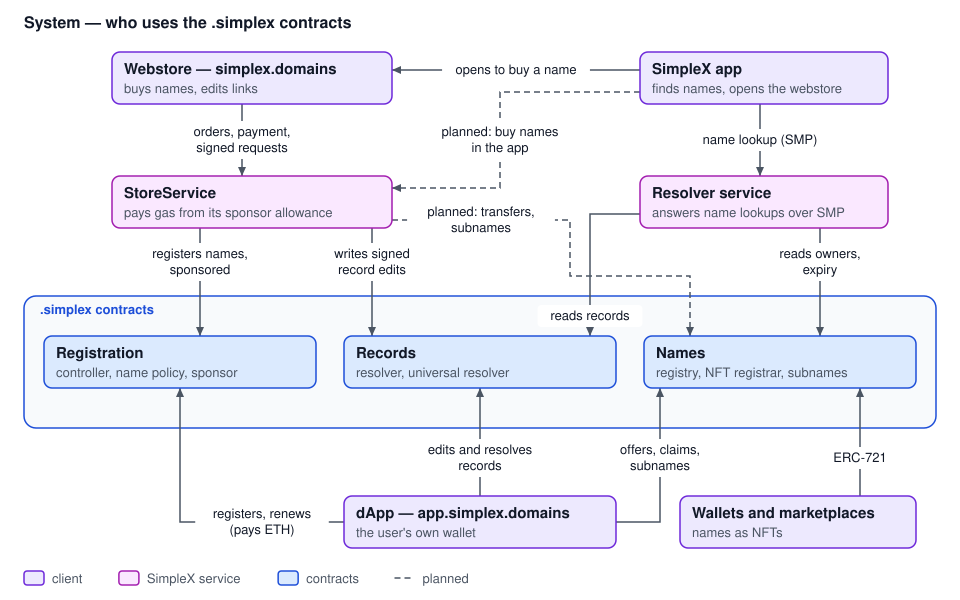
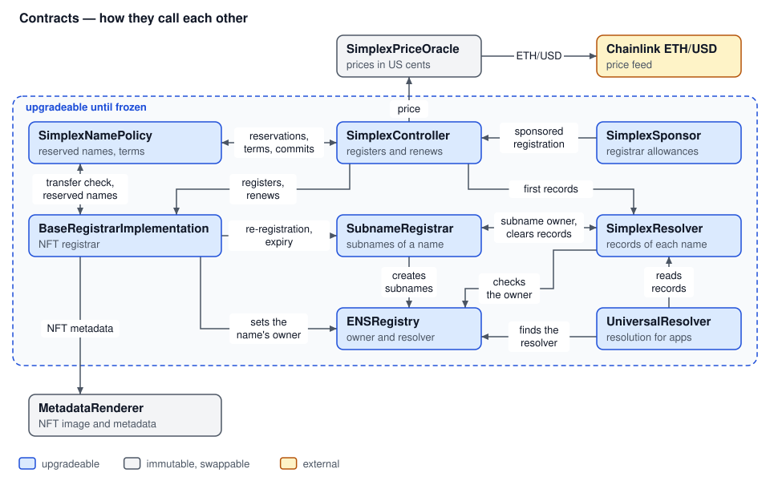
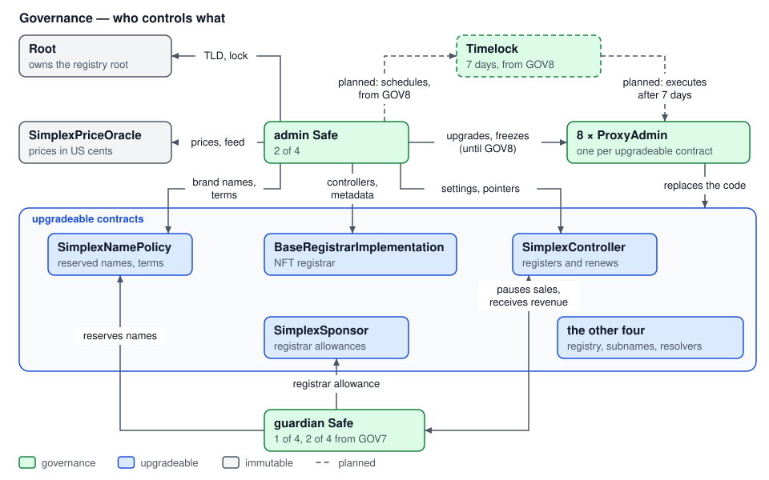
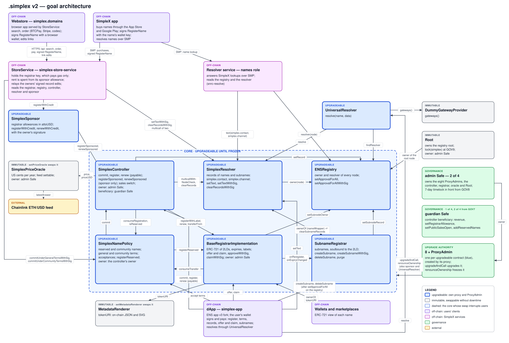
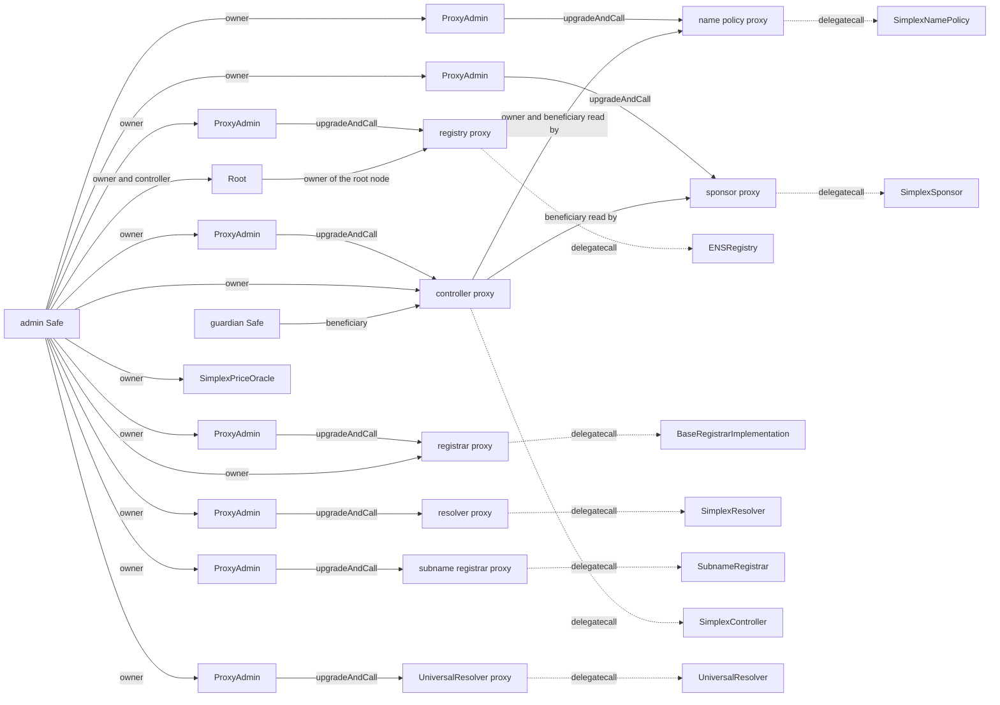
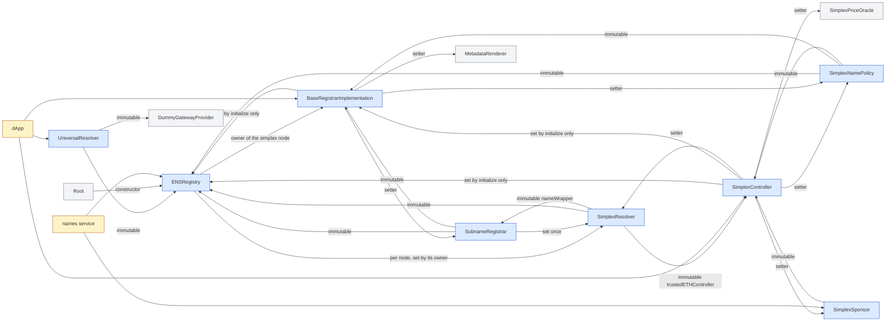
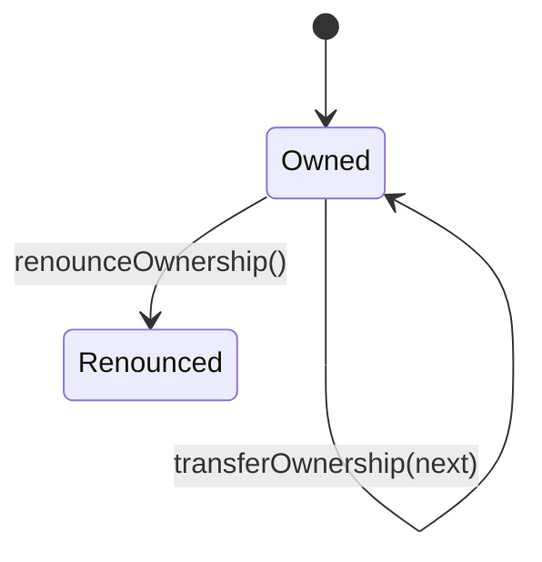
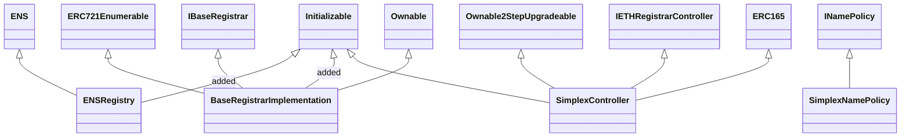
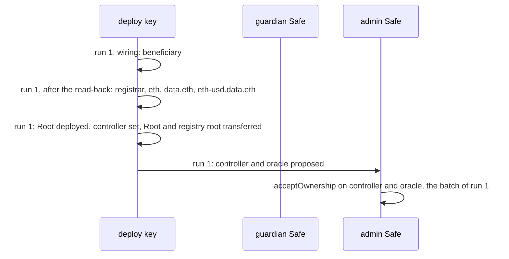
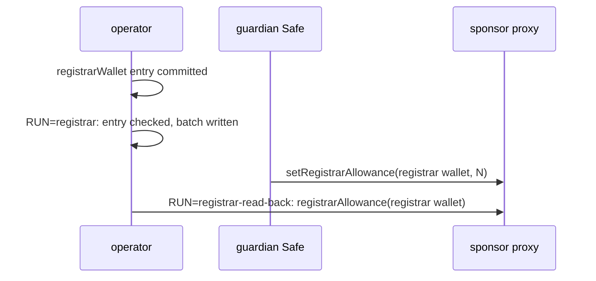

# `.simplex` v2: upgradeable contracts, each frozen on its own

On v1, the registry, the registrar, the resolver and the subname registrar are immutable, so a defect in any of them is repaired only by a snapshot and a redeploy of all state; the controller and the name policy are upgradeable, and one `freeze()` fixes both. The owner requires each contract to be upgradeable during a stabilization period, and frozen, or its upgrade authority moved, at a time of its own.

## 1. Contents

1. Contents
2. Decisions
3. Contracts
4. Upgrade authority, ownership, freeze and guarantees
5. Contract changes
6. Migration sequence
7. Deployment
8. Handover
9. Switch and retirement of v1
10. Tests
11. Scripts and documentation
12. Why transparent proxies in place of UUPS

## 2. Decisions

- D1. Scope: `.simplex` is redeployed as v2. `.testing` remains as deployed, on its current controller implementation. The v2 controller source is built without `proxiableUUID`, so it cannot be installed through the `.testing` UUPS proxy, and its storage layout differs from the deployed one. A fix of the `.testing` controller is built from the tag `simplex-mainnet-testing-v3`.
- D2. Behind an OpenZeppelin 5.1.0 `TransparentUpgradeableProxy`, one `ProxyAdmin` per proxy, eight contracts (section 3, "Swap without downtime"):
  - `ENSRegistry`, whose replacement interrupts user interaction
  - `BaseRegistrarImplementation`, idem
  - `SimplexResolver`, idem
  - `SubnameRegistrar`, idem
  - `SimplexController`, idem
  - `SimplexNamePolicy`, idem
  - `SimplexSponsor`, replaceable without downtime only with coordinated changes outside the contracts
  - `UniversalResolver`, idem
- D3. The UUPS upgrade code is removed from `SimplexController` and `SimplexNamePolicy`. `SimplexSponsor` and `UniversalResolver` keep their code: their constructors assign only immutables, so their proxies need no initializer.
- D4. Immutable, each replaceable without downtime (section 3), deployed fresh with unchanged code:
  - `SimplexPriceOracle`
  - `MetadataRenderer`
  - `DummyGatewayProvider`
  - `Root`
- D5. Upgrade authority of each proxy: the owner of its `ProxyAdmin`. Each proxy is created with `initialOwner` = admin Safe `0xf38920389740E46A7f4160DaF1672f3df2754Df4`.
- D6. A contract is frozen when its `ProxyAdmin` is renounced: `renounceOwnership()`, per contract, at any time and in any order.
- D7. `controller.freeze()` and its `frozen` flag are removed. A seal of the sponsor or of the public sales switch, where wanted, is added by the controller's last upgrade before its `ProxyAdmin` is renounced.
- D8. Constructors of `ENSRegistry` and `BaseRegistrarImplementation`: unchanged, plus `_disableInitializers()`, except that the registrar passes empty strings to `ERC721`, as upstream does, and its name and symbol are returned by `name()` and `symbol()`. A proxy is initialized by `initialize`.
- D9. Deploy key of v2: the v1 deploy key `0x38D19404644fe24EE7d638229a732CbE8275E333`. The ens-contracts commit of run 1 is `ebf76989ec5cab1c7dd49085b4c18faf303657d0` of simplex-network/ens-contracts `simplex`, which holds #50 and the dispute period of #51, so #51's code is live from the first deployment (the owner, 20 Nov: "#50 #51 merge before deploy"). The parent repository pins it, and it is tagged `simplex-mainnet-v2` before run 1.
- D10. Governance addresses are committed in `governance.mainnet.json`, the only source of these addresses for `deploy-mainnet.mjs`; the names service's registrar wallet is added to it for the registrar step (D21). `scripts/governance-check.mjs` checks a governance address against its entry (section 7); each check validates the address and its configuration at the moment of checking. The checks run:
  - in run 1, before its first transaction: every entry except the registrar wallet
  - in run 1, before each of the eight upgradeable contracts is deployed with its proxy: the admin Safe
  - in run 1, before `setBeneficiary`: the guardian Safe
  - in run 1, before each single-step transfer to the admin Safe: the admin Safe
  - in the registrar step, before its batch is written: the registrar wallet
- D11. The Safes as deployed: admin Safe 2 of 4, guardian Safe `0xE6623AA6b8d335367828C2A8b06A714678d22e2c` 1 of 4, the same four owners. The guardian Safe moves to 2 of 4 before public sales open (GOV7). The eight `ProxyAdmin`s stay with the admin Safe, without delay, past GOV7; the 7-day timelock of GOV8 follows GOV7, at a date not set.
- D12. v2 state comes from the committed files, as in the v1 run:
  - `reserved-names.simplex.csv`, unchanged: `evgeny`, `brenzi` and `evgenypoberezkin` are left unreserved
  - `community-names.simplex.csv`
  - `terms.simplex.json`, with the links of the conditions version of D13
- D13. The registry paragraph of simplex-chat `docs/NAMES-CONDITIONS.md` (line 7) reads: "**Registry**. The .simplex names registry is a set of contracts on the Ethereum blockchain. The contracts may be updated during a stabilization period, expected to last 12 to 24 months from the first registration, after which each of them is made immutable." This version is simplex-chat/simplex-chat#8272. The terms linked at run 1 describe v2 with the dispute period of D9, so they are `docs/NAMES-CONDITIONS.md` at the merge commit of simplex-chat/simplex-chat#8271 (the dispute period), merged after #8272, with master merged into #8271 after #8272's merge. That merge commit is tagged `general-terms-v1` and `community-terms-v1` and mirrored to git.simplex.chat before run 1, and both links of `terms.simplex.json` name the file at that commit. Run 1 is stopped by a failed terms check in every case.
- D14. The two names registered on v1 are registered again on v2 for their holders through the names service, as the first check of the v2 line: after the registrar step (D21), while purchase entry is still closed (D22); purchase entry opens only afterwards (the owner, 20 Nov).
- D15. `.simplex` stays unlocked at deployment. `root.lock(labelhash("simplex"))` is a step of the launch-to-freeze plan, which keeps its freeze naming for the end state.
- D16. Single-step transfers, by the deploy key in run 1:
  - in the wiring: beneficiary, guardian Safe
  - after the read-back:
    - registrar: admin Safe
    - `eth` and `data.eth`: admin Safe
    - `eth-usd.data.eth`: owner zero
    - `Root`: owner and controller admin Safe
    - registry root: `Root`
- D17. Two-step transfers, proposed at the end of run 1 and accepted by the admin Safe in one batch before the switch:
  - `SimplexController`
  - `SimplexPriceOracle`
- D18. v1 retirement, by the deploy key, at the end of run 1, with the v1 addresses of `deployments.mainnet.simplex-v1.json`:
  - `removeController(v1 controller)` on the v1 registrar
  - `removeController(v1 name policy)` on the v1 registrar
  - `transferOwnership(0x0)` on the v1 controller, which clears its pending owner
  - `transferOwnership(0x0)` on the v1 oracle, which clears its pending owner
- D19. simplex-network/ens-contracts#49 is merged after the deployment and ships as the first upgrade of v2: one admin Safe batch of the controller, the name policy and the sponsor (the owner, 20 Nov: "#49 might be merged after deploy and run a contract update"). Its storage-slot statements are recomputed for the layout without UUPS. brenzi/simplex-namespace-contract#18 is rewritten for v2 and carries the batch extension of `scripts/prepare-upgrade.mjs`, with which that batch is prepared; the extension exists before the batch. With the extension, each candidate is prepared, the Safe MultiSend is assembled and simulated on a mainnet fork with the admin Safe impersonated, and each implementation slot is compared with its candidate (ens-contracts `docs/upgrades.md`).
- D20. A sponsor replaced by `setSponsor` instead of an upgrade, for instance after its freeze, is replaced in this order: the guardian funds the new sponsor; the names service accepts both sponsors; the owner calls `setSponsor`; the names service drops the old sponsor.
- D21. The owner provides the registrar wallet after run 1; only then is its entry added to `governance.mainnet.json`. Runs 1 and 2 neither set nor read a registrar allowance. The registrar step follows run 2 and the commit of the v2 addresses file at the switch, without a wait for an upgrade: the sponsor of run 1 already holds #51's `RegisterName`, with `disputeDays`, and `registerWithCredit(registration, disputeDays, nonce, deadline, sig)` (D9). The store service on simplex-chat `names` at 0410929 still signs `RegisterName` without `disputeDays` and calls the four-argument `registerWithCredit` (`Names/Registration.hs`), so its change to #51's form precedes the first sponsored registration, the re-registration of D14. The re-registration of the two v1 names (D14) follows the registrar step. The registrar step, once the entry is committed:
  - `RUN=registrar`: the entry checked; the guardian Safe's batch of `sponsor.setRegistrarAllowance(wallet, allowance)` written
  - the guardian Safe executes the batch
  - `RUN=registrar-read-back`: `sponsor.registrarAllowance(wallet)` read back
- D22. Store orders across the switch. The store service keeps, per order, a commitment on the controller of its ini and the owner's `RegisterName` and terms-acceptance signatures, whose EIP-712 domains name the sponsor and the name policy (simplex-chat `apps/simplex-store-service`, `Names/Store.hs`, `Names/Registration.hs`, `Names/Reveal.hs`); after the switch such an order's commitment is absent on the v2 controller, its signatures name v1's addresses, and v1 reverts from step 8 of section 6. Therefore:
  - before run 1, an operator check (the owner, 20 Nov): purchase entry stays closed in the webstore and the SimpleX app, and the operator confirms that no name invoice is open and that no order is in the phase queued, committing, committed or registering, so that every paid order has registered on v1; with purchase entry closed, that state is reached by waiting, since such an order registers or fails (`Names/Worker.hs`). The check is made with the store service as it is
  - for the check, the store's metrics endpoint is read; it listens on 127.0.0.1 at `listener.metrics_port`, optional: where the deployed ini lacks it, it is set and the store service is restarted, since the ini is read only at start (`Main.hs`). `curl -s http://127.0.0.1:<metrics_port>/metrics | grep -E 'simplex_store_names_(invoices_open|orders)'` prints, read in this order, 0 for `simplex_store_names_invoices_open`, then 0 for the four phases (gauge `simplex_store_names_orders{phase="…"}`, counted from each order's stored phase, `Metrics.hs`, `Names/Store.hs`)
  - an unpaid order whose invoice is paid while open is queued in the same settlement, and a payment of an invoice no longer open queues nothing (`Orders.hs`, `nameSettled`); an order whose invoice expired is closed and keeps the phase unpaid until its deletion 30 days later, or for good with a recorded payment (`Poller.hs`), so the `unpaid` count need not be 0
  - a committed order past its `revealBefore` is counted as committed until the worker saves it as failed, so the operator waits for that
  - a failed paid order is closed with `//close`, with a refund recorded for support; a failed code order's code is released after 30 days
  - after the registrar step (D21) and the re-registration of the two v1 names (D14): purchase entry opens; an order is not committed or signed again

## 3. Contracts

### Goal architecture

Who uses the contracts: the users' clients and the SimpleX services, with the three groups of contracts they call; dashed arrows are planned.



How the contracts call each other; the dashed frame holds the eight upgradeable contracts.



Who controls what: the admin Safe, the guardian Safe, the ProxyAdmins and the planned timelock.



Every call between the components in one picture: solid arrows for calls in the code, dashed arrows for calls the plans assign.



The `.simplex` contracts after run 2, and the off-chain components that call them:

- Webstore, simplex.domains: the browser app served by StoreService; orders are paid through BTCPay, Stripe or codes, and the browser signs `RegisterName` with a wallet it generates.
- SimpleX app: purchases through the App Store and Google Play, and the `RegisterName` signed with the name's wallet key, go to StoreService over SMP; lookups go to the resolver service.
- StoreService, `simplex-store-service`: holds the registrar key; sends the owner's signed acceptance of the terms for a commitment to the name policy (`commitUnderGeneralTermsWithSig` or `commitUnderCommunityTermsWithSig`), and the commitment is stored on the controller by the policy's call of `commit`, unless an unexpired one is stored there; sends `registerWithCredit` to the sponsor, and the owners' signed record edits to the resolver.
- Resolver service, the names role (simplex-chat/simplexmq `scripts/resolver/service/snrc-resolve.py`, configured with `SNRC_REGISTRY_<TLD>`, `SNRC_REGISTRAR_<TLD>` and `SNRC_CONTROLLER_<TLD>`): reads `resolver(node)` and `owner(node)` from the registry; `nameExpires`, `GRACE_PERIOD`, `labelOf` and `subnameHook()` from the registrar; `ownerOf(node)` of a subname from the subname registrar; `namePolicy()`, `prices()` and `minCharLength()` from the controller; `reservedNames` from the name policy; the prices from the oracle; and `text` and `addr(bytes32,uint256)` from the resolver.
- dApp, `simplex-app`: the user's own wallet calls the controller, the name policy, the registrar, the subname registrar and the resolver, and resolves through `UniversalResolver`.

Sources: `docs/architecture-simplex-v2-views.gen.mjs` writes `docs/architecture-simplex-v2-system.svg`, `docs/architecture-simplex-v2-contracts.svg` and `docs/architecture-simplex-v2-governance.svg`, each with an `.excalidraw` file of the same name; `docs/architecture-simplex-v2.gen.mjs` writes `docs/architecture-simplex-v2.excalidraw` and `docs/architecture-simplex-v2.svg`.

### Sizes

Runtime bytes; the limit is 24,576 (EIP-170). Compiled with solc 0.8.26, optimizer 1,000,000 runs, `evmVersion` paris, metadata `ipfs`. The v1 column equals the runtime size of each v1 instance on mainnet.

| Contract | v1 | v2 |
|---|---:|---:|
| `ENSRegistry` | 5,809 | 6,370 |
| `BaseRegistrarImplementation` | 19,556 | 20,166 |
| `SimplexResolver` | 18,964 | 18,964 |
| `SubnameRegistrar` | 9,651 | 9,651 |
| `SimplexController` | 21,619 | 17,841 |
| `SimplexNamePolicy` | 20,210 | 15,779 |
| `SimplexSponsor` | 5,779 | 5,779 |
| `SimplexPriceOracle` | 5,667 | 5,667 |
| `MetadataRenderer` | 8,986 | 8,986 |
| `UniversalResolver` | 19,035 | 19,035 |
| `DummyGatewayProvider` | 400 | 400 |
| `Root` | – | 2,150 |
| `TransparentUpgradeableProxy` | – | 1,581 |
| `ProxyAdmin` | – | 1,415 |

`TransparentUpgradeableProxy` initcode, including its `ProxyAdmin`: 4,474 bytes.

### Upgrade authority and roles



### Swap without downtime

Question, per contract: can every user interaction continue, without downtime, while the contract is replaced by a new instance? A contract for which the answer is no is upgradeable (D2). So is a contract for which the answer is yes only with coordinated changes outside the contracts; the others are immutable (D4).

User interactions:

- register, payable or sponsored, with the acceptance of terms
- renew
- resolve, through the names service or the dApp
- change records of a name or a subname
- transfer: offer, acceptance of terms, claim
- create, delete or purge a subname

Where each contract's address is held, at `6eb2dd1d`:



| Contract | Its address is held by | State users rely on | Every user interaction continues across a swap | Model |
|---|---|---|---|---|
| `ENSRegistry` | immutable in the resolver (`PublicResolver.sol:31`), the subname registrar (`SubnameRegistrar.sol:35`), the name policy (`SimplexNamePolicy.sol:13`) and `UniversalResolver` (`UniversalResolver.sol:8`); set by `initialize` only in the registrar (`BaseRegistrarImplementation.sol:90-98`) and the controller (`SimplexController.sol:211`); `Root`; the names service (`SNRC_REGISTRY_SIMPLEX`) and the dApp | the owner and resolver of every name and subname; operator approvals | no: every node is copied to the new instance, every contract holding its address is redeployed, every client is reconfigured; registration, resolution and record changes stop until all are done | upgradeable |
| `BaseRegistrarImplementation` | owner of the `simplex` node in the registry, re-pointable through `Root` until the lock; controller `base`, set by `initialize` only (`SimplexController.sol:212`); immutable in the name policy (`SimplexNamePolicy.sol:12`) and the subname registrar (`SubnameRegistrar.sol:37`); the dApp, the names service, wallets | each name's token, holder, expiry and label; offers and approvals; per-signer nonces | no: every name is minted again to its holder; open offers and signed intents are lost; the controller, the name policy and the subname registrar are redeployed; wallets see a new token contract | upgradeable |
| `SimplexResolver` | each node's `resolver` in the registry, changed only by the node's owner; controller `defaultResolver` (setter, `SimplexController.sol:261`); subname registrar `resolver`, set once (`SubnameRegistrar.sol:119-123`) | every record of every name and subname; delegates; per-signer nonces | no: new registrations can use a new default resolver, but resolution and record changes of every existing name stay on the old instance until its holder re-points the name and writes its records again; new subnames keep the old instance, since the subname registrar's pointer is set once | upgradeable |
| `SubnameRegistrar` | owner of every subname node in the registry; the resolver's `nameWrapper`, immutable (`PublicResolver.sol:32`), through which subname record changes are authorised (`PublicResolver.sol:112-127`); registrar `subnameHook` (setter, `BaseRegistrarImplementation.sol:262`) | each subname's parent, generation and index; the expiry mirror of each name; per-signer nonces | no: existing subnames stay owned by the old instance, and their record changes are authorised only through it; a new instance starts without generations and expiries | upgradeable |
| `SimplexController` | registrar `controllers`, several at once; the resolver's `trustedETHController`, immutable (`PublicResolver.sol:33`); the name policy's and the sponsor's `controller`, immutable (`SimplexNamePolicy.sol:11`, `SimplexSponsor.sol:27`); the dApp and the names service | commitments in flight; beneficiary, sales switch and pointers; the revenue balance | no: a new instance is not the resolver's `trustedETHController`, so it cannot clear a lapsed name's records when the name is registered again (`SimplexController.sol:392-397`, `ResolverBase.sol:20`); the name policy, with its lists, and the sponsor are redeployed for it; commitments in flight are lost | upgradeable |
| `SimplexNamePolicy` | controller `namePolicy` and registrar `namePolicy` (setters, `SimplexController.sol:269`, `BaseRegistrarImplementation.sol:267`); registrar `controllers`, for `registerReserved` | 798 reserved and 457 community names at deployment, and later additions; terms; acceptances of commitments and offers in flight; per-signer nonces | no: every list is copied to the new instance before the two pointers change, or reserved names are registrable in the gap; the pointers change in two transactions; an acceptance made on the old instance for a registration or claim in flight is lost and made again | upgradeable |
| `SimplexSponsor` | controller `sponsor` (setter, `SimplexController.sol:254`); the names service | the registrar wallet's allowance; per-signer nonces | yes, in the order of D20: the guardian funds the new instance, the names service accepts both, `setSponsor`, the names service drops the old; a `RegisterName` intent signed for the old instance's domain (`SimplexSponsor.sol:102-110`) is signed again; the swap needs this coordination with the names service | upgradeable, so that its address and nonces stay |
| `SimplexPriceOracle` | controller `prices` (setter, `SimplexController.sol:306`) | the price list and the feed pointer, both passed to the constructor | yes: a new instance with the same list and feed, then `setPriceOracle`, one transaction | immutable |
| `MetadataRenderer` | registrar `metadataRenderer` (setter, `BaseRegistrarImplementation.sol:250`) | the suffix, passed to the constructor | yes: `setMetadataRenderer`, one transaction; only `tokenURI` reads it | immutable |
| `UniversalResolver` | the dApp's deployments file, read by `simplex-app/.github/workflows/deploy-pages.yml:65` | none | yes: the names service resolves through the registry (`docs/plans/names-v2-contracts.md`, section 8); the dApp moves to a new instance with its next build, and any other integrator with its own configuration | upgradeable, so that its address stays for the dApp and integrators |
| `DummyGatewayProvider` | `UniversalResolver`, immutable (`AbstractUniversalResolver.sol:29`), read on each `resolve` (`AbstractUniversalResolver.sol:95`) | none | yes: by an upgrade of `UniversalResolver` that names a new instance | immutable |
| `Root` | owner of the registry's root node | `locked`; its controllers | yes: no user interaction calls it; it is replaced only through a registry upgrade, since the root node cannot be moved out of it | immutable |

The sponsor and `UniversalResolver` could be swapped without downtime, but each swap needs coordinated changes outside the contracts, in the names service, the dApp and integrators; by the owner's decision they are upgradeable as well, which keeps their addresses.

The immutable references bind the upgradeable contracts to each other: a swap of the controller requires new instances of the resolver, the name policy and the sponsor, and a swap of the subname registrar requires a new resolver. An upgrade keeps every address, so none of these references changes.

## 4. Upgrade authority, ownership, freeze and guarantees

### Upgrade, freeze and transfer of upgrade authority

| Action | Call | Caller |
|---|---|---|
| upgrade | `ProxyAdmin.upgradeAndCall(proxy, implementation, data)` | `ProxyAdmin` owner |
| freeze | `ProxyAdmin.renounceOwnership()` | `ProxyAdmin` owner |
| move upgrade authority | `ProxyAdmin.transferOwnership(next)` | `ProxyAdmin` owner, after the GOV8 prerequisites, to a `TimelockController` entry for which `scripts/governance-check.mjs` passes |

`ProxyAdmin`, per proxy:

| State | `owner()` | `upgradeAndCall` |
|---|---|---|
| Owned | an address | accepted from that address |
| Renounced | `0x0` | reverts |

```
upgradeAndCall(proxy, implementation, data):
  require msg.sender == owner
  proxy.upgradeToAndCall(implementation, data)

renounceOwnership():
  require msg.sender == owner
  owner = 0x0
```



Calls prepared by `scripts/prepare-upgrade.mjs`, per owner of the `ProxyAdmin`:

| Owner | upgrade | freeze | move upgrade authority |
|---|---|---|---|
| admin Safe, before GOV8 | admin Safe batch | none: a freeze waits for GOV8 (launch-to-freeze plan, A7) | none until the GOV8 prerequisites; then an admin Safe batch, to a `TimelockController` entry |
| timelock, from GOV8 | after the GOV8 prerequisites: admin Safe batches of `schedule` and `execute` | after the GOV8 prerequisites: admin Safe batches of `schedule` and `execute` | after the GOV8 prerequisites |
| any other | none | none | none |

GOV8 prerequisites, before the timelock is deployed (launch-to-freeze plan, A5):

- OpenZeppelin 5.1.0 `TimelockController` in the ens-contracts build; the timelock is deployed from that artifact, and `scripts/governance-check.mjs` compares the timelock's runtime code with the keccak256 of that artifact's `deployedBytecode`, which holds no immutables, in place of the `codeHash` of its entry
- `scripts/prepare-upgrade.mjs` for a `ProxyAdmin` owned by the timelock: two admin-Safe batches, the timelock's `schedule` and `execute` of the call, with `hashOperation` printed and the call simulated from the timelock

Until both exist, `ACTION=transfer` of `scripts/prepare-upgrade.mjs` is refused: the `codeHash` of a `TimelockController` entry is written by the operator in the entry itself, so the timelock is tied to the OpenZeppelin 5.1.0 artifact only by the comparison.

### Owners of each contract's own calls

Owner of each contract's own calls, apart from its upgrade authority:

| Contract | Owner | Transfer |
|---|---|---|
| registrar | admin Safe | `Ownable`, single-step |
| controller | admin Safe | `Ownable2Step`, two-step |
| name policy | `controller.owner()` and `controller.beneficiary()` (`SimplexNamePolicy.sol:112-123`) | with the controller's |
| oracle | admin Safe | `Ownable2Step`, two-step |
| `Root` | admin Safe | `Ownable`, single-step |
| resolver | – | – |
| subname registrar | – | – |
| sponsor | `controller.beneficiary()` for `setRegistrarAllowance` (`SimplexSponsor.sol:58-65`) | with the controller's beneficiary |

### Guarantees

Until a `ProxyAdmin` is renounced, its owner can replace the code behind its proxy. Once it is renounced, the code behind that proxy is fixed. Each guarantee holds from the last of its conditions:

| Guarantee | Condition |
|---|---|
| a held name cannot be taken, transferred or re-pointed before it expires | registry `ProxyAdmin` renounced |
| | registrar `ProxyAdmin` renounced |
| | subname registrar `ProxyAdmin` renounced |
| a name's records are written only by its holder | registry `ProxyAdmin` renounced |
| | registrar `ProxyAdmin` renounced |
| | resolver `ProxyAdmin` renounced |
| | subname registrar `ProxyAdmin` renounced |
| | controller `ProxyAdmin` renounced |
| the answers that the dApp and integrators get through `UniversalResolver` are read from the registry and the name's resolver | `UniversalResolver` `ProxyAdmin` renounced |
| | registry `ProxyAdmin` renounced |
| | resolver `ProxyAdmin` renounced |

Until the `UniversalResolver` `ProxyAdmin` is renounced, an upgrade of `UniversalResolver` can change the answers that the dApp and integrators get through it.

`root.lock(labelhash("simplex"))` is a further condition of the three guarantees, scheduled by the launch-to-freeze plan (D15).

### Paths open after every freeze

Paths that remain open after every condition holds, through the calls below:

| Guarantee | Path | Call |
|---|---|---|
| a held name cannot be taken before it expires | renewals stopped, so names lapse and become available | `registrar.removeController(controller)` |
| | | `registrar.setSubnameHook` to a contract that reverts |
| | | `controller.setNamePolicy` to a policy that reserves every name |
| | renewals priced out | `controller.setPriceOracle` |
| | | `oracle.setPrices` |
| | payable renewals priced out | `oracle.setUsdOracle` to a feed with a low positive answer |
| | renewal of one name stopped | `namePolicy.addReservedNames`, also by the beneficiary |
| a name's records are written only by its holder | a re-registration that bumps no subname generation, so the previous holder's subnames and records stay under the name | `registrar.setSubnameHook(0x0)` during the re-registration |

### Calls that remain after every freeze

Calls that remain after every freeze:

| Contract | Call | Caller |
|---|---|---|
| controller | `setSponsor` | owner |
| controller | `setPublicSalesOpen` | owner or beneficiary |
| controller | `setNamePolicy` | owner |
| controller | `setPriceOracle` | owner |
| controller | `setMinCharLength` | owner |
| controller | `setDefaultResolver` | owner |
| controller | `recoverFunds` | owner |
| controller | `setBeneficiary` | beneficiary |
| controller | `transferOwnership`, `renounceOwnership` | owner |
| registrar | `addController` | owner |
| registrar | `removeController` | owner |
| registrar | `setNamePolicy` | owner |
| registrar | `setSubnameHook` | owner |
| registrar | `setMaxLabelLength` | owner |
| registrar | `setMetadataRenderer` | owner |
| registrar | `setResolver` | owner |
| registrar | `transferOwnership`, `renounceOwnership` | owner |
| oracle | `setPrices` | owner |
| oracle | `setUsdOracle` | owner |
| oracle | `transferOwnership`, `renounceOwnership` | owner |
| sponsor | `setRegistrarAllowance` | controller's beneficiary |
| name policy | `addReservedNames` | controller's owner or beneficiary |
| name policy | `setReservationReason` | controller's owner or beneficiary |
| name policy | `addCommunityNames` | controller's owner or beneficiary |
| name policy | `removeReservedNames` | controller's owner |
| name policy | `registerReserved` | controller's owner |
| name policy | `removeCommunityNames` | controller's owner |
| name policy | `setGeneralTerms` | controller's owner |
| name policy | `setCommunityTerms` | controller's owner |
| `Root` | `setSubnodeOwner` for unlocked labels, `simplex` until its lock | controller of `Root` |
| `Root` | `setResolver` | owner |
| `Root` | `setController` | owner |
| `Root` | `lock` | owner |
| `Root` | `transferOwnership`, `renounceOwnership` | owner |

## 5. Contract changes

simplex-network/ens-contracts, branch `ab/upgradeable-stack` from `simplex` at `1a11cda`.



`UUPSUpgradeable` is removed from the inheritance lists of `SimplexController` and `SimplexNamePolicy`.

### `ENSRegistry`

`contracts/registry/ENSRegistry.sol`:

```solidity
import {Initializable} from "@openzeppelin/contracts-upgradeable/proxy/utils/Initializable.sol";

contract ENSRegistry is ENS, Initializable {
    constructor() public {
        records[0x0].owner = msg.sender;
        _disableInitializers();
    }

    function initialize(address rootOwner) external initializer {
        records[0x0].owner = rootOwner;
    }
}
```

### `BaseRegistrarImplementation`

`contracts/ethregistrar/BaseRegistrarImplementation.sol`:

```solidity
import {Initializable} from "@openzeppelin/contracts-upgradeable/proxy/utils/Initializable.sol";

contract BaseRegistrarImplementation is
    ERC721Enumerable,
    IBaseRegistrar,
    Ownable,
    Initializable
{
    constructor(ENS _ens, bytes32 _baseNode) ERC721("", "") {
        ens = _ens;
        baseNode = _baseNode;
        _disableInitializers();
    }

    function initialize(
        ENS _ens,
        bytes32 _baseNode,
        address initialOwner
    ) external initializer {
        ens = _ens;
        baseNode = _baseNode;
        _transferOwnership(initialOwner);
    }

    function name() public pure override returns (string memory) {
        return "SimpleX Names";
    }

    function symbol() public pure override returns (string memory) {
        return "SIMPLEX";
    }
}
```

### `SimplexController`

`contracts/simplex/SimplexController.sol`, removed:

- the import of `UUPSUpgradeable`
- `UUPSUpgradeable` from the inheritance list
- `__UUPSUpgradeable_init()` in `initialize`
- `_authorizeUpgrade`
- `freeze()` with its NatSpec
- `bool public frozen`
- the `frozen` check in `setSponsor`
- the `frozen` check in `setPublicSalesOpen`
- error `Frozen`
- error `AlreadyFrozen`
- event `ContractFrozen`

Comments of `SimplexController` restated:

- lines 36, 57 and 62: a proxy in place of UUPS
- line 263, `setSponsor`: the mention of `freeze`
- line 280, `setNamePolicy`: the mention of `freeze`
- line 290, `setPublicSalesOpen`: the mention of `freeze`
- line 338, `setPriceOracle`: the mention of `freeze`
- line 685: the slot packing without `frozen`

### `SimplexNamePolicy`

`contracts/simplex/SimplexNamePolicy.sol`, removed:

- the import of `UUPSUpgradeable`
- `UUPSUpgradeable` from the inheritance list
- `_authorizeUpgrade`
- error `Frozen`
- error `ImplementationMismatch`

`contracts/simplex/SimplexSponsor.sol`: the comment at lines 13-15 without "until `freeze`".

### Build configuration

`hardhat.config.ts`, `npmFilesToBuild`, for the proxy and `ProxyAdmin` artifacts:

- `@openzeppelin/contracts-v5/proxy/transparent/TransparentUpgradeableProxy.sol`
- `@openzeppelin/contracts-v5/proxy/transparent/ProxyAdmin.sol`

`hardhat.config.ts`, the solc settings of 0.8.26: `outputSelection` `storageLayout` for every contract, read by the layout snapshot of section 10; solc's metadata excludes `outputSelection`, so the bytecode stays the same.

### Unchanged sources

Unchanged:

- `SimplexResolver`
- `SubnameRegistrar`
- `SimplexControllerProxy` and `SimplexNamePolicyProxy`, read by `scripts/build-verification.mjs` for v1; `SimplexNamePolicyProxy` is also deployed by tests; the NatSpec of `SimplexControllerProxy` is restated for its v1-only role

## 6. Migration sequence

### Steps

| # | Actor | Step |
|---|---|---|
| 1 | maintainers | the conditions version of D13 merged, tagged and mirrored to git.simplex.chat |
| 2 | operator | `terms.simplex.json` set to its links, both links checked with `scripts/terms-check.mjs` without a key, and the file committed to main; v1 files renamed on the operator's checkout (section 9) |
| 3 | operator | operator check: purchase entry closed in the webstore and the SimpleX app, no open name invoice, and no store order in the phase queued, committing, committed or registering (D22) |
| 4 | deploy key, run 1 | governance checks (section 7) |
| 5 | deploy key, run 1 | implementations and proxies deployed and wired; beneficiary set |
| 6 | deploy key, run 1 | read-back |
| 7 | deploy key, run 1 | single-step transfers (D16); controller and oracle proposed (D17) |
| 8 | deploy key, run 1 | v1 retirement (D18) |
| 9 | admin Safe | `acceptOwnership()` on the controller and the oracle, one batch |
| 10 | operator, run 2 | handover read-back, without transactions |
| 11 | operator, names service | the switch (section 9): the store service, the resolver service and the production dApp switched to v2; committed to main together: the renamed v1 files, the v2 addresses file, the v2 journal, `verification.mainnet.simplex.json` and the `simplex-app` submodule pointer |
| 12 | operator, guardian Safe, registrar step | after step 11, once the owner provides the registrar wallet: its entry committed and checked; the guardian Safe sets its allowance; the allowance read back (D21) |
| 13 | names service | the two v1 names registered again for their holders, while purchase entry is still closed, by the store service in #51's form of `RegisterName` (D14, D21) |
| 14 | operator | purchase entry opened in the webstore and the SimpleX app (D22) |
| 15 | operator | Etherscan verification |
| 16 | operator | deploy key destroyed |

```mermaid
sequenceDiagram
  participant M as maintainers
  participant O as operator
  participant D as deploy key
  participant G as guardian Safe
  participant A as admin Safe
  participant N as names service
  M->>M: tag and mirror the conditions version
  O->>O: terms.simplex.json: links checked, committed; rename v1 files
  O->>O: check: purchase entry closed, no store order in flight
  D->>D: run 1: checks, deploy, wire, read-back
  D->>D: run 1: single-step transfers, proposals, v1 retirement
  A->>A: acceptOwnership x2
  O->>O: run 2: read-back
  N->>N: switch: store and resolver services, production dApp
  O->>O: commit files and the simplex-app pointer
  O->>O: registrar step: entry committed and checked
  G->>G: v2 sponsor setRegistrarAllowance
  O->>O: registrar step: allowance read back
  N->>N: register the two v1 names again
  O->>O: open purchase entry
  O->>O: Etherscan verification, destroy deploy key
```

### Runs, resume and restore

Each run of `deploy-mainnet.mjs` is one invocation with a `RUN` of 1, 2, `registrar` or `registrar-read-back`. The inputs of runs 1 and 2 are the ens-contracts commit tagged `simplex-mainnet-v2`, the committed files of D10, D12 and D13, and, on the operator's checkout, the renamed v1 files `deployments.mainnet.simplex-v1.json`, `deployments.mainnet.simplex-v1.journal.jsonl` and `verification.mainnet.simplex-v1.json`, the v2 journal and the attempts log. A resumed run re-sends no journalled step and evaluates only its own read-back.

After step 8, registration and renewal on v1 revert: both v1 registrar controllers are removed by D18.

Steps 13 and 14 follow step 12: a sponsored registration reverts while the registrar wallet's allowance is zero. Step 14 follows step 13, so the two v1 names are registered for their holders before any buyer can order them (D14).

Until step 11, v1 is restored by the deploy key: `addController` for the v1 controller and the v1 name policy on the v1 registrar, and `transferOwnership(admin Safe)` on the v1 controller and the v1 oracle.

## 7. Deployment

### Governance check

`governance.mainnet.json` entries and the checks of `scripts/governance-check.mjs`:

| Kind | Read | Value |
|---|---|---|
| Safe | `getCode` | the SafeProxy 1.5.0 code |
| Safe | storage slot 0 | Safe 1.5.0 singleton `0xff51a5898e281db6dfc7855790607438df2ca44b` |
| Safe | `VERSION()` | `1.5.0` |
| Safe | `getThreshold()` | the entry's threshold |
| Safe | `getOwners()` | the entry's owners |
| Safe | `getModulesPaginated(0x1, 10)` | empty |
| Safe | guard slot | `0x0` |
| Safe | fallback handler slot | Safe 1.5.0 compatibility fallback handler `0x3efcbb83a4a7afcb4f68d501e2c2203a38be77f4` |
| Safe | `nonce()` | at least 1 |
| TimelockController | `getCode` | the entry's code hash |
| TimelockController | `getMinDelay()` | the entry's delay |
| TimelockController | `hasRole` of the proposer, executor and canceller roles | `true` for the entry's Safes; `false` for every other account named by the `RoleGranted` logs of these roles since the entry's deploy block, and for `0x0` |
| TimelockController | `hasRole` of its admin role | `false` for every account named by its `RoleGranted` logs since the entry's deploy block, every account of the entry and the deploy key, except the timelock itself |

The registrar wallet's entry, added for the registrar step (D21), holds its address and its allowance N, in attoUSD, as a JSON string of decimal digits; `scripts/governance-check.mjs` checks that its `getCode` is empty.

### Contracts of run 1

Run 1, deploy key. Each proxy is a `TransparentUpgradeableProxy` with `initialOwner` = admin Safe. The address of a proxy's `ProxyAdmin` is the CREATE address of the proxy at nonce 1.

| # | Implementation or contract, constructor arguments | Proxy data |
|---|---|---|
| 1 | `ENSRegistry()` | `initialize(deploy key)` |
| 2 | `BaseRegistrarImplementation(registry proxy, namehash("simplex"))` | `initialize(registry proxy, namehash("simplex"), deploy key)` |
| 3 | `SimplexPriceOracle(feed, decimals, base, exceptions)`, with the decimals, base price and exceptions of `scripts/simplex-price-curve.mjs` | – |
| 4 | `SimplexController()` | `initialize(registrar proxy, oracle, 60, 86400, registry proxy, config, deploy key)` |
| 5 | `SimplexNamePolicy(controller proxy, registrar proxy)` | empty |
| 6 | `SubnameRegistrar(registry proxy, registrar proxy)` | empty |
| 7 | `SimplexResolver(registry proxy, subname registrar proxy, controller proxy, 0x0)` | empty |
| 8 | `SimplexSponsor(controller proxy)` | empty |
| 9 | `DummyGatewayProvider()` | – |
| 10 | `UniversalResolver(deploy key, registry proxy, gateway provider)` | empty |
| 11 | `MetadataRenderer(".simplex")` | – |

### Wiring

Wiring: the calls of the v1 run against the v2 addresses, including `controller.setBeneficiary(guardian Safe)`, in the order of steps 1 to 16 of `docs/deployment.md`, "Deployment and wiring".

### Read-back of run 1

The read-back of run 1 checks, before section 8:

- the checks of the v1 run against the v2 addresses: the wiring, every reserved and community name, the price list and the feed (`docs/deployment.md`, "Read-back of run 1")
- the ownership checks of the v1 run, with the deploy key as the holder of every role and `0x0` as the pending owner of the controller and the oracle, while `registrar.owner()` is the deploy key; once it is the admin Safe, section 8 has started after an earlier passing read-back, and these checks are skipped; any other owner fails; run 2 checks the table of section 8 in their place
- the runtime code of each of the eight implementations: the compiled artifact, with the expected immutables placed at its `immutableReferences`
- the runtime code of `SimplexPriceOracle`, `DummyGatewayProvider` and `MetadataRenderer`: the compiled artifact
- `_initialized` of the registry, registrar and controller implementations: 255
- the ERC-1967 implementation slot of each of the eight proxies: its implementation
- the ERC-1967 admin slot of each of the eight proxies: the CREATE address of the proxy at nonce 1
- `owner()` of each of the eight `ProxyAdmin`s: admin Safe
- the runtime code of each of the eight `ProxyAdmin`s: the compiled `ProxyAdmin` artifact
- `registrar.ens()`: the registry proxy
- `registrar.baseNode()`: `namehash("simplex")`
- `controller.ens()`: the registry proxy
- `controller.tldNode()`: `namehash("simplex")`
- `subnameRegistrar.ens()`: the registry proxy
- `subnameRegistrar.baseRegistrar()`: the registrar proxy
- the runtime code of each of the eight proxies: the `TransparentUpgradeableProxy` artifact, with its `ProxyAdmin` placed at the immutable `_admin`
- `universalResolver.registry()`: the registry proxy
- `ens.resolver(namehash("simplex"))`: the resolver proxy
- the distinct addresses of the registrar's `ControllerAdded` events: the controller proxy and the name policy proxy, and no other address

### Addresses file

Addresses file `deployments.mainnet.simplex.json`, committed at step 11:

| Key | Value |
|---|---|
| each existing key | the proxy, or the immutable contract |
| `Root` | `Root` |

`PublicResolver` and `NameWrapperPublicResolver` both hold the resolver proxy. The keys `SimplexControllerImpl` and `SimplexNamePolicyImpl` are dropped; scripts read the implementation and the `ProxyAdmin` of a proxy from its ERC-1967 slots.

## 8. Handover

### Transfers in run 1

Run 1, deploy key, after its read-back passes:

1. `registrar.transferOwnership(admin Safe)`
2. `ens.setOwner(namehash("eth-usd.data.eth"), 0x0)`
3. `ens.setSubnodeOwner(namehash("eth"), labelhash("data"), admin Safe)`
4. `ens.setSubnodeOwner(0x0, labelhash("eth"), admin Safe)`
5. deploy `Root(registry proxy)`; its runtime code is the compiled artifact, or run 1 stops before step 6
6. `root.setController(admin Safe, true)`
7. `root.transferOwnership(admin Safe)`
8. `ens.setOwner(0x0, root)`
9. `controller.transferOwnership(admin Safe)`
10. `oracle.transferOwnership(admin Safe)`

### Read-back of run 2

The read-back of run 2 checks, after step 9 of section 6:

| Read | Value |
|---|---|
| `owner()` of each of the eight `ProxyAdmin`s | admin Safe |
| `controller.owner()` | admin Safe |
| `controller.pendingOwner()` | `0x0` |
| `controller.beneficiary()` | guardian Safe |
| `registrar.owner()` | admin Safe |
| `oracle.owner()` | admin Safe |
| `oracle.pendingOwner()` | `0x0` |
| `ens.owner(0x0)` | `Root` |
| `ens.owner(namehash("eth"))` | admin Safe |
| `ens.owner(namehash("data.eth"))` | admin Safe |
| `ens.owner(namehash("eth-usd.data.eth"))` | `0x0` |
| `root.ens()` | the registry proxy |
| `root.owner()` | admin Safe |
| `root.controllers(admin Safe)` | `true` |
| `root.controllers(deploy key)` | `false` |
| `root.locked(labelhash("simplex"))` | `false` |
| v1 registrar `controllers(v1 controller)` | `false` |
| v1 registrar `controllers(v1 name policy)` | `false` |
| v1 controller `pendingOwner()` | `0x0` |
| v1 oracle `pendingOwner()` | `0x0` |
| each owner and pending owner above, and `ens.owner` of the root node, `eth` and `data.eth` | not the deploy key |



### Registrar step

After step 11 of section 6, without a wait for an upgrade, once the owner provides the registrar wallet (D21); `RUN=registrar` writes the batch only when each of its reads below has the value shown:

| Call or read | Caller | Value |
|---|---|---|
| `governance.mainnet.json` entry `registrarWallet` | operator, committed | kind `EOA`, `address`, allowance N in attoUSD |
| governance check of the entry | `RUN=registrar` | no code at the address |
| sponsor proxy's admin slot | `RUN=registrar` | the CREATE address of the proxy at nonce 1 |
| `controller.sponsor()` | `RUN=registrar` | the sponsor proxy |
| `sponsor.controller()` | `RUN=registrar` | the controller proxy |
| `controller.beneficiary()` | `RUN=registrar` | the guardian Safe |
| batch `safe-transaction.mainnet.simplex.registrar.json` | `RUN=registrar` | one transaction: `sponsor.setRegistrarAllowance(registrar wallet, N)` |
| the batch executed | guardian Safe | – |
| `sponsor.registrarAllowance(registrar wallet)` | `RUN=registrar-read-back` | N |



## 9. Switch and retirement of v1

### v1 files

Renamed to `*.simplex-v1.*` at step 2 on the operator's checkout, committed to main at step 11:

- `deployments.mainnet.simplex.json`
- `deployments.mainnet.simplex.journal.jsonl`
- `verification.mainnet.simplex.json`

`deployments.mainnet.simplex.attempts.log` is renamed on the operator's machine only.

The two v1 NFTs remain with their holders on the retired v1 registrar.

### Names service

Names service, at step 11: the four address keys of the `[chain]` section of the store service's ini (simplex-chat `apps/simplex-store-service`, `Config.hs`), then a restart of the service:

| Key | Value |
|---|---|
| `controller` | controller proxy |
| `sponsor` | sponsor proxy |
| `base_registrar` | registrar proxy |
| `resolver` | resolver proxy |

The service reads three further addresses from these:

| Address | Read from | Kept |
|---|---|---|
| name policy | `controller.namePolicy()` (`Names/Contracts.hs`) | until a restart, or until a registration reverts `TermsNotAccepted` |
| registry | `baseRegistrar.ens()`, in `registrarConstants` (`Names/Contracts.hs`) | until a restart |
| registry and subname registrar | `baseRegistrar.ens()` and `baseRegistrar.subnameHook()`, in `nameCensus` (`Names/Census.hs`) | read again on each census |

The restart is required because of the two kept addresses.

### Other consumers

The resolver service, also at step 11, with the store service, so that a name registered on v2 is resolved from its first registration (names-v2-contracts plan, section 8):

| Consumer | Setting | Value |
|---|---|---|
| resolver service, simplex-chat/simplexmq `scripts/resolver/service/snrc-resolve.py` | `SNRC_REGISTRY_SIMPLEX` | registry proxy |
| resolver service | `SNRC_REGISTRAR_SIMPLEX` | registrar proxy |
| resolver service | `SNRC_CONTROLLER_SIMPLEX` | controller proxy |

The production dApp, app.simplex.domains, is built by `.github/workflows/deploy-pages.yml` of simplex-chat/simplex-domains-app-v3 on each push to its `production` branch, from that repository's own `deployments.mainnet.simplex.json`. Its switch:

1. A copy of the v2 addresses file and the change of the storage slots of the gas estimate (`src/hooks/gasEstimation/calculateTransactions.ts`) to v2's are put in one pull request from `ab/v2-storage-slots` into `simplex`, the repository's default branch.
2. At step 11 it is merged, `production` is fast-forwarded to that merge commit, and the parent's `simplex-app` submodule pointer moves to the same commit.

The deployment from `production` of 4 Nov was refused by the repository's `github-pages` environment (`Branch "production" is not allowed to deploy to github-pages due to environment protection rules.`), and the `.testing` build of `38a90e6`, deployed from `simplex` on 3 Nov, is served at app.simplex.domains; `production` is admitted in that environment before step 11.

| Variable | v1 slot | v2 slot |
|---|---|---|
| `SimplexNamePolicy.acceptedTerms` | 103 | 2 |
| `SimplexController.commitments` | 260 | 160 |

Without the slot change, the estimate of `registerName` reverts and a fixed 700,000 gas is used (`src/hooks/chain/useEstimateGasWithStateOverride.ts`).

`scripts/cloudflare-build-simplex.sh`, the staging build, reads the parent's `deployments.mainnet.simplex.json` from main, so the staging dApp is built against v2 from the commit of step 11.

### Etherscan verification

Etherscan verification:

- the eight implementations
- the eight proxies
- the eight `ProxyAdmin`s
- `SimplexPriceOracle`
- `MetadataRenderer`
- `DummyGatewayProvider`
- `Root`

## 10. Tests

### ens-contracts: new suite

simplex-network/ens-contracts, `test/simplex/TestUpgradeableStack.test.ts`, new:

- for the registry, the registrar and the controller:
  - `initialize` sets the registry's root owner, the registrar's `ens`, `baseNode` and owner, and the controller's configuration and owner
  - a second `initialize` reverts
  - `initialize` on the implementation reverts
- for each of the eight proxies:
  - `upgradeAndCall` by the `ProxyAdmin` owner succeeds; by any other caller it reverts
  - `upgradeToAndCall` sent to the proxy by the `ProxyAdmin` owner reverts, and the implementation slot is unchanged
  - `upgradeToAndCall` sent to the proxy by the contract's owner reverts, and the implementation slot is unchanged
  - for the registry root, the registrar, the controller and the name policy: an owner call, sent through the proxy by the admin Safe, succeeds; for the resolver and the subname registrar, which have no owner calls: a holder call through the proxy succeeds; for the sponsor: `setRegistrarAllowance` by the guardian Safe succeeds; for `UniversalResolver`: a `resolve` call succeeds
  - state written before an upgrade reads the same after it
- for the six proxies whose contract has `DOMAIN_SEPARATOR()`: it reads the same after an upgrade
- the ABIs of the eight implementations exclude these selectors:
  - `0x3659cfe6`
  - `0x4f1ef286`
  - `0x52d1902d`
- after `renounceOwnership` on one `ProxyAdmin`, that proxy's upgrade reverts and the other seven upgrade
- after `transferOwnership` on one `ProxyAdmin`, that proxy is upgraded by the new owner only, and the other seven by the admin Safe only
- the registrar through its proxy: `name()`, `symbol()`, registration, transfer and `tokenURI`
- storage layout snapshots of the eight implementations
- gas of these calls through proxies and on direct deployments, reported in the pull request:
  - `register`
  - `registerWithCredit`
  - `setTextWithSig` on a name
  - `createSubnameWithSig`
  - `setTextWithSig` on a subname

### ens-contracts: existing tests

simplex-network/ens-contracts, existing tests:

- `test/simplex/TestControllerStorageLayout.test.ts`:
  - the comments at lines 23 and 42-47 restated
  - the beneficiary's slot found through `setBeneficiary` by the beneficiary, in place of `freeze` (lines 49-65 and 79-103)
- `test/simplex/TestNamePolicy.test.ts:218-231`: the terms at slots 1, 5, 6 and 7 in place of 102, 106, 107 and 108
- removed: the tests and assertions that call `freeze()`, read `frozen` or expect `Frozen`, `AlreadyFrozen` or `ImplementationMismatch`, in:
  - `test/simplex/TestBeneficiaryAndFreeze.test.ts`
  - `test/simplex/TestPublicSalesSwitch.test.ts`
  - `test/simplex/TestAdminSplit.test.ts`
  - `test/simplex/TestNamePolicy.test.ts`
  - `test/simplex/TestLaunchLifecycle.test.ts`
- removed: `test/simplex/TestBeneficiaryAndFreeze.test.ts:109-113`, the upgrade before the freeze
- renamed: `test/simplex/TestBeneficiaryAndFreeze.test.ts` to `test/simplex/TestBeneficiary.test.ts`
- rewritten for `ProxyAdmin.upgradeAndCall`:
  - `test/simplex/TestNamePolicy.test.ts:136-151`
  - `test/simplex/TestNamePolicy.test.ts:176` onwards, the upgrade that preserves the lists
  - `test/simplex/TestSimplexController.test.ts`, its upgrade tests
- `test/simplex/fixtures/namesV2.ts` deploys the eight contracts behind `TransparentUpgradeableProxy`; the suites that use it run through the proxies
- `test/simplex/TestLaunchLifecycle.test.ts` follows sections 6 to 8
- these suites keep direct deployments:
  - `test/simplex/FuzzSubnameRegistrar.test.ts`
  - `test/simplex/TestApproveClaimWithSig.test.ts`
  - `test/simplex/TestRegistrarV3.test.ts`
  - `test/simplex/TestSimplexResolver.test.ts`
  - `test/simplex/TestSnrcResolution.test.ts`
  - `test/simplex/TestSubnameChainIntegrity.test.ts`
  - `test/simplex/TestSubnameLapse.test.ts`
  - `test/simplex/TestSubnameRegistrar.test.ts`

### simplex-namespace-contract: scripts and rehearsal

brenzi/simplex-namespace-contract:

- `scripts/deploy-local.mjs` deploys the v2 shape; the Playwright suite runs against it
- fork dry runs, with the Safes impersonated:
  - runs 1 and 2 pass both read-backs
  - a `ProxyAdmin` owner other than the admin Safe stops run 1 before section 8
  - run 1 stopped after each step of section 8 and resumed sends each remaining step once and passes both read-backs
  - run 1 resumed while a step's transaction is pending waits for it and sends nothing new
  - run 2 passes without a registrar wallet; then the registrar step's read-back fails before the guardian Safe executes its batch and passes after it
  - the restore path of section 6 returns v1 to its state before step 8
- `scripts/governance-check.test.mjs`, run with `node --test`; a Safe is refused for each of:
  - a different threshold
  - different owners
  - an enabled module
  - a guard
  - a different singleton
  - a different fallback handler
  - nonce 0
  - an address without code
- `scripts/governance-check.test.mjs`: a `registrarWallet` allowance given as a JSON number is refused
- `scripts/prepare-upgrade.test.mjs`, run with `node --test`:
  - refused: a different `trustedETHController`
  - accepted: a different `trustedETHController` named as an intended change, printed with both values
  - refused: a reordered state variable
  - refused: a reordered member of a stored struct
  - refused: a reordered member of a stored enum
  - accepted: a member appended to a stored enum, its storage size unchanged
  - refused: a call for an unknown `CONTRACT`, or for a proxy whose admin slot is not its CREATE address at nonce 1, or whose `ProxyAdmin` is renounced or owned by another account than the admin Safe
  - refused: `ACTION=freeze` and `ACTION=transfer` for a `ProxyAdmin` the admin Safe owns
  - accepted: upgrade `data` encoded for a function of the candidate; refused: a function the candidate lacks
  - refused: a `_proxyAdmin` immutable that differs from the proxy's `ProxyAdmin`, also when named as an intended change
  - refused: an upgrade whose simulation from the `ProxyAdmin`'s owner reverts
  - refused: a non-empty `data` for a candidate without a `_proxyAdmin` immutable
  - refused: `data` of `multicall(bytes[])` or `multicallWithNodeCheck(bytes32,bytes[])`, also for a candidate with a `_proxyAdmin` immutable
  - refused: a candidate without a custom error of the current implementation
  - refused: a new variable placed before an existing one
  - refused: an `upgradeToAndCall` function
  - refused: a `fallback` or `receive` function
  - refused: bytecode that contains the ERC-1967 implementation or admin slot
  - accepted: an identical rebuild
  - accepted: a variable appended in place of the first slot of the trailing `__gap`, as in #49
- fork rehearsal of upgrade `data` on `SimplexController`: a missing function refused; `data` for a candidate without a `_proxyAdmin` immutable refused before any deployment
- the reference test of the guard is added with the first upgrade whose `data` writes state: the `data` writes the state, a direct call from any other address reverts, and in the three contracts with `Initializable` a second `upgradeAndCall` with the same `data` reverts

## 11. Scripts and documentation

### simplex-chat

simplex-chat/simplex-chat:

- `docs/NAMES-CONDITIONS.md`, line 7 (D13)

### simplex-namespace-contract

brenzi/simplex-namespace-contract:

- `governance.mainnet.json`, new
- `scripts/governance-check.mjs`, new
- `terms.simplex.json`: the links of D13
- `scripts/deploy-mainnet.mjs`:
  - runs 1 and 2
  - governance addresses from `governance.mainnet.json` in place of `OWNER_ADDRESS` and `GUARDIAN_ADDRESS`
  - `TERMS_UNCHECKED` removed: run 1 is stopped by a failed terms check in every case
  - the read-backs of `frozen()` (lines 571-572) and of the implementation keys (lines 661-664) removed
  - the comment at line 395 without the mention of `freeze`
- `scripts/deploy-local.mjs`, with its comment at line 159
- `scripts/deploy-testnet.mjs`: unchanged; Sepolia is retired (`docs/deployment.md:12`)
- `scripts/prepare-upgrade.mjs`, new, in place of `scripts/deploy-controller-impl.mjs`:
  - deploys a candidate implementation
  - compares its runtime code with the artifact, with the current immutables placed at its `immutableReferences`, except `SimplexNamePolicy._self`, `SubnameRegistrar._deployer` and each immutable that the operator names as an intended change; each intended change is printed with its current and new value
  - compares the storage layouts with type names freed of AST ids: every variable except a trailing `__gap` keeps its slot, offset and type, and a trailing `__gap` ends at the same slot
  - a candidate with the selectors `0x3659cfe6`, `0x4f1ef286` or `0x52d1902d`, a `fallback` or a `receive` is rejected
  - a candidate whose bytecode contains the ERC-1967 implementation or admin slot is rejected
  - prints the calldata of `ProxyAdmin.upgradeAndCall`, with the `data` it encodes from a named function and its arguments, after simulating the call from the `ProxyAdmin`'s owner
  - deploys the candidate with the proxy's `ProxyAdmin` as a constructor argument where the candidate declares a `_proxyAdmin` immutable, and checks that immutable against the proxy's `ProxyAdmin`
  - compares the members of every stored struct, and of every stored enum from the build output's AST, as well
  - a candidate without a function selector or an event topic of the current implementation, or with another shape for one (a function's state mutability or outputs, an event's indexing or anonymity), is rejected, unless `INTENDED` names its signature; the other contracts of the stack call these functions through fixed addresses
  - a candidate without a custom error selector of the current implementation is rejected, unless `INTENDED` names its signature: the names service treats a `TermsNotAccepted` revert as a signal to read the name policy again
  - upgrade `data` of `multicall(bytes[])` or `multicallWithNodeCheck(bytes32,bytes[])` is rejected: each entry is executed by a `delegatecall` to the proxy with the `ProxyAdmin` as its sender, so an entry with the selector of `upgradeToAndCall` would install another implementation
  - prepares a call only through a `ProxyAdmin` the admin Safe owns, until the GOV8 prerequisites (section 4)
  - refuses a freeze and an upgrade-authority transfer until the GOV8 prerequisites exist: a freeze is prepared after GOV8 (launch-to-freeze plan, A7), as the timelock's `schedule` and `execute` of `renounceOwnership()`; a transfer, as `transferOwnership(next)` to a `TimelockController` entry whose code is compared with the OpenZeppelin 5.1.0 artifact
  - reads the target of each call from the ERC-1967 admin slot of the proxy of the contract named by `CONTRACT`, checked to be the proxy's CREATE address at nonce 1, and prints the proxy's implementation slot with the call
- `scripts/build-verification.mjs`
- `scripts/verify-etherscan.mjs`
- `docs/deployment.md`, with the sponsor replacement of D20
- `docs/ens-diff.md`
- `docs/plans/names-v2-launch-to-freeze-plan.md`:
  - section 3, the keys and the Safes (D11)
  - section 4, the power table
  - section 5, what no key can do, with the paths of section 4 of this plan
  - section 6, the immutable registrar and `Root`
  - section 7, the redeploy fallback
  - appendix A1, the deployment through proxies
  - appendix A2, the handover order
  - appendix A5, the eight `ProxyAdmin`s moved to the timelock, each after `scripts/governance-check.mjs` passes for it
  - appendix A6, the upgrade and freeze of one contract
  - GOV9, as per-contract freezes and `Root.lock`, with its freeze naming kept
- `docs/plans/names-v2-contracts.md`
- `docs/security.md`:
  - L1
  - H1
  - V1
  - "The invariant everything rests on"
  - "New privileged surface"
  - "What freeze() does not stop"
  - "Bounds that are the registrar's job, not the contract's"
  - "Deployment opsec"
  - V3, with the paths of section 4
  - line 589
- `docs/architecture.md`
- `docs/sequence-happy-flow.md`
- `CLAUDE.md`:
  - architecture and admin capabilities
  - deployment order
  - "Deviations", where the registrar and the subname registrar are called immutable, and the change from UUPS to transparent proxies
  - "Toolchain": contracts-upgradeable
  - "UUPS wrapping is mechanical", restated for transparent proxies

### ens-contracts

simplex-network/ens-contracts:

- `hardhat.config.ts`
- `deploy/simplex/00_deploy_simplex_controller.ts`
- `docs/upgrades.md`:
  - transparent proxies and their layout rules
  - invariant 4 restated for the immutables of the resolver and the subname registrar, which determine who may write records
  - a review item for each upgrade: no `delegatecall` to an address other than the contract itself; no state written by a constructor or a variable initializer of the new implementation; state the upgrade needs is written by the function passed as `data`, which reverts unless `msg.sender` equals its `_proxyAdmin` immutable, and in `ENSRegistry`, `BaseRegistrarImplementation` and `SimplexController` is also a `reinitializer(n)`

## 12. Why transparent proxies in place of UUPS

The owner requires that each upgradeable contract can be frozen, and its upgrade authority moved, on its own and at its own time. With a UUPS proxy, the upgrade code is part of each implementation: each contract then contains `upgradeToAndCall` and an owner that authorizes it, and a contract is frozen by a last upgrade to an implementation whose `_authorizeUpgrade` reverts. With a transparent proxy, the upgrade code is part of the proxy and of a `ProxyAdmin` created with it; the contracts contain none of it. A freeze state kept in `SimplexController` for all contracts would be subject to the controller's own upgrade authority, so one controller upgrade could undo every freeze; in v1, `controller.owner()` and `controller.frozen()` are read by the name policy in that way (`SimplexNamePolicy.sol:115-118`, `513-520`).

### Comparison of the three models

Three models were compared: transparent proxies for all six contracts, UUPS for all six, and the v1 mix of UUPS for the controller and the name policy with transparent proxies for the other four. Sizes are runtime bytes, compiled with the repository's settings; the limit is 24,576. The UUPS variant measured, without a freeze flag (D7):

- `UUPSUpgradeable` 4.9.3
- `_authorizeUpgrade` gated by `onlyOwner`
- an initializer, and `_disableInitializers()` in the constructor
- registry, resolver and subname registrar: an `Ownable2StepUpgradeable` owner
- registrar: `Ownable2Step` in place of `Ownable`
- controller: the v2 source with `UUPSUpgradeable` restored
- name policy: the v2 source with `UUPSUpgradeable` restored and the v1 check of its controller and registrar

Sizes in parentheses: the same variant with single-step `Ownable` owners.

| Criterion | All transparent | All UUPS | Mix |
|---|---|---|---|
| upgrade procedure | `ProxyAdmin.upgradeAndCall` for all six | `upgradeToAndCall` on each contract | both procedures |
| freeze of one contract | `ProxyAdmin.renounceOwnership()`; the proxy's admin is immutable, so the freeze is final | a last upgrade to an implementation whose `_authorizeUpgrade` reverts | both |
| `BaseRegistrarImplementation` | 20,166; 4,410 bytes of headroom | 24,051; 525 bytes of headroom (23,742; 834) | 20,166 |
| `SimplexResolver` | 18,964, unchanged code | 24,090; 486 bytes of headroom (23,778; 798) | 18,964 |
| `SubnameRegistrar` | 9,651, unchanged code | 14,770 (14,413) | 9,651 |
| `ENSRegistry` | 6,370 | 11,026 (10,717) | 6,370 |
| `SimplexController` | 17,841 | 20,901 | 20,901 |
| `SimplexNamePolicy` | 15,779 | 20,012 | 20,012 |
| changes to `ENSRegistry` | `Initializable`, `_disableInitializers`, `initialize` | the same, upgrade code and an owner | as all transparent |
| changes to `BaseRegistrarImplementation` | `Initializable`, `_disableInitializers`, `initialize`, `name`, `symbol` | the same, upgrade code and `Ownable2Step` | as all transparent |
| changes to `SimplexResolver` and `SubnameRegistrar` | none | upgrade code, an initializer and an owner, about 15 lines each | none |
| changes to `SimplexController` and `SimplexNamePolicy` | UUPS code and `freeze` removed | `freeze` removed | `freeze` removed |
| upgrade authority after a faulty new implementation | unaffected: it is held by the `ProxyAdmin` | lost when the new implementation's `_authorizeUpgrade` is faulty; OpenZeppelin 4.9.3 checks only `proxiableUUID` (`ERC1967UpgradeUpgradeable.sol:84-87`) | as all transparent for four, as all UUPS for two |
| transfer of upgrade authority | single-step, `ProxyAdmin.transferOwnership` | two-step, `Ownable2Step` in each contract | single-step for four, two-step for two |
| check that a policy implementation targets the same controller and registrar | in `scripts/prepare-upgrade.mjs` | on chain, in `SimplexNamePolicy._authorizeUpgrade` | on chain |
| storage layout of the controller and the name policy | moved; the slot statements of #49 are recomputed | as v1, without `frozen` | as v1, without `frozen` |
| `.testing` controller proxy | cannot be upgraded to this source | can be upgraded to this source | can be upgraded to this source |
| gas per call | one read of the implementation slot, and one comparison of the caller with an immutable | one read of the implementation slot | as each contract's model |
| contracts per upgradeable contract | proxy, implementation and `ProxyAdmin` | proxy and implementation | as each contract's model |

At the repository's optimizer setting of 1,000,000 runs, the UUPS registrar and resolver leave 525 and 486 bytes for any later fix, or 834 and 798 with single-step owners. At 10,000 runs they measure 21,061 and 22,272 bytes, at a higher gas cost per call.

### Choice and its costs

The all-transparent model is chosen, by the owner's answer: "I think the pros of "all transparent" outweigh the con of singles-step-ownership risk". Its costs are met as follows:

| Cost | Measure |
|---|---|
| single-step transfer of upgrade authority | each `ProxyAdmin` is owned by the admin Safe from creation; a later transfer is sent only after `scripts/governance-check.mjs` passes for the next owner |
| policy implementation check off-chain | `scripts/prepare-upgrade.mjs` compares runtime code with immutables and storage layout, and a candidate with UUPS selectors is rejected, tested in section 10 |
| a UUPS base left in an implementation would add a second upgrade path | the ABI test of section 10 fails on the selectors `0x3659cfe6`, `0x4f1ef286` and `0x52d1902d` |
| moved storage layout of the controller and the name policy | #49 recomputes its slot statements (D19) |
| eight `ProxyAdmin`s to deploy and verify | created by the proxies' constructors; verified with the proxies (section 9) |

The comparison covers the six contracts upgradeable by the swap analysis; `SimplexSponsor` and `UniversalResolver`, added by the owner's later decision, follow the same model.
